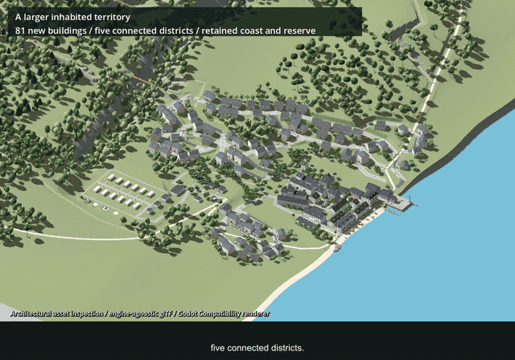

# Living Town · 小镇有灵

A life simulation where you can become a resident or watch a town unfold, with a Blender 3D compound town, coastal nature reserve, and the original pixel map.

Residents work, eat, make friends, and remember promises, rumors, and disputes. Choose someone to play, explore their neighborhood, or use the observer panels to follow relationships, trade, and civic decisions.

[中文](README.md) · [Development notes](docs/README.md)

Development now targets **Unreal Engine 5.8 / C++**. The native café passes actual walking, lease and ledger save/load tests; full-town migration and visual refinement continue. [Current scope and evidence](docs/active-town-roadmap.md). The Godot walkthrough below preserves the previous edition.

[](https://github.com/ForTe13X/living-town/releases/download/town-refinement-2026-10-23/LivingTown_Walkthrough.mp4)

A 30-second silent GIF excerpt. Click for the **14-minute in-engine walkthrough** with Edge TTS narration and subtitles. The full game image is retained above a separate caption band.

[Full walkthrough (MP4,14:00)](https://github.com/ForTe13X/living-town/releases/download/town-refinement-2026-10-23/LivingTown_Walkthrough.mp4) · [Chapters, downloads, and recording evidence](docs/town_walkthrough/README.md) · [Original pixel tour archive](docs/249-gameplay-tour.md)

**Blender 3D town: ** the compiled profile covers 151 buildings, 263 floors, 1,582 room zones, 2,089 furnishing assemblies, and 784 new legal fixture bindings, using 11 town GLB chunks and 25 rigged character models. The ordinary runtime measurement includes 62 residents. Access still follows resident, door, and floor permissions.
[14-minute narrated tour, chapters and downloads](docs/town_walkthrough/README.md) · [Run guide and spatial contract](docs/town_bridge/README.md).
Large runtime assets use a checksum-bound [release manifest](docs/town_walkthrough/ASSET_RELEASE.md). On Windows, use `./tools/run-town3d.ps1`; use `-Legacy` for the original pixel map. Five model/input ZIPs, the optional Blender working file and this recording have actual local verification records. **Release status: Locally checksum-bound current version; public retrieval is recorded separately in the proof index.**

[](https://github.com/ForTe13X/living-town/releases/download/town-territory-2026-10-20/expanded_town_architectural_tour.mp4)

**Historical asset tour, 2026-10-20:** six minutes of actual Godot import footage with Edge TTS narration and subtitles; the GIF is a 20-second excerpt. It preserves the earlier expansion plan/model edition and is separate from the new resident walkthrough above.

## Latest changes

- Reworked the 3D life-mode HUD with a compact five-need resident card, top clock controls, and separate expandable activity and wishes panels. Actual input and screen checks passed at two window sizes. [HUD and presentation checks](docs/town_bridge/HUD_REVIEW.md).
- Added a reusable [asset refinement toolbox](docs/ASSET_TOOLBOX.md): JSON recipes compose native authoring, PBR/UV checks, export, Godot and recording evidence. Iterations retain source/output bindings, while technical results and art reviews remain separate.
- Ordered room indexing and portal-path reuse preserve live permission checks, the original fallback and save semantics. A 62-resident, 90-tick paired oracle retained identical state and event chains. Ordinary 1280×768 Mobile/Vulkan measurements now show about 30.1 FPS outdoors at 1× and 24.2 FPS at 4×; spikes remain. The 18 FPS film setting is separate. [Performance and limits](docs/town_bridge/PERFORMANCE.md).
- Actual Main now hits cache004 with all 2,880 groups, 19,197 source proxies and full validation retained. Synchronous setup fell from 80.3 to 66.3 seconds and first completed draw from 95.6 to 81.7 seconds. These exclude process launch, autoload parsing and editor import; loading is still long. [Current runtime evidence](docs/town_bridge/README.md#current-performance-and-evidence).
- An optional Blender exterior working file recorded 77.4 ms median redraw as opened and about 169 ms in Material Preview. These are redraw-operator wall times, not navigation FPS. Full-interior Scenes remain selectable; the separate canonical file owns export. [Native, GLB, character and input deliveries](docs/town_walkthrough/ASSET_RELEASE.md#verified-authoring-and-interchange-deliveries).

- Added a real compound-town generator: five connected districts, 81 new buildings, 153 floors and 929 furnished room zones, with terrain-aware streets, fine foliage, CC0 PBR and an actually executed Infinigen planter factory. Outputs include packed Blender source and district GLBs. [Plan, model, tour and verification](docs/TERRITORY_EXPANSION.md).

- Refined café furniture, facades, and landscape materials, with detailed hydrangea florets, ground PBR, and corrected pine atlas UVs. Source, native save/reopen, and targeted export proofs stay bound to each revision. [Pilot and close-ups](docs/CONCEPT_REFINEMENT_PILOT.md); targeted art review remains bound to the rendered views.
- The 151-building profile includes the wooded reserve and camping services: trailer interiors, convenience and souvenir shops, baths, public toilets, a lunch car, ridge trails, bridges, and a running loop. [Reserve asset history](docs/RESERVE_EDITION.md).
- The complete spatial profile connects to existing resident life mode. The recorded walkthrough distinguishes real resident actions from labelled architectural and terrain inspection; sampled visual review and technical audio checks are recorded. [Current evidence scope](docs/town_bridge/README.md#rebuild-and-evidence-boundaries).
- Rebuilt coastal streets, courtyards, passages, tree belts, and gardens using detailed PixelLab assets.
- Distinct residential, commercial, civic, and workshop facades, with entrances aligned to the street.
- Irregular room plans, partitions, accessible stairs, and a camera that follows the character indoors and outdoors.
- Inspectable civic policy, election, and cooperative bank impact receipts.

## Life in town

- Meet needs, pursue wishes, work, and rest as a resident.
- Talk, give gifts, arrange meetings, spread rumors, and resolve conflicts.
- Explore the market, library, baths, workshop, homes, and waterfront.
- Inspect resident states, stories, the transaction ledger, and civic policies.

This is a playable prototype under active development. Authored permissions distinguish public and private spaces; decorative objects do not automatically gain gameplay effects. The recording uses the logic backend and existing Main/LifeMode inputs for resident movement, stairs, fixtures and save/load. Architectural and terrain inspection is labelled camera-only. Sampled images pass within their stated scope; audio has full decode/level checks without recorded human listening. Some night views are dark, room/landscape dressing is sparse and the return journey depletes needs; the recording does not establish balanced play or complete fidelity to the concept. Selected demonstrations do not establish complete town art, every mechanic, or ordinary game framerate.

## Play

Use **Godot 4.6.2**. Launch from the repository root to retrieve missing assets using this version's manifest. A complete local source package can use `./tools/run-town3d.ps1 -Local` offline. Verify/import assets before editor **F5**. See [release notes](docs/town_walkthrough/ASSET_RELEASE.md) for file identities and separate public-retrieval evidence.

```powershell
git clone https://github.com/ForTe13X/living-town.git
cd living-town
./tools/run-town3d.ps1
```

Choose a resident in the default life mode. **No LLM or API key is required.** Local LLM and NobodyWho SLM backends are optional; model weights and extension binaries are distributed separately. See [backend setup](docs/03-LLM集成架构.md).

| Action | Controls |
| --- | --- |
| Walk | WASD / arrows / click ground |
| Interact / cycle target | E / Tab |
| Cancel / relationships | Q / R |
| Pause / speed | Space / 1–3 |
| Expand activity / wishes | H / Shift+H |
| Free will / choose resident | F / C |
| Save / load | F5 / F8 inside the game |

## Development

`game/` holds the Godot project, `tools/` contains audits and recording tools, and `docs/` preserves design and experimental notes. The simulation owns outcomes; optional models choose legal actions and supply dialogue.

```bash
python tools/lint_data.py
python tools/audit_coastal_plan.py
python tools/audit_neighborhoods.py
bash tools/ci.sh
```

On Windows, use `tools/run-godot-supervised.ps1` for local Godot checks. See the [recording guide](docs/town_walkthrough/RECORDING.md) to reproduce the tour. Reproducible bug reports, gameplay feedback, and PRs are welcome.

Code is MIT licensed. Art includes CC0 derivatives and PixelLab-generated assets; see [credits](docs/09-美术资产与版权.md), [coastal asset provenance](docs/246-coastal-circulation-pixellab-camera.md), and [facade orientation notes](docs/248-blueprint-frontages.md).
