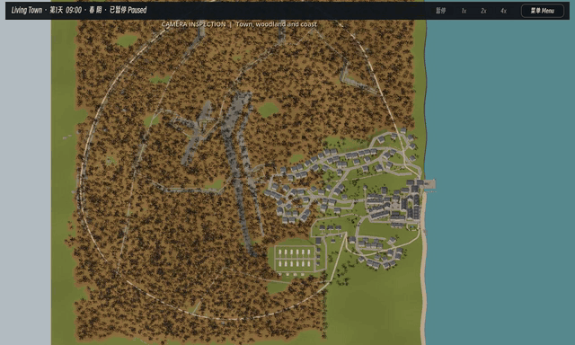

# Living Town · 小镇有灵

A life simulation where you can become a resident or watch a town unfold, with a Blender 3D coastal town and the original pixel map.

Residents work, eat, make friends, and remember promises, rumors, and disputes. Choose someone to play, explore their neighborhood, or use the observer panels to follow relationships, trade, and civic decisions.

[中文](README.md) · [Development notes](docs/README.md)

[](https://github.com/ForTe13X/living-town/releases/download/town3d-walkthrough-2026-10-12/LivingTown_Walkthrough.mp4)

A 30-second silent GIF highlight reel. Click the preview for the full ten-minute recording with Edge TTS narration and subtitles.

[Watch the full walkthrough (MP4)](https://github.com/ForTe13X/living-town/releases/download/town3d-walkthrough-2026-10-12/LivingTown_Walkthrough.mp4) · [Chapters, downloads, and recording evidence](docs/town_walkthrough/README.md) · [Original pixel tour archive](docs/249-gameplay-tour.md)

**Blender 3D town:** explore the coastal terrain, 49 buildings, layered interiors, and existing residents.
[Ten-minute narrated walkthrough and downloads](docs/town_walkthrough/README.md) · [Run guide and spatial contract](docs/town_bridge/README.md).
The large model is a checksum-verified release download. On Windows, use `./tools/run-town3d.ps1`; use `-Legacy` for the original pixel map.

## Latest changes

- Added an Infinigen-informed town-generation approach and deterministic recipe compiler for the existing terrain, 49 urban buildings and 21 reserve buildings. Recipe compilation is implemented; full-town detailed factory integration remains pending. [Approach, command and stages](docs/INFINIGEN_TOWN_GENERATION.md).

- A concept-led café pilot rebuilds furniture and fine foliage with source-bound CC0 PBR materials and PixelArtistry MIT workflow adaptations. Three street frontages now have visible limewash variation, sill weathering and shallow relief. The local model texture trial was interrupted; town-wide migration remains pending. [Pilot, close-up renders and checks](docs/CONCEPT_REFINEMENT_PILOT.md).
- The Blender asset source adds a wooded reserve and camping services: recomposed furniture, furnished trailers, shops, baths, public toilets, a lunch car, ridge trails, bridges, and a running loop. See the [reserve asset edition and validation](docs/RESERVE_EDITION.md). The existing recorded game tour covers the integrated urban life mode.
- The Blender 3D coastal town now connects to resident life mode, with layered interiors, a harbor, graded pond banks, and planting, plus a ten-minute narrated in-engine walkthrough.
- Rebuilt coastal streets, courtyards, passages, tree belts, and gardens using detailed PixelLab assets.
- Distinct residential, commercial, civic, and workshop facades, with entrances aligned to the street.
- Irregular room plans, partitions, accessible stairs, and a camera that follows the character indoors and outdoors.
- Inspectable civic policy, election, and cooperative bank impact receipts.

## Life in town

- Meet needs, pursue wishes, work, and rest as a resident.
- Talk, give gifts, arrange meetings, spread rumors, and resolve conflicts.
- Explore the market, library, baths, workshop, homes, and waterfront.
- Inspect resident states, stories, the transaction ledger, and civic policies.

This is a playable prototype under active development. Some buildings are scenery. The new recording uses the logic backend and existing Main/LifeMode inputs for movement, stairs, and fixture interactions. Labelled architectural inspection moves only the camera. The tour demonstrates selected actions and places; it does not establish every mechanic or model response.

## Play

Use **Godot 4.6.2**, import `game/project.godot`, and press **F5** in the editor. Let the first asset import finish.

```bash
git clone https://github.com/ForTe13X/living-town.git
cd living-town
godot --editor --path game
```

Choose a resident in the default life mode. **No model or API key is required.** Local LLM and NobodyWho SLM backends are optional; model weights and extension binaries are distributed separately. See [backend setup](docs/03-LLM集成架构.md).

| Action | Controls |
| --- | --- |
| Walk | WASD / arrows / click ground |
| Interact / cycle target | E / Tab |
| Cancel / relationships | Q / R |
| Pause / speed | Space / 1–3 |
| Free will / choose resident | F / C |
| Save / load | F5 / F8 inside the game |

## Development

`game/` holds the Godot project, `tools/` contains audits and recording tools, and `docs/` preserves design and experimental notes. The simulation owns outcomes; optional models choose legal actions and supply dialogue.

```bash
python tools/lint_data.py
python tools/audit_coastal_plan.py
python tools/audit_neighborhoods.py
bash tools/ci.sh
```

On Windows, use `tools/run-godot-supervised.ps1` for local Godot checks. See the [recording guide](docs/249-gameplay-tour.md) to reproduce the tour. Reproducible bug reports, gameplay feedback, and PRs are welcome.

Code is MIT licensed. Art includes CC0 derivatives and PixelLab-generated assets; see [credits](docs/09-美术资产与版权.md), [coastal asset provenance](docs/246-coastal-circulation-pixellab-camera.md), and [facade orientation notes](docs/248-blueprint-frontages.md).
