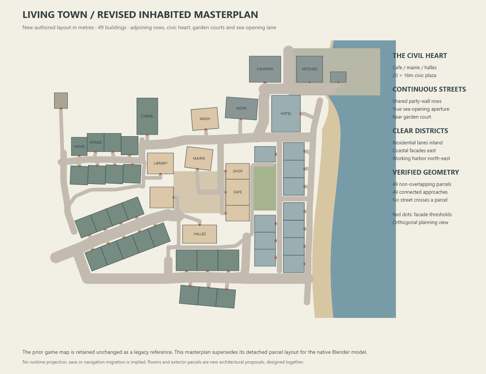

# Living Town — current presentation blueprint

Public source plans and selected original diagrams are included here. Archived local evidence and supplied film/image references stay in the local authoring delivery. Current interactive proof is documented in [the game bridge](../../docs/town_bridge/README.md); public Blender/GLB files and the narrated walkthrough are in [the release](https://github.com/ForTe13X/living-town/releases/tag/town3d-walkthrough-2026-10-12).

Planning authority · 12 October 2026. The irregular town and interior-planning revision remains unchanged. V5 passes 30 native checks, current exports/Godot checks, all 19 still-image reviews, the encoded camera-film checks and all 61 browser checks. Portable publication requires the standalone and extracted-archive checks documented in the completion audit. V4 and older PASS records describe their saved checkpoints only.

[Canonical masterplan](masterplan.json) · urban planning revision (`evidence/URBAN_PLANNING_REVISION.md`, archived local evidence) · reference boundaries (`REFERENCE_REQUIREMENTS.md`, archived local evidence)

## Architectural intent

Make ordinary daily life spatially understandable. Adjoining frontages lead into a civic heart; doors address real public space; bends, narrow passages and small courts vary the sequence; lanes release the enclosed town toward the coast; private gardens support intimacy; work and cargo occupy a separate harbor edge. Preserve deliberate urban relationships while avoiding a repeated straight-grid composition.

Use refined stylized realism: slate, cream plaster, granite and restrained painted joinery, with readable oak, linen, tile, metal and glass under neutral Atlantic summer daylight. Large forms and street rhythm dominate the overview. Tableware, fixtures, hinges, textile folds and working edges become visible in close views. Beach and open water remain quieter than the café and harbor.

The [idealized concept](concept/01_idealized_presentation.png) establishes atmosphere and material intent. The [source-aligned diagram](concept/02_site_blueprint.svg) and earlier versions of concept 03 are historical comparisons. The current [concept 03 blueprint](concept/03_revised_masterplan.svg) is regenerated from the canonical masterplan. [Concept 06](concept/06_irregular_layout_proposal.png) explains the irregular planning changes. Their machine-readable authority is `masterplan.json`.

## Town, streets and thresholds

The town preserves all seven main and 41 lot program identities and adds one declared harbor warehouse. The user-authorized offline plan relocates and resizes the original source layout; the latest revision retains the established 49 building widths, depths and floor counts while adjusting selected positions/yaws and streets. Original game coordinates and separate runtime Spaces do not determine architectural fit.

| District role | Spatial composition |
|---|---|
| Inland residential | Adjoining frontage rows, small alignment changes, quieter lanes and compact courts. Party-wall ownership follows actual shared edges. |
| Civic center | A 20×16m plaza; café/shop/creperie to the east, bakery/library to the west, mairie north and halles south. Public thresholds lead into the square and surrounding lanes. |
| Coastal neighborhood | Compact coastal frontages, back lane, deliberate sea-opening passage and hotel anchor. The revised promenade follows a dry land terrace. |
| Quiet beach and park | Layered shore planting, open view gaps, public park loop, garden courts and a graded-bank pond. |
| Inland/headland edge | Modest rising ground and working windmill; finite landforms rather than isolated tall terraces. |
| Working harbor | Workshop transition, then cannery, warehouse and netshed with service space separated from beach leisure. |

World coordinates are metres, X east and Y north. A building's local front faces south before `yaw_degrees` rotates it about Z. Each record provides a rotated polygon, facade threshold, outward front vector, approach, typology and program lineage. The canonical JSON is the coordinate inventory; duplicated coordinate tables would drift.

The current layout has 49 non-overlapping parcels, 86 street/approach/threshold records and 49 connected entrances. Seventeen authored public-route controls define the main streets and passages. Bounded corner fillets retain those controls and are accepted only after full-width parcel clearance; final routes must retain zero neighboring-footprint crossings. These checks establish architectural geometry, not game navigation. See urban revision (`evidence/URBAN_PLANNING_REVISION.md`, archived local evidence) for the exact changes and validation.

## Inhabitable interiors and local reveals

[interior_plan.json](interior_plan.json) and [tools/interior_design.py](tools/interior_design.py) define 89 levels, 561 logical zones (223 activity, 338 circulation/landing), 753 furnishing assemblies and 40 connected stair flights. Every program has purposeful fixtures. The count includes halls, stairwells and landings; it is not a count of enclosed habitable rooms.

Planning follows actual shell and stairs → entry/circulation → public/private/service/wet adjacency → real openings → furniture and pedestrian clearance. The bounded revision adds centered service-entry spines, exterior hotel sleeping rooms with corridor-side bathrooms/private entries, and a mill entrance return. Core-based grid rooms now have actual side-hall partitions; hotel side-hall doors enter private entry strips, and the café staff WC's shell-side edge is closed. See interior methodology and verification (`evidence/INTERIOR_PLANNING_REVISION.md`, archived local evidence).

Finished floors are local Z0.38m plus 2.85m per level. Partitions are 0.12m thick; typical room door apertures are 0.92m. The 1.20m entrance spine and 1.10m hall/suite-entry widths are nominal zone widths between partition centerlines: two walls reduce them to 1.08m and 0.98m net respectively. Fourteen equal risers connect each storey through actual upper-slab shafts with landing bridges and guards. These are authored dimensions, not code/accessibility certification.

The plan audit passes all 49 actual entrance axes, 47 sleeping-room exterior boundaries, 104 sleeping/sanitary partition enclosures, 484 horizontal room/landing routes and 633 essential fixture requirements. Exterior contact alone does not prove a window or daylight. Native mesh/ray evidence and actual interior views remain necessary.

Roof, front-wall and upper-cover ownership stays local to each building. The three-adjoining-building café study presents exterior, a selective section and restored cover visibility while neighbors stay roofed. Upper slabs and room contents belong under upper-cover descendants so the ground section remains readable. All 57 chimney bases must intersect their actual saved roof surfaces at nine evaluated points each. Observer cutaways and static presentation figures do not establish gameplay access or simulated inhabitants.

## Topography and landscape

[terrain_plan.json](terrain_plan.json), [tools/terrain_profile.py](tools/terrain_profile.py) and [TOPOGRAPHY.md](TOPOGRAPHY.md) define one authored elevation authority for surface mesh, pads, foundations, roads, thresholds, shore and contours. Inland relief is finite; the square receives a coherent grade; the quay is engineered; building bases meet the terrain with foundations and adaptive entry steps. This is a fictional Breton site, not surveyed geography or civil-engineering certification. Revised-route grades and source bindings must be refreshed together.

The [landscape plan](landscape_plan.json) retains 52 declared trees with route-safe placement, useful public-space canopy, layered pocket gardens, hedges/flowers, meadow clumps and coastal dune grasses with open view/access gaps. Tree counts are not canopy coverage. Projected crown envelopes, actual porous leaf geometry and walking-route shade are reported separately in the site-plan evidence (`evidence/LANDSCAPE_SITE_PLAN.md`, archived local evidence).

The required park pond is centered at (26,−42)m, with a 5×3m elliptical water edge, 7×5m outer bank, water Z−0.12m and bed Z−0.92m. The recessed basin and graded banks replace the ground surface; water must meet its bank rather than overlay grass. The 1.5m public loop and gates remain connected and parcel-clear. Bank grades, level water and native terrain contact require current-source evidence after the planning revision.

## Materials and detail

Use original procedural PBR sources, not imagery extracted from the references. Nine map families—slate, lime plaster, granite, cobbles, oak, sand, grass, ceramic tile and canvas—supply base color, roughness and normal maps, 27 maps total. Base color is 1024² and roughness/normal 512², with periodic U/V borders and physical repeat scales. Packed native dependencies and editable map sources travel with the delivery.

Concentrate close detail where daily use explains it: café service counter and seating, domestic kitchens/baths, library reading and stacks, hotel suites, workshop tools, mill gears, market stalls and harbor cargo. Keep joinery, wet fixtures, seats, stairs and room partitions physically legible. Roof runoff, drainage props, fences, lamps and garden layers support the town hierarchy. Detail density does not substitute for essential equipment or circulation.

## Presentation and delivery acceptance

The planned camera rig has 14 cameras and produces 13 town stills: town overview, café street, café ground section, promenade, harbor, orthographic production plan, material detail, home section, hotel section, library section, café interior, café upper floor and pond park. Three study images show exterior/section/restored. Three additional fixture plates isolate kitchen sink/fridge, dining seating and connected mill gear geometry.

The animated camera deliverable is a 10-second, 240-frame, 24fps, 1280×720 MP4. Acceptance requires the actual video hash and a matching ffprobe record with 240 decoded/read frames, 24fps and duration 10s±0.05. Still records must bind current native, masterplan, terrain, interior and landscape sources. Study restoration requires exact native cover-state restoration and bounded decoded-image equivalence: at most one 8-bit channel unit on no more than 0.01% of pixels. Report exact equality honestly, both decoded/encoded hashes and the difference bounds. The actual V5 exterior/restored pair passes: 83 of 2,170,800 pixels differ (0.00382348%), maximum one unit and none above one. Exact decoded equality is false.

Deliver editable packed Blender town/study sources, procedural inputs and documentation; high-detail and optimized town GLBs; 49 local-origin building GLBs; an optional camera/animation rig; and a standalone Godot consumer harness with logical checks and actual GPU captures. Portable asset references must resolve inside the artifact. Consumer evidence does not claim integration into the existing game, shipping performance, collision/navigation completion or NPC simulation.

Current canonical planning checks pass. V5 preserves all programs, dimensions, interiors, terrain and planting, extending only chimney feet while retaining their positions and tops. [Source review](evidence/chimney_repair_source_review.json) proves the narrow delta and eight unchanged design files. Town `b7e3fb724d2056ba633c01c2b201728d5c978c34b41c0aaeb8e2cb9c8df19755` passes all 30 [native checks](evidence/native_scene_audit.json), including 57 chimney bodies/513 roof-contact samples; it contains 8,321 objects, 1,257,978 mesh vertices and 14 cameras.

The [export manifest](game_assets/export_manifest.json) passes for 52 GLBs: optimized town 2,112,945 triangles / 203,666,604 bytes, high detail 6,267,841 triangles / 642,459,416 bytes, 49 prefabs and camera rig. Godot passes 35 logical and 41 GPU checks; the coordinator directly reviewed all five current captures in the source-bound Godot visual review (`evidence/FINAL_GODOT_VISUAL_REVIEW.json`, archived local evidence). These costs do not certify shipping performance.

All 19 actual V5 stills are accepted: six room views and three fixture plates (`evidence/FINAL_INTERIOR_RENDER_REVIEW.md`, archived local evidence), plus seven exterior/detail/plan views and three study images (`evidence/FINAL_TOWN_RENDER_REVIEW.md`, archived local evidence). Their reviews retain native/input/image hashes and visible limits. The actual encoded film (`evidence/flythrough_render.json`, archived local evidence) passes 240 decoded/read frames, 24fps, 10.0s and 1280×720; four decoded samples pass visual review. All 61 desktop/mobile browser checks (`evidence/presentation_browser_qa.json`, archived local evidence) pass, including actual playback. Archive acceptance is recorded separately by the package publisher after extracted verification. V4 `f2d05d83…` and earlier checkpoints remain historical. Current concept 03 remains the canonical planning diagram; only its earlier versions are historical. PLANNING_HISTORY.md (`evidence/PLANNING_HISTORY.md`, archived local evidence) preserves prior snapshots.
