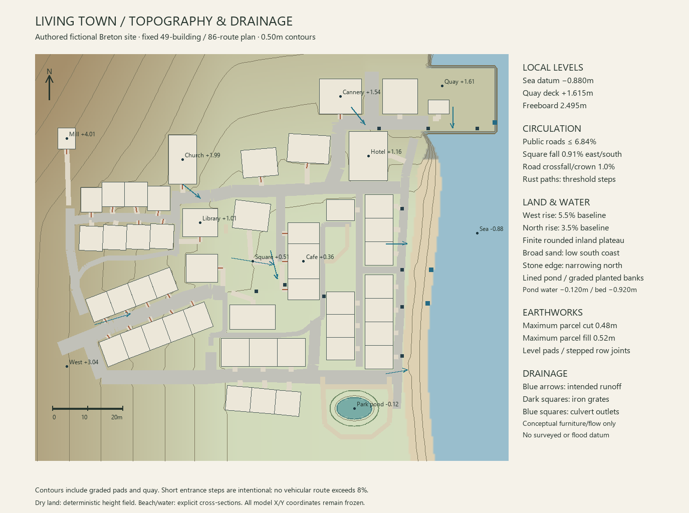

# Living Town — authored topography and surface elevation

Public source plans and selected original diagrams are included here. Archived local evidence and supplied film/image references stay in the local authoring delivery. Current interactive proof is documented in [the game bridge](../../docs/town_bridge/README.md); public Blender/GLB files and the narrated walkthrough are in [the release](https://github.com/ForTe13X/living-town/releases/tag/town3d-walkthrough-2026-10-12).

The revised model uses one deterministic elevation authority, [terrain_profile.py](tools/terrain_profile.py), around the frozen 49-building and 86-route masterplan. This is a coherent fictional Breton coastal site; it is not a reconstruction of surveyed terrain.

[Editable contour drawing](concept/05_topography_and_drainage.svg) · [Levels and grade evidence](terrain_plan.json)

The western town rises toward the windmill and church. A broad coastal terrace supports the square, coastal housing and promenade. Small, broad granite swells soften the original two-direction slope. The baseline western slope is 5.5%; the northern slope is 3.5%. Both round to finite plateaus outside the presentation site, so the distant environment does not develop an endless escarpment.

The local water surface is **Z −0.880m**. The engineered harbor deck is **Z +1.615m**, with 2.495m of visible freeboard. These are local model coordinates, not a geographic elevation datum. A continuous transition limited to 6.5% joins the quay to its landward surroundings. The quay's seaward edge is a constructed retaining wall; it is not a naturally vertical coastline.

The public square is a single plane, `Z = 0.48 − 0.009X + 0.0015Y`, with a **0.91%** resultant fall toward the east and south. Its landward transition uses a bounded grade cone, avoiding a steep shoulder around a flat square. A continuous distance-to-street-network crown supplies a 1.0% local fall and stays continuous at intersecting roads. Its elevation references the shared engineering surface, avoiding jumps between competing road planes.

The independently sampled surface checks every route at no more than 0.25m spacing. All 17 public street records remain at or below **6.8444% centerline grade**. Both native ribbon edges, including averaged corner normals, remain at or below **7.50%**; the 0.15m paving apron edges also remain at or below **7.50%**. Continuous pedestrian approaches remain below 8%. Twenty-five short threshold connectors exceed that limit where a level building pad meets a sloping street; those connectors require actual entrance steps, with landings tied to the finished floor. A threshold is not certified accessible merely because its X/Y route is connected.

Each rotated parcel is exactly level at the engineered height of its center. The native building shell starts at that ground/plinth level; the finished interior floor remains a separate **+0.38m** construction offset. Adjoining buildings can step vertically, with shared-edge foundations or retaining joints. The maximum calculated natural-ground cut is **0.481m**; maximum fill is **0.516m**, measured around parcel perimeters. Foundation toes must reach at least 0.15m below the lower natural/design corner level, rather than ending at the center's height.

Dry-land grading, road crowns and parcel pads use `design_height(x,y)`. `natural_height(x,y)` supplies the unengineered land for cut/fill comparisons. `building_pad_level(record)` returns the shell's ground/plinth base, not its finished floor. `surface_height(x,y)` adds the explicit beach/water cross-section for contour mapping. All functions use the standard library and resolve `masterplan.json` relative to the delivered artifact. The module indexes nearby streets and parcels in 8m cells, so Blender can sample it repeatedly without scanning the entire town. Public paving takes priority over an adjacent pad's blending skirt; a foundation/retaining joint handles the height difference. Paving aprons must remain within 0.15m of each nominal street edge to retain the verified parcel clearance.

The southern beach has a broad sand cross-section between the raised promenade edge and water. Above Y≈29m, the narrowing shore becomes a stone/revetment transition approaching the harbor. The narrow northern strip is not represented as a walkable sandy ramp. Beach sections in `terrain_plan.json` report their actual widths, rises and crossfalls.

Visible drainage furniture is specified separately: ten iron grates/channel grates and three conceptual culvert outlets, with local surface levels and directional arrows. The square sheds to its east/south edge; inland routes fall toward the coastal system. The harbor uses shallow collection channels within the nominal deck datum. These details communicate a plausible surface-water intent. Pipe sizes, storm capacity, flood levels and discharge engineering have not been calculated.

The contour drawing samples the same complete surface at a 1m grid and draws contours every 0.5m. The background raster is a presentation aid; numerical road grades come from the independent 0.25m sampling. A native mesh needs a fine local town patch, approximately 0.5m cells or explicit parcel/road boundaries, plus a coarse distant apron. A landscape mesh spanning a kilometre with multi-metre cells cannot reproduce the level pads and narrow grade transitions.

The model's final evidence must bind the terrain plan to the saved town, show foundation connections, entry stairs, graded streets, the quay transition and shore treatment, and use the resulting saved model for all final renders. The runtime game map remains unchanged.

## Required park pond and landscape revision

The user explicitly requested a pond with properly graded banks. The frozen [landscape plan](landscape_plan.json) adds a bounded ornamental basin at (26,-42)m. Level water is Z−0.120m, bed Z−0.920m, water radii 5×3m and outer grading radii 7×5m. The terrain authority replaces the original ground inside the basin and meets the level shoreline; the native mesh audit tests actual water vertices, bed rays, shoreline rays and bank-face slopes.

The complete sampled bank, including submerged slopes, reaches **31.3725%**, below **33.3333% (1:3)**. Measurements use a 0.10m grid with 0.025m central differences. The outer bank remains 6.530m from the nearest parcel and 2.000m from existing route edges, preserving all 49 level pads and 88 original route profiles. Public road grades and threshold-step requirements remain unchanged. New park/pocket walks conform to this same authority.

The regenerated 0.50m contour map includes the recessed pond. `pond_spec`, `pond_radius`, `pond_ground_height` and `beach_height` expose the same portable surface rules to Blender and vegetation. Pond reeds use the basin surface; beach plants use the real beach profile. Tree roots remain on inland dry land. Landscape siting and canopy evidence (`evidence/LANDSCAPE_SITE_PLAN.md`, archived local evidence) distinguishes local canopy envelopes from background woodland and records five new walks.

The revision is a fictional lined landscape feature. It does not add an unverified natural spring, tidal connection or civil drainage claim. Final town renders, native audit and flythrough must bind both the current terrain and landscape plan hashes.
