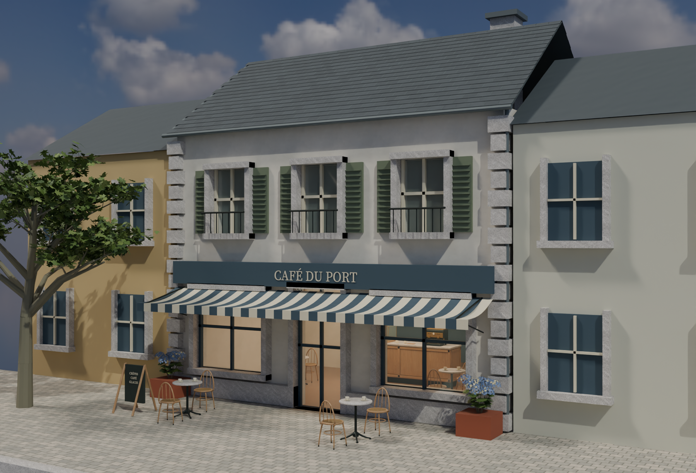
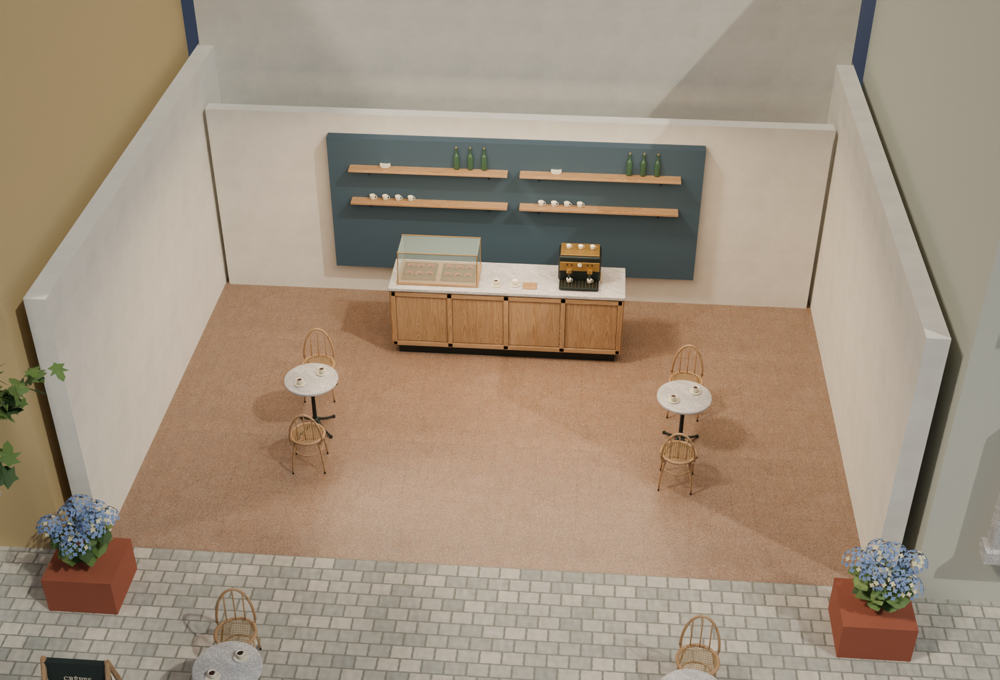
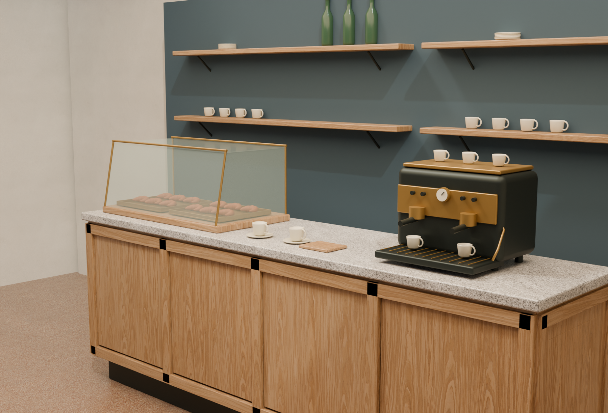
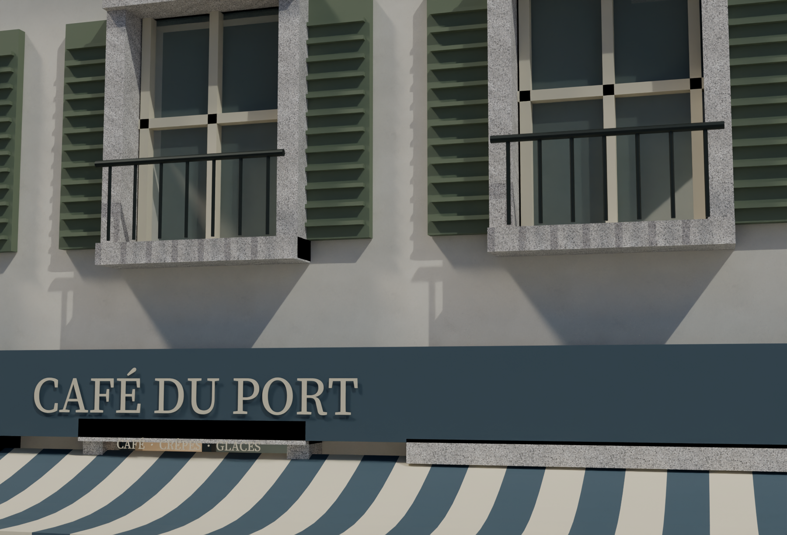
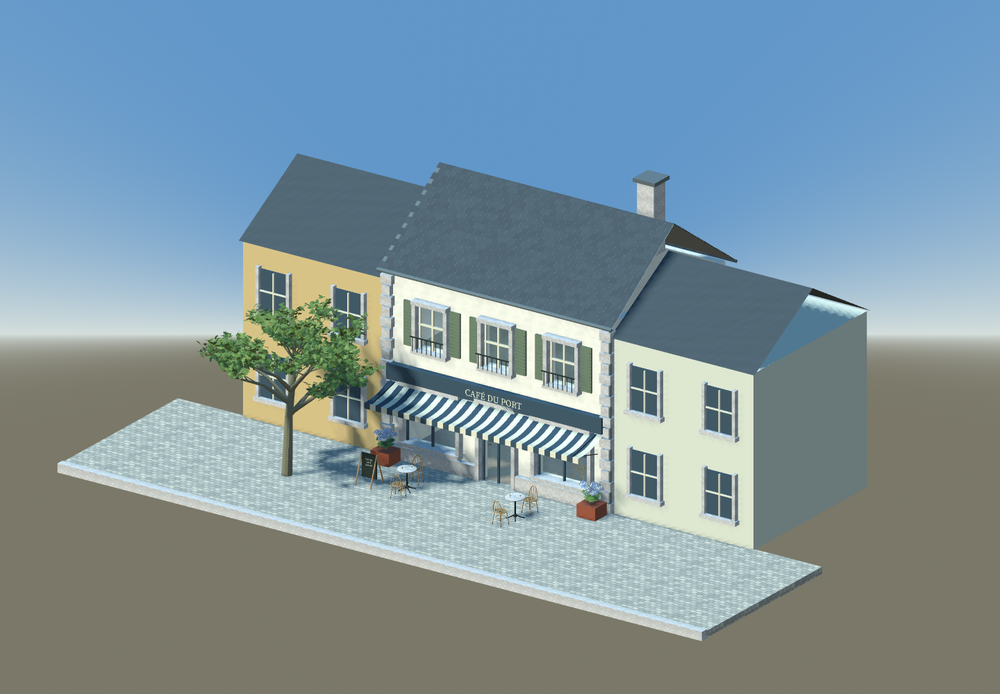

# Café texture refinement comparison

The earlier v6 textures were rejected as too smooth. This revision replaces the prominent provisional finishes with provenanced CC0 PBR materials and adds detail views for assessing the result against the idealized Breton summer concept. It is a reviewable café/street comparison. Technical PASS results do not establish artistic acceptance or concept parity.

The exemplar includes authored shop openings, individual slate overlaps, blue joinery, a striped awning, fitted counter panels, a glazed pastry case and bentwood seating. The foliage uses actual branches/leaves and flower geometry. Adjoining buildings remain visual context. The user permits replacing older meshes and placements when that improves the art direction; the previous town/reserve release remains recoverable.

## PBR sources and close views

| Surface | Source | Scale and authored changes |
| --- | --- | --- |
| Oak furniture | Poly Haven `oak_veneer_01`, CC0 | Approximately 1.83 m repeat. |
| Pale plaster | Poly Haven `white_plaster_02`, CC0 | 1 m repeat; a pale paint palette is baked into basecolor while preserving source-derived detail and separate normal/roughness maps. |
| Interior terrazzo | Poly Haven `terrazzo_tiles`, CC0 | 2 m repeat; distinct from the exterior pavement. |
| Counter and cut granite | ambientCG `Granite002A`, CC0, source classification `PBRProcedural` | Source dimensions are uncalibrated. The 0.5 m repeat and separate counter/trim finishes are artist-authored presentation choices; the polished source is not described as a photoscan or calibrated honed stone. |

The source pack retains untouched originals and their provenance, including 16-bit files. Engine copies are 2K RGB8/L8 PNGs. Sixteen-bit grayscale roughness is normalized to 8-bit, rather than clipped to white. The plaster paint bake shifts the linear mean toward sRGB `(224, 218, 204)` and retains 0.65 of the source linear deviation; it does not replace fine surface detail with a flat color. No PBR normal or roughness map is inferred from an AI RGB image.

The prepared `scanned_pbr_v3` library bakes counter roughness as `0.38 + 0.5 × source_roughness` and trim roughness as `0.72 + 0.28 × source_roughness`. The counter uses an additional roughness factor of `0.8` and normal strength `0.35`; trim uses factor `1` and normal strength `0.25`. These authored finish changes are recorded separately from the unmodified source maps.

Physical `MetricUV` uses metres divided by two, with a texture scale of `2 / repeat_metres`. Repeating UVs suit these materials but are not a validated unique 0–1 atlas. Optional contextual grime needs an explicit bake before export; the toolkit leaves that reference unlinked rather than silently dropping an unsupported multi-UV shader.

## Owned views and evidence

These four counter images come from one Blender asset at a common orthographic scale. Preparation composites RGB over white while retaining original alpha. The sheet panels match the individual prepared images. The PixelArtistry adaptations customize only pinned MIT workflow sources and retain notices; they do not install dependencies or queue ComfyUI.

`verify_scanned_exports.py` compares actual embedded GLB basecolor/normal pixels and ORM green against the prepared source images. It also checks physical texture transforms, tint and roughness factors, normal strength and normal/tangent/UV coverage. The comparison includes the authored plaster bake. It is exporter-fidelity evidence, not visual approval or model-quality evidence.

The [toolkit guide](../tools/asset_refinement/README.md) contains reproduction commands. The revision's native/GLB binaries are `hero_v9/cafe_hero.blend`, `hero_v9/cafe_hero.glb` and `hero_v9/input/counter.glb`. The files and receipts are distributed through the [concept refinement pilot release](https://github.com/ForTe13X/living-town/releases/tag/concept-refinement-pilot-2026-10-20).

Consult these paths under `art/living_town/refinement_pilot/` for the exact version and review status:

- `hero_v9/hero_manifest.json`, `scanned_pbr_v3/library_manifest.json`, `prepared_v9/preparation_manifest.json` and `workflows_v9/workflow_manifest.json` bind the authored source, prepared textures and owned inputs.
- `verification_v9.json` checks current file/source/geometry bindings.
- `native_reopen_v9.json` records an independent Blender reopening.
- `scanned_export_v9.json` records actual exported PBR image, scale and factor checks.
- `godot_v9b.json` accompanies the real GLB import capture.
- `visual_review_v9.json` records observations and exact source/image hashes.

A successful native read, static verification or engine capture has a narrower scope than concept matching. Read the visual observations as well as the technical receipts.

## Standalone model experiment

The separately reviewed Apache-2.0 stack is cached locally at full source precision: BF16 FLUX.2 Klein base 4B and Qwen3 4B, plus the original FLUX2 VAE, approximately 16.13 GB. A 1024-square, 50-step Vulkan test was interrupted by an unexpected host reboot after its last recorded progress of **7/50**. No usable output was produced, so the experiment establishes no model-quality or successful hardware-compatibility claim. Its exact failure cause remains unproven.

The incident is recorded in `model_slate_v1/interruption_receipt.json`; that Vulkan configuration is quarantined. The benchmark now defaults to CPU, but CPU inference has **not** been executed. The current material revision uses CC0 source maps and authored preparation. The interrupted experiment supplies no texture asset.

No ComfyUI or UltraTex inference ran. UltraTex's 9B adapters are not interchangeable with the Apache 4B model. The excluded Qwen-Image 2.1/UltraTex 9B layouts and the optional Pixal3D dependency gate remain described in the [component review](PIXELARTISTRY_COMPONENT_REVIEW.md). Workflow filenames and metadata express policy; they do not prevent a person from manually queuing a graph in ComfyUI.

This pilot has not replaced the whole town or migrated the playable game. Complete upstairs/back-of-house/service interiors, navigation, physics, performance validation and a newly recorded walkthrough remain pending. The existing [town/reserve edition](RESERVE_EDITION.md) and repository showcase GIF provide the earlier comparison, with their original scope.
