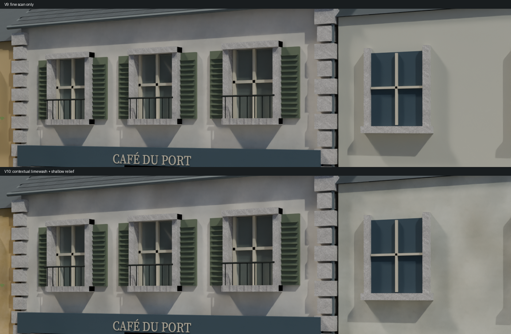
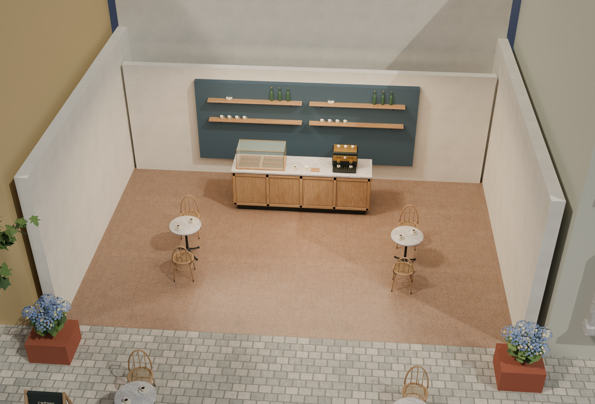
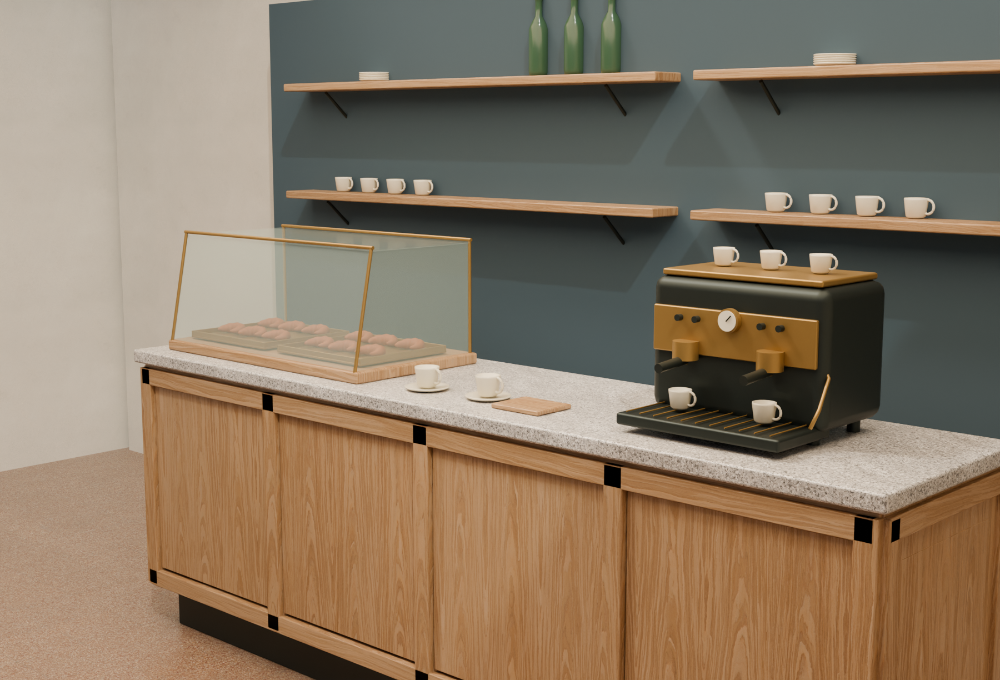
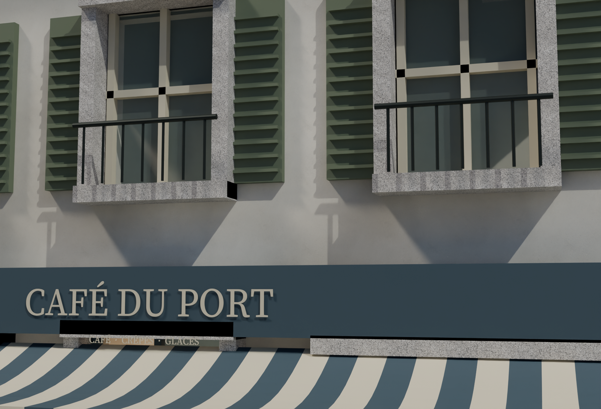
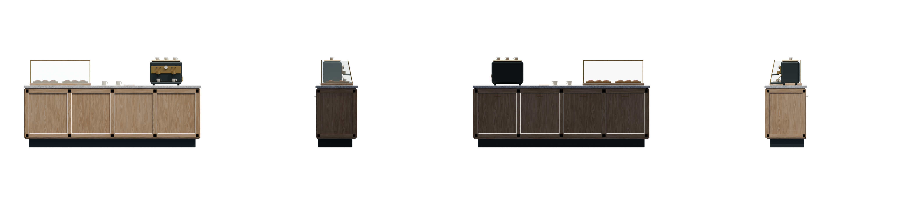

# Café texture refinement comparison

The user found the v9 building-wall texture insufficiently visible. V10 adds facade-scale limewash context to the café and its two neighbouring street fronts while retaining the fine CC0 plaster scan at its real 1 m repeat. It is a reviewable café/street comparison against the idealized Breton summer concept. Technical PASS results do not establish artistic acceptance or concept parity.

The previous street image remains the baseline for judging whether the new wall treatment reads at the presentation camera:

V10 was rendered with the same street camera, lighting and exposure as V9. The unchanged crops below show the added variation at street distance. The packed native source reopened successfully, and the GLB was imported and captured in Godot. These checks do not establish user aesthetic approval.

The exemplar includes authored shop openings, individual slate overlaps, blue joinery, a striped awning, fitted counter panels, a glazed pastry case and bentwood seating. The foliage uses actual branches/leaves and flower geometry. The new wall treatment covers three frontages; adjoining buildings remain visual context rather than fully developed interior assets. The user permits replacing older meshes and placements when that improves the art direction; the previous town/reserve release remains recoverable.

## PBR sources and close views

| Surface | Source | Scale and authored changes |
| --- | --- | --- |
| Oak furniture | Poly Haven `oak_veneer_01`, CC0 | Approximately 1.83 m repeat. |
| Pale plaster | Poly Haven `white_plaster_02`, CC0 | 1 m fine repeat; prepared pale paint plus separately baked facade-scale variation, sill runoff, roughness and shallow authored relief. |
| Interior terrazzo | Poly Haven `terrazzo_tiles`, CC0 | 2 m repeat; distinct from the exterior pavement. |
| Counter and cut granite | ambientCG `Granite002A`, CC0, source classification `PBRProcedural` | Source dimensions are uncalibrated. The 0.5 m repeat and separate counter/trim finishes are artist-authored presentation choices; the polished source is not described as a photoscan or calibrated honed stone. |

The source pack retains untouched originals and their provenance, including 16-bit files. Prepared repeating engine maps are 2K RGB8/L8 PNGs; the new full-frontage bakes use 4K for the café and 2K for each neighbour. Sixteen-bit grayscale roughness is normalized to 8-bit, rather than clipped to white. The prepared plaster paint shifts the linear mean toward sRGB `(224, 218, 204)` and retains 0.65 of the source linear deviation. No PBR normal or roughness map is inferred from an AI RGB image.

The prepared `scanned_pbr_v3` library bakes counter roughness as `0.38 + 0.5 × source_roughness` and trim roughness as `0.72 + 0.28 × source_roughness`. The counter uses an additional roughness factor of `0.8` and normal strength `0.35`; trim uses factor `1` and normal strength `0.25`. These authored finish changes are recorded separately from the unmodified source maps.

Physical `MetricUV` uses metres divided by two, with a texture scale of `2 / repeat_metres`. Repeating UVs suit these materials but are not a validated unique 0–1 atlas.

## Three-frontage wall treatment

The café bake covers 8.6 × 6.5 m with its original pale palette. The two neighbour bakes cover 5.4 × 6.1 m each, with independent warm ochre `(194, 168, 117)` and muted pale `(199, 199, 181)` sRGB palettes and different seeds. `hero_walls.py` combines the fine scan with broader limewash variation at 0.55, 1.3 and 2.8 m control-point spacings, restrained warm/cool replastering, eave shelter, lower-wall grime and runoff located below actual window sills. The scan is prefiltered to the final physical texel density before repetition, rather than enlarged to create false large-scale grain.

The result is baked into conventional basecolor, roughness and OpenGL +Y normal images so the context travels in the GLB. The normal combines the photographic scan with physical derivatives of an authored 0.7–4 mm height field. `facade_height.png` stores that field as unsigned 16-bit data, decoded with the minimum/maximum metres in each `wall_manifest.json`; it is not measured scan displacement. PNG rows run from the facade top down to ground level.

The scene builds separate shared-vertex front skins with rectangular openings and at most 0.085 m grid spacing, displaces them slightly outward, and applies the baked normal at strength `0.7`. Wall returns retain the repeating scan. Each complete frontage uses its own image and explicit `(2 / facade_width, 2 / facade_height)` UV scale. The street and detail renders show broader mineral color variation and restrained sill staining; the Godot overview retains the variation under its separate lighting. Wall returns and adjoining-building sides remain simpler than the frontages. The normal contains the full authored relief while the mesh also carries coarse relief; strength 0.7 limits that overlap rather than claiming a residual-normal bake.

## Owned views and evidence

These four counter images come from one Blender asset at a common orthographic scale. Preparation composites RGB over white while retaining original alpha. The sheet panels match the individual prepared images. The PixelArtistry adaptations customize only pinned MIT workflow sources and retain notices; they do not install dependencies or queue ComfyUI.

`verify_scanned_exports.py` compares actual embedded GLB basecolor/normal pixels and ORM green against the recorded prepared or baked source images. It also checks physical texture transforms, tint and roughness factors, normal strength and normal/tangent/UV coverage. The comparison includes the authored plaster palette and contextual frontage maps. It is exporter-fidelity evidence, not visual approval or model-quality evidence.

The [toolkit guide](../tools/asset_refinement/README.md) contains exact main/neighbor bake and scene reproduction commands. The V10 native/GLB files are `hero_v10/cafe_hero.blend`, `hero_v10/cafe_hero.glb` and `hero_v10/input/counter.glb`. The [concept refinement pilot release](https://github.com/ForTe13X/living-town/releases/tag/concept-refinement-pilot-2026-10-20) carries versioned files and receipts; check its actual member manifest rather than assuming a version label proves file identity.

The V10 generation and review receipts are under `art/living_town/refinement_pilot/`. Consult each receipt for its exact source and evidence scope:

- `hero_v10/hero_manifest.json`, `scanned_pbr_v3/library_manifest.json`, `prepared_v10/preparation_manifest.json` and `workflows_v10/workflow_manifest.json` bind the authored source, prepared textures and owned inputs. The scene source inventory now contains seven modules, including `hero_walls.py`.
- `wall_bakes_v10/cafe/wall_manifest.json`, `wall_bakes_v10/left/wall_manifest.json` and `wall_bakes_v10/right/wall_manifest.json` bind the scan inputs, contextual recipes, height decoding, window placement and output PNG hashes.
- `verification_v10.json` checks current file/source/geometry bindings.
- `native_reopen_v10.json` records an independent Blender reopening.
- `scanned_export_v10.json` records actual exported PBR image, scale and factor checks.
- `wall_export_v10.json` checks the three actual exported wall skins: outward displacement, UV orientation, triangle winding and preserved apertures.
- `godot_v10.json` accompanies the actual GLB import capture.
- `visual_review_v10.json` records observations and exact source/image hashes.

A successful native read, static verification or engine capture has a narrower scope than concept matching. Read the visual observations as well as the technical receipts.

## Standalone model experiment

The separately reviewed Apache-2.0 stack is cached locally at full source precision: BF16 FLUX.2 Klein base 4B and Qwen3 4B, plus the original FLUX2 VAE, approximately 16.13 GB. A 1024-square, 50-step Vulkan test was interrupted by an unexpected host reboot after its last recorded progress of **7/50**. No usable output was produced, so the experiment establishes no model-quality or successful hardware-compatibility claim. Its exact failure cause remains unproven.

The incident is recorded in `model_slate_v1/interruption_receipt.json`; that Vulkan configuration is quarantined. The benchmark now defaults to CPU, but CPU inference has **not** been executed. The current material revision uses CC0 source maps and authored preparation. The interrupted experiment supplies no texture asset.

No ComfyUI or UltraTex inference ran. UltraTex's 9B adapters are not interchangeable with the Apache 4B model. The excluded Qwen-Image 2.1/UltraTex 9B layouts and the optional Pixal3D dependency gate remain described in the [component review](PIXELARTISTRY_COMPONENT_REVIEW.md). Workflow filenames and metadata express policy; they do not prevent a person from manually queuing a graph in ComfyUI.

This pilot has not replaced the whole town or migrated the playable game. Complete upstairs/back-of-house/service interiors, navigation, physics, performance validation and a newly recorded walkthrough remain pending. The existing [town/reserve edition](RESERVE_EDITION.md) and repository showcase GIF provide the earlier comparison, with their original scope.
