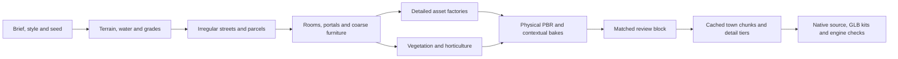

# Infinigen informed town generation

Use one command to coordinate a staged town build: establish the terrain and circulation, solve rooms and furniture with inexpensive geometry, replace accepted arrangements with detailed factories, bake portable materials, then export and review the result. Infinigen offers useful methods for those stages. The town's Breton summer art direction, urban planning and game contracts remain project-specific.

The first implementation is a **recipe compiler**. It reads the actual town and reserve plans, validates their current source bindings, computes world-space floor levels and furniture transforms, and assigns stable per-object seeds. It currently compiles 49 urban buildings, 21 reserve buildings, 89 urban floors, 561 room zones and 757 furnishing assemblies. These counts describe existing coverage, not visual fidelity. Full-town refinement adapters are the next integration step; the compiler does not render a new town or run Infinigen.

```powershell
python tools/town_generation/compile_recipe.py --output build/town_generation/new_run
```

The [compile evidence](town_generation/recipe_compile_report.json), [upstream review](town_generation/infinigen_review.json) and [pinned source inventory](town_generation/infinigen_sources.json) record the current result and inspected references.

Use a fresh output directory. The generated `generation_recipe.json` records the exact inputs, source-module hashes, style profile, stage dependencies, first integration block and missing adapters. Its status is `COMPILED_NOT_GENERATED`. The command uses ordinary Python without Blender, model inference, downloads or changes to the canonical plans.

## Methods to adopt

| Infinigen method | Application here |
| --- | --- |
| Seeded factories and inexpensive placeholders | Validate roads, rooms and object envelopes before producing detailed geometry. Stable ids receive independent seeds, so inserting a shop does not randomize every tree and chair. |
| Relational placement | Chairs face their table, furniture dimensions determine spacing, service equipment faces usable working space, and door/stair routes remain clear. Hard constraints take precedence over decorative composition. |
| Detail allocated by projected size | Give playable rooms, street-level views and walkthrough routes sufficient mesh and texture detail. Keep complete world content; choose display tiers and shared prototypes rather than deleting everything outside one camera. |
| Masked, instanced scatter | Use slope, elevation, moisture/context, habitat patches and exclusions to place varied trees, understory, rocks, flowers and gardens. Preserve clearings and readable paths. |
| Layered materials | Combine fine physical scan detail, larger construction/paint variation and contextual weathering, then bake conventional PBR maps. |

These methods are visible in the pinned upstream [factory](https://github.com/princeton-vl/infinigen/blob/b11700ebac77695d8f53538705cfdc0cd890c54d/infinigen/core/placement/factory.py), [relational home constraints](https://github.com/princeton-vl/infinigen/blob/b11700ebac77695d8f53538705cfdc0cd890c54d/infinigen_examples/constraints/home.py), [table and chair composition](https://github.com/princeton-vl/infinigen/blob/224598d4a2ff95b4fc928e72c222598b7122c698/src/infinigen2/scenes/room/dining_table_setup.py), [detail allocation](https://github.com/princeton-vl/infinigen/blob/b11700ebac77695d8f53538705cfdc0cd890c54d/infinigen/core/placement/detail.py), [instance scatter](https://github.com/princeton-vl/infinigen/blob/b11700ebac77695d8f53538705cfdc0cd890c54d/infinigen/core/placement/instance_scatter.py) and [paint overlay](https://github.com/princeton-vl/infinigen/blob/224598d4a2ff95b4fc928e72c222598b7122c698/src/infinigen2/shaders/composites/paint_overlay.py) implementations. No upstream implementation is copied into the recipe compiler.

## Build sequence



1. **Terrain and urban structure.** Use the existing height authority for roads, pads, foundations, ponds and vegetation contacts. Rework the layout where useful: irregular blocks, narrow passages, service access, courtyards, coast-facing public space and terrain-following streets. Upstream room generators do not supply this town-planning layer.
2. **Rooms and relationships.** Retain the current room purposes, doors, stairs, service/storage spaces and circulation keepouts. Fit detailed furniture through its returned mesh bounds, then rerun clearance and facing checks. The newer counter is deeper than its old proxy, so replacing it by name alone is insufficient.
3. **Geometry and materials.** Parameterize architecture by each building's dimensions and actual opening layout. Preserve the finer cabinet joinery, bentwood seating and botanical geometry from the café pilot. Wall bakes must derive runoff from the target sills and eaves. Use proper residual normals when mesh displacement already represents coarse relief, avoiding duplicate slope strength.
4. **Reserve and planting.** Replace simplified nearby crowns with a small family of detailed botanical prototypes. Vary species, age, crown shape and patch composition. Preserve the terrain-connected jogging loop, mountain passages, stairs and bridges, as well as furnished trailers and visitor services. Distance tiers reduce display cost; they do not remove required interiors.
5. **Export and review.** Preserve shared meshes and transform manifests in chunks. Deliver packed Blender source and conventional GLB/PBR assets, with collision, navigation and LOD checks recorded separately. Inspect matched street, room, canopy and terrain-contact views in Blender and an actual consumer before scaling the accepted factories across town.

The proposed runtime starts with one heavy engine process at a time and six CPU threads. Stage outputs need content-bound checkpoints and bounded retries; neither full-town caching nor runtime performance is currently established. A single command should coordinate recoverable work rather than rerun the entire scene after every failure.

## Existing work to connect

| Existing source | Reuse and required change |
| --- | --- |
| `art/living_town/masterplan.json`, `terrain_plan.json`, `landscape_plan.json` | Current site geometry and grades. Replanning remains permitted; update dependent plans together. Do not replay the older masterplan generator over the revised layout. |
| `art/living_town/tools/interior_design.py` | Room planning, asset assignment, furniture refinement and circulation audit. Add adapters for the newer geometry bounds and material families. |
| `art/living_town/tools/reserve_plan.py`, `reserve_environment.py`, `reserve_amenities.py` | Terrain, paths, habitat exclusions and visitor-service program. Improve factory detail while keeping contacts and connections consistent. |
| `tools/asset_refinement/hero_furniture.py`, `hero_foliage.py`, `hero_pbr.py`, `hero_walls.py` | Detailed furniture, leaves/flowers and portable scan/context materials. Convert the vignette helpers into parameterized town factories. |
| Native, GLB and Godot verification tools | Retain actual source/image/geometry checks, adding chunk, instance, LOD and performance evidence as those products exist. |

The current reserve builder writes fixed authoring filenames and uses an order-sensitive global random stream. It needs explicit output-root and seed adapters before an automated runner can execute it safely in a new generation directory. The recipe compiler only reads those sources.

Urban floor levels use the recorded pad base plus the interior's local floor offset. Reserve services retain their own pad and floor offsets. Historical baseline hashes in the landscape siting document are retained as historical evidence; current masterplan/interior/terrain/reserve bindings are validated separately.

## First integration block

Start with the actual adjacent buildings `Main_cafe`, `Main_shop` and `lot_05_creperie`, then a reserve-edge slice containing planting and a furnished visitor facility. The café is 10 × 9 m; the adjoining shops are 6 × 9 m. All three face west, with thresholds at X=7 m and individual recorded terrain levels.

The isolated V10 hero is a different 8.6 × 6.4 m building at Z=0. Reuse its factories and finishes through adapters; derive the new shells, apertures, weather masks and room fits from the target recipes. Compare the first block against the concept and current street images before expanding to all 70 buildings. Numeric checks complement that visual comparison.

## Upstream version and component boundaries

The inspected main revision is `224598d4a2ff95b4fc928e72c222598b7122c698`. Its [V2 guide](https://github.com/princeton-vl/infinigen/blob/224598d4a2ff95b4fc928e72c222598b7122c698/docs/source/Infinigen2.md) describes a preview with limited indoor types and simple arrangements. Its [dependencies](https://github.com/princeton-vl/infinigen/blob/224598d4a2ff95b4fc928e72c222598b7122c698/pyproject.toml) pin Python 3.11 and `bpy==4.2.0`; this is a separate environment from this project's Blender 5.2.2. Terrain remains a legacy extra. Direct upstream asset experiments should use an isolated worker and interchange files after a small compatibility test.

The inspected stable references are Indoors `b11700ebac77695d8f53538705cfdc0cd890c54d` and Nature `f5bcba8de47623da9b715348cf95822445e0e9a7`. The [upstream exporter](https://github.com/princeton-vl/infinigen/blob/224598d4a2ff95b4fc928e72c222598b7122c698/docs/source/ExportingToExternalFileFormats.md) documents procedural baking losses and large instance-realization costs. Its full-scene support is USDC; that implementation limit does not imply that glTF cannot share meshes. Retain the project's own verified GLB route.

The [root license](https://github.com/princeton-vl/infinigen/blob/224598d4a2ff95b4fc928e72c222598b7122c698/LICENSE) is BSD-3-Clause. Selected adaptations must retain their notices. The tree also has GPL components, the ANT wrapper can obtain a separate extension, and [static-asset examples](https://github.com/princeton-vl/infinigen/blob/224598d4a2ff95b4fc928e72c222598b7122c698/docs/source/StaticAssets.md) include attribution/share-alike assets. Review actual components individually rather than labeling the complete dependency tree CC0.
