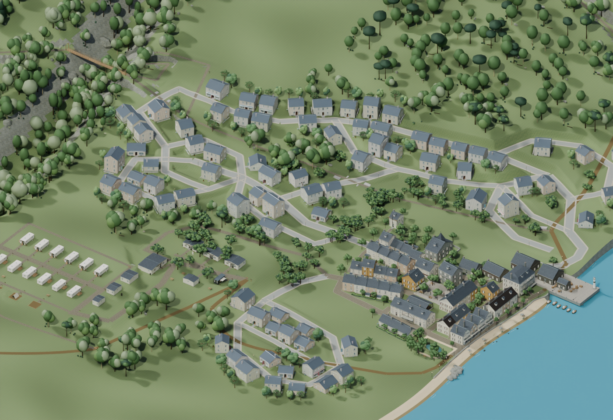
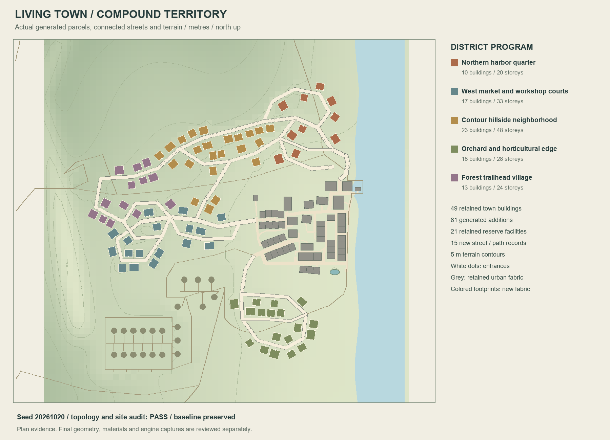
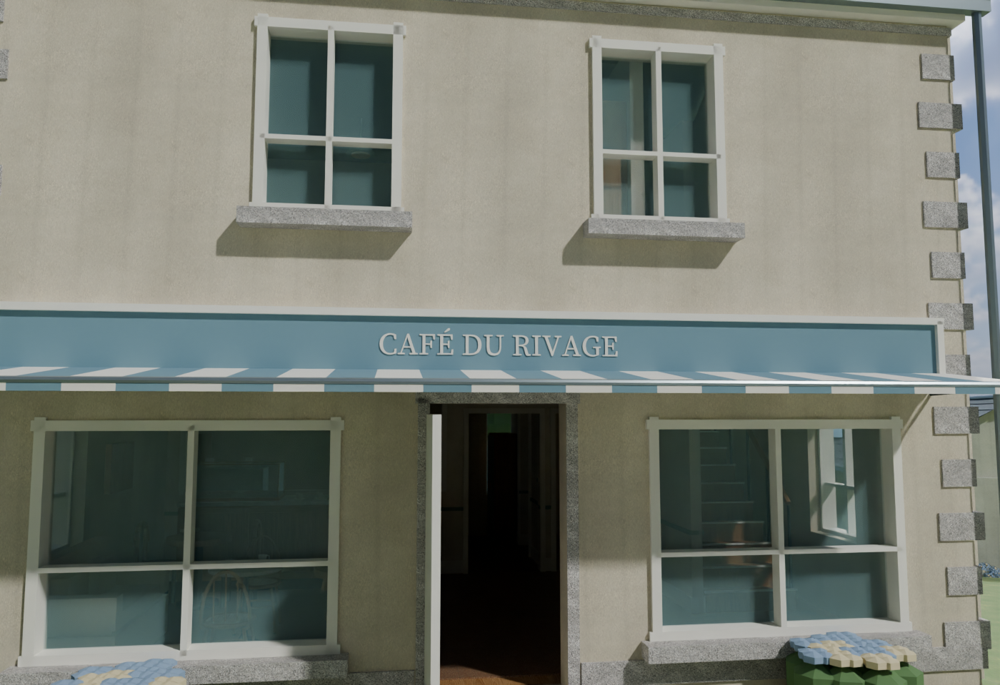
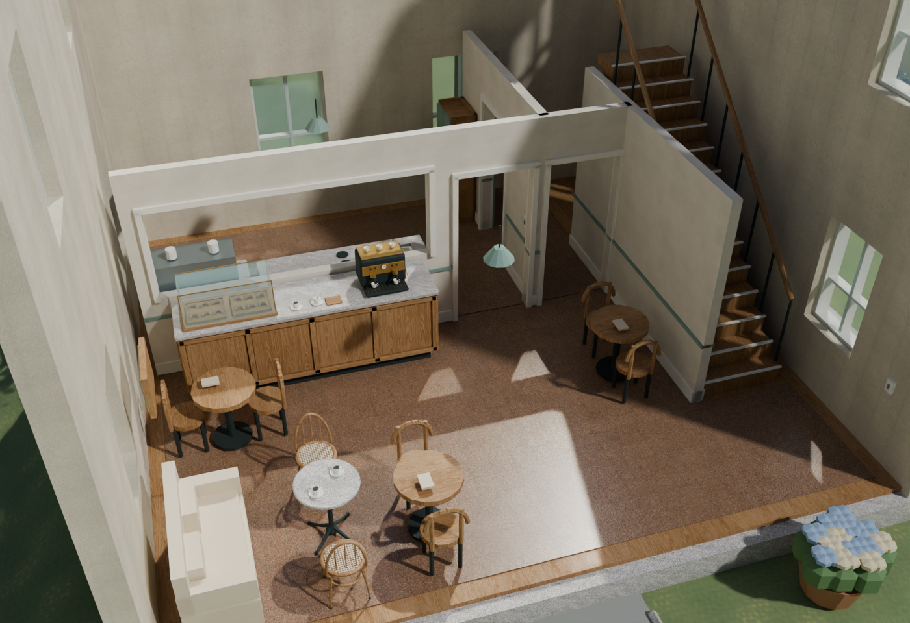
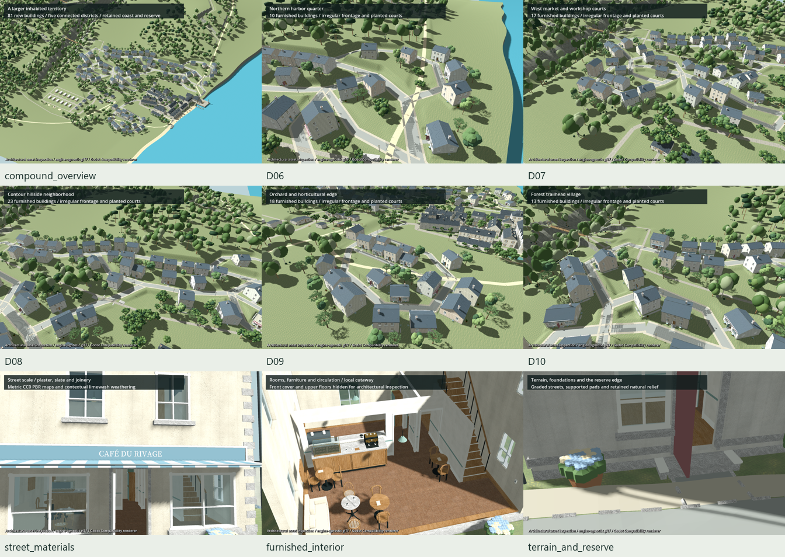

# Expanded territory asset edition

The town grows through five connected neighborhoods: a northern harbor quarter, western market and workshop courts, contour hillside housing, an orchard edge and a forest trailhead village. The expansion adds 81 buildings to the retained 49-building town and 21 reserve facilities. New buildings contain 153 floors and 929 partitioned room zones with furnishings and purposeful service spaces.

This is an engine-agnostic architectural asset edition. The resident simulation continues to use its existing urban core. The separate Godot viewer imports the actual exported assets for architectural inspection; its recording does not establish gameplay, physics, navigation or real-time performance integration.





## Scale and layout

The inhabited footprint spans approximately 284 × 288 m, versus 112 × 96 m for the earlier core. Its convex hull grows from 0.83 to 5.27 hectares, a 6.32× area ratio. These figures measure the urban envelope, including streets, gardens and intervening open space; they do not mean the whole reserve is paved or built over.

| District | Added buildings | Program |
| --- | ---: | --- |
| Northern harbor quarter | 10 | Fishing households, food shops, small cafés and working premises along landward coastal lanes |
| West market and workshop courts | 17 | Shops, artisans, service courts and homes around bent streets and connected loops |
| Contour hillside neighborhood | 23 | Houses and gardens on engineered pads, linked by contour streets and short approaches |
| Orchard and horticultural edge | 18 | Gardeners' homes, nursery retail and work buildings around an irregular lane |
| Forest trailhead village | 13 | Visitor-oriented shops, cycling café, cottages and reserve access |

Fifteen new street/path records join three existing town anchors. A segment-incidence graph checks actual connectivity. Parcel checks use rotated footprints, road ribbons and entrance approaches, including a reverse check so later parcels cannot block an earlier front door. The accepted plan has at least 1.5 m between building shells, no recorded building/road overlaps, no blocked approaches and no shoreline infill.

The existing coast, pond, reserve facilities, trails, bridges and stone stair systems remain the baseline. New local earthworks use one finished-height authority. Road centerlines have an 8% designed grade limit; shared junction aprons and explicit banked cross-sections connect their full paved widths. Stone retaining walls support steep terrace edges, and solid bedding supports raised paving. Native checks measure the actual terrain and road geometry across each width. The surface review also records short banked outer strips reaching 25.6% longitudinal and 20.1% transverse slope, the retained 2 cm North Harbor joint, and a tight rear-pad transition with explicit granite support. Centerline grades and full-width surface measurements are reported separately. The retained harbor junction has overlapping original paving up to 3.9 cm above the new approach; its visible upper surface is recorded separately for consumer collision generation. This authored fictional terrain is not a surveyed civil-engineering design.

## Architecture, interiors and planting

New shells have genuine window and door apertures, slate roof courses, chimneys, gutters, downpipes, framed glazing, shutters, granite plinths and restrained façade trim. Commercial roles receive larger glazed fronts, French fascia lettering and fitted striped awnings. Door leaves, trim, entrance steps and canopy clearances are checked against the actual opening geometry.

Room planning retains kitchens, dining, bedrooms, sanitary rooms, storage, working areas and protected stairs. Compact cafés use an open dining/stair-lobby arrangement where an enclosed side corridor consumed too much space. The unchanged essential-fixture, privacy, entrance, pedestrian-clearance, furniture-facing and density gates remain active. Selected cafés reserve the measured bounds of the detailed counter and bistro assemblies before those meshes replace their simpler fixtures.

The planting mixes retained woodland, shared detailed leaf-spray trees, individual-floret hydrangeas, street trees, garden pots and the upstream courtyard planter. Conflicting baseline trees and local components of combined rocks/understory batches are cleared; the rest of the reserve remains in place. Repeated props retain shared mesh data through the native and GLB exports.

Wall finishes use source-bound CC0 plaster scans, metric fine normal/roughness detail and a portable contextual limewash/weather color bake. Cabinet oak, honed/cut granite and interior flooring retain their own physical texture scales. The retained original core and the earlier three-frontage café pilot remain distinct fidelity stages; this edition applies the new factories to the expansion.





## Actual Infinigen use

An isolated Python 3.11 / `bpy 4.2.0` worker ran the upstream `infinigen==2.0.0a3` plant-pot, phyllotactic plant and leaf factories. The bounded CPU experiment produced one UV-mapped 10,488-triangle planter with three materials and nine embedded 512 px PBR maps. Its prototype is shared at courtyard placements. The project authored the conventional raster maps and placement constraints; it did not run an upstream whole-town or terrain generator.

The wider territory planner, building adapter, furniture relationships and landscape masks are project-specific. They apply the staged, seeded factory approach described in the [Infinigen review](INFINIGEN_TOWN_GENERATION.md). The selected Infinigen and ProcFunc code has BSD-3-Clause notices; Blender's authoring runtime is a separate dependency. See [the retained notices](../tools/town_generation/INFINIGEN_NOTICES.txt). No model-inference or GPU-compute job is part of this build.

## Rebuild in a fresh folder

Use the release source package to obtain the packed baseline, prepared CC0 maps and upstream prototype. Blender 5.2.2 is the tested main-scene runtime. Ordinary Python needs NumPy and Pillow for planning, verification and the map.

```powershell
python tools/town_generation/generate_town.py `
  --output build/town_generation/my_expansion `
  --blender "D:/Program Files/Blender/blender.exe" `
  --pbr-library art/living_town/refinement_pilot/scanned_pbr_v3/library_manifest.json `
  --infinigen-asset upstream/infinigen/courtyard_planter.blend
```

`--plan-only` writes the checked territory plan and map without launching Blender. `--quick` reduces render size/samples while retaining complete geometry. Existing output folders and canonical source locations are rejected. The generation receipt binds the source native, plans, generator modules and geometry helpers; failed runs remain available for diagnosis.

The native opens at the overview camera in **Material Preview**, using the scene lights and world so the PBR wall finishes are visible. The first opening may compile shaders. The included larger Cycles renders provide a separate saved review; render settings remain editable.

The native reopens without external texture files. The GLB handoff contains five district chunks, a shared public-realm chunk, replacement ground geometry, room plans and engine-neutral collision/walkable-surface metadata. Building ownership and front/roof/upper presentation layers are exported explicitly from the native collection hierarchy, so consumers can make matching cutaways while retaining ground-floor stairs. Apply the chunk manifest's complete baseline clearing list before adding replacements. The metadata is input to consumer-created collisions and navigation; it is not a baked game navigation product.

Offline validation and native reopening are separate commands:

```powershell
python tools/town_generation/verify_expansion.py --run generation `
  --baseline art/living_town/living_town_complete.blend
blender --background --threads 6 --python-exit-code 1 `
  --python tools/town_generation/inspect_expansion_native.py -- `
  --scene generation/scene --plan generation/territory_plan.json `
  --baseline art/living_town/living_town_complete.blend
```

Historical receipts preserve their original machine paths. After extracting the package, regenerate a local inspection config:

```powershell
python tools/town_generation/prepare_inspection.py --run generation `
  --baseline baseline/living_town_game.glb --output build/inspection.json
Godot --path tools/town_generation/godot_viewer --rendering-method gl_compatibility `
  -- --config="ABSOLUTE/PATH/build/inspection.json"
```

Keep substantial engine stages serial, with six CPU threads. The narrated movie uses actual Godot MovieWriter frames, measured Edge TTS word timings, burned subtitles and an animated GIF excerpt. The independent viewer uses [Godot AgX tone mapping](https://docs.godotengine.org/en/4.6/classes/class_environment.html#enum-environment-tonemapper) and the native summer-sun direction to retain pale-wall detail. Offline capture frame counts are not a real-time benchmark. Technical audio checks are separate from human listening acceptance.

For recording, use an `.avi` output on a drive with several gigabytes free, `--fixed-fps 18`, and the viewer's `--movie` argument. The viewer sets MovieWriter's audio rate to 44,100 Hz, which divides evenly into 18 frames per second. This edition uses the AVI writer after rejecting an incomplete OGV recording whose shutdown repeated audio pages. `build_expansion_tour.py` accepts the completed raw capture through `--raw` and checks its decoded frame count before trimming the measured loading prefix; run its `voice`, `compose` and `verify` phases with the same inspection config, scene and media folder.

## Evidence and downloads

The [release](https://github.com/ForTe13X/living-town/releases/tag/town-territory-2026-10-20) contains the complete ZIP and packed native. The ZIP has a detached content manifest and readback-verification receipt. The repository retains the compact [evidence inventory](town_generation/territory_expansion/acceptance.json), actual review images and tour preview; heavy native/GLB/media assets stay in the release.

[](https://github.com/ForTe13X/living-town/releases/download/town-territory-2026-10-20/expanded_town_architectural_tour.mp4)

[Complete asset ZIP](https://github.com/ForTe13X/living-town/releases/download/town-territory-2026-10-20/LivingTown_Territory_Expansion_v1.zip) · [Packed Blender scene](https://github.com/ForTe13X/living-town/releases/download/town-territory-2026-10-20/expanded_town.blend) · [Six-minute narrated and subtitled MP4](https://github.com/ForTe13X/living-town/releases/download/town-territory-2026-10-20/expanded_town_architectural_tour.mp4)


