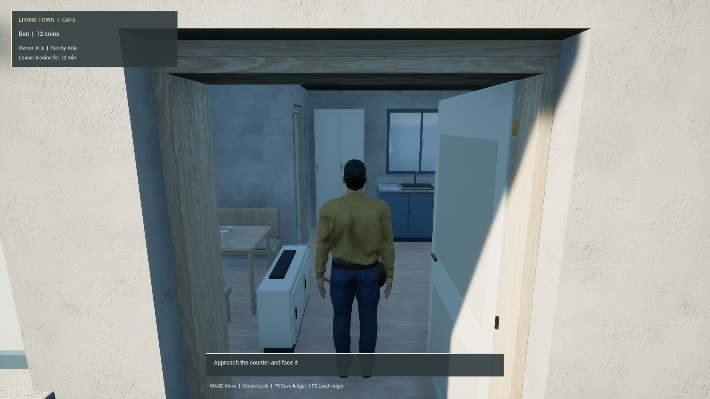

# Mill Court B: connected native slice

This slice connects the furnished Mill Court B house and corrected entrance terrain to the existing native café journey. The building, corrected-ground unit maps, connected root scene and 971-role descriptor have passed independent cold reads. The C++ profile binds their actual saved package identities, compiles and passes seven focused native tests. After isolated terrain and doorway collision repairs, a fresh ordinary Game run completed the 27-waypoint café → house room → café journey with normal movement input. Its four captures also demonstrate the removal of the earlier gross overexposure. Final art, full-town performance and cooked startup remain unfinished. The legacy profile remains available.

## Intended composition

| Unit | Roles | Ownership |
| --- | ---: | --- |
| Existing U0131 | 66 | Existing qualified map |
| Mill Court B | 749 | Three identity carriers, 256/256/237 components |
| Ground156 | 156 | One pinned carrier; 154 retained components plus remainder and corrected patch |
| External café | 262 | Existing café authority, outside the streamed units |

The new profile is `B749_U0131_66_Ground156_ExternalCafe81_v001`. It has 971 streamed roles and 262 café roles. It retains the 64-actor, 32-owner and 256-components-per-owner limits. Carrier names are not runtime identities; role partitions and tags establish ownership.

The house includes the existing bedding and room segmentation. Its source lineage distinguishes 724 house parts, 23 pilot-site parts and one study foundation. Material overrides remain ordered component data: 141 cut granite, 46 plaster, 22 exterior plaster, 43 brass, 111 oak joinery, five oak floor and 13 honed worktop arrays. The remaining 368 arrays are empty. Mesh defaults, slot names and effective materials must be observed separately; no mesh copies are needed to preserve these 381 finishes.

## Completed asset evidence

The corrected ground patch was saved and reopened in a separate process. Its complete 2,328,788-byte native buffer and native metadata matched exactly. It contains 23,697 vertices, two UV channels and 43,976 triangles split into 26,451 grass and 17,525 paving triangles. All paving vertex colors are white. The original 859 packages and the two new packages passed byte and timestamp preservation checks.

The derived Ground156 unit map has now been saved in a separate author run. It retained 154 components and added the remainder and corrected patch with exact recorded collision responses and step-up settings. Its 145,199-byte map passed an independent cold read; operational walking contact remains pending.

Source correspondence has a separate scope. Eight grass and 76 paving triangles differ in UV values by one float32 ULP; corresponding position triangles and cyclic corner orientation match. These differences are retained in the evidence. Complete source normal, tangent and grass-color encoding parity is still pending. Reopening the mesh does not establish collision, navigation or walking support.

The building unit saved all 749 roles under three identity carriers. Its independent cold read retained 381 material override arrays and 368 empty arrays. A marked stock `LOGACTORCOUNTS` observation returned 10 raw level actor entries, including null slots, within the existing 64-entry limit. Editor-only noncolliding root icons are recorded separately from the modeled parts. This does not establish Game performance or walking support.

The root author joined 971 streamed roles and the café's 262 external roles without overlap. It saved a 1,315,578-byte descriptor and a 10,525-byte root map, preserving all 5,842 input packages. The successful independent cold run took 99.94 seconds and compared every descriptor field while leaving all three unit worlds unloaded. Its root scene contained eight raw actor entries. An independent reader rehashed the 5,844 staged packages and all 410 worktree/snapshot metadata rows; all seven preservation checks passed.

The nonloading reader uses native struct text export for a unit's soft map reference. The installed Python binding's ordinary soft-object property getter calls `LoadSynchronous()`. Native empty arrays export as empty text, so the bounded parser handles that format while requiring one exact top-level map reference. Other descriptor fields remain compared through typed getters. Root actor/driver/settings stability was enforced by the frozen worker across successful phases; its separate raw before-state baseline was not retained, so an independent before/after replay is unqualified.

## Collision bridge

The installed engine has 64 serialized collision channels, followed by deprecated sentinel 64 and `ECC_MAX` 65. Python exposes only the first eight channel entries. Numeric enum casts cannot recover hidden entries, and sparse collision-response struct equality does not compare the effective 64-channel cache.

The additive editor reader reports all 64 responses from already-loaded static mesh components. It accepts bounded batches in four exact source/owned map packages and performs no collision mutation, cooking or asset loading. The author scripts copy only the inner collision-response value and require native source/target equality before saving. The coherent C++ build and six focused native tests passed. An independent reader verified all 155 ground components in two identical observations of all 64 response channels, along with empty, duplicate and oversize input refusals. The run closed in 132.20 seconds with all seven preservation checks passing. No already-loaded wrong-world component was available for that runtime refusal check. Copying the inner response value, saved unit-map serialization and walking support still require their own actual observations.

Hidden streamed levels need a separate transform check. Unreal's `ComponentToWorld` cache can be uninitialized before component registration. Under the new profile's exact direct-child, identity-root and identity-level hierarchy, hidden validation compares serialized relative transforms. It rejects sockets, absolute transforms, nested parents and attached owners. Registered components still require their actual world transforms to match. The legacy path, collision/material checks and ownership limits retain their existing behavior. A failed predicate now emits bounded structured diagnostics identifying its unit, role, component and actual/expected values.

Seven stock command-line Automation tests passed in a fresh coherent build, including a regression that reproduces an unregistered translated component with an identity world cache. Its negative cases cover a wrong expected transform, nonidentity root/level, nested parent, socket, absolute transform and registered-phase misuse. The process exited with code 0 after the queue emptied; all seven preservation checks passed. These CPU tests used NullRHI and provide no rendering or frame-rate evidence.

## Visual work still required

The proof export dropped glass transmission and flattened five slate variants into a single `GAP_FLAT` material. The roof fields already have metric UVs; missing UVs are not the supported explanation for their flat appearance. The next visual comparisons should restore a suitable slate surface on M0447/M0448 and address the ten clear/frosted panes separately.

[Roof Slates 03](https://polyhaven.com/a/roof_slates_03), by Rob Tuytel, was tested as a 2K material candidate under [Poly Haven's CC0 asset license](https://polyhaven.com/license). The native import, saved derivative and matched-camera before/after renders passed technical checks. The result remains unapproved: photographed flashing creates a visible repeating band, and the surface is too pale. A continuous slate stone surface should let the modeled geometry define the tile courses. DX and GL normal sources remain separate. API credit: [Powered by Poly Haven](https://github.com/Poly-Haven/Public-API).

A subsequent [continuous slate rock](https://www.meshy.ai/textures/stone/dark-slate-rock) comparison removed the band but produced overly large, strong stone folds. It also remains unapproved and is excluded from the runtime profile. Its original CC0 GL normal is preserved, with exactly one green-channel flip observed in Unreal. The next roof surface needs fine grain and tile-aligned variation rather than geological folds.

## Runtime evidence and remaining acceptance

An existing three-map slice completed a 171.92 m circuit in 153.19 seconds. Its initial timing window retained 550 phase-stable rows at 1080p: median frame time 9.32 ms, p95 11.36 ms. This is limited slice evidence. The optional repeat exceeded the recorder's sample limit; the overall run remained failed, with no final quality pair or natural shutdown. Expanded-town performance and packaged startup are unqualified.

The revised B749 loader subsequently reported all three units visible and validated, with 66/749/156 components and movement unlocked. Its armed-to-ready interval was 17.83 seconds; that excludes earlier engine startup and is not a packaged loading measurement. The observer then rejected a naming heuristic: the ground unit includes the declared `CONTEXT::PERSISTENT_ATLANTIC_OCEAN` role. The corrected observer compares the exact 156-role descriptor set and explicitly rejects ocean as pedestrian support.

The next ordinary Game run retained 418 grounded, walkable observations and 8,651 per-frame movement submissions. It walked 65.36 m, then stopped at `[-4999.47, -771.89, 274.87]` cm, before the house approach. Its 28 cm capsule stopped 28.11 cm from the next terrain mesh's Y = -800 cm boundary. Twelve source triangle queries beyond that boundary show a continuous surface at or slightly below the current floor. The actual blocking component and cooked collision shape still need direct observation; source continuity alone does not identify the collision defect. The run closed with all seven preservation checks passing, but remains a failed journey.

The same run exposed a separate presentation defect. After Unreal's stock screenshot-loading preparation returned in 122.86 seconds and subsequent frames settled, the world was still black behind a visible HUD. The saved root's eight-actor roster contained no lighting actors. That assisted loading wait is not a natural startup or packaged loading result. The initial screenshot is structurally valid but rejected for presentation.

A subsequent isolated author saved a movable 35,000 lux sun, captured-scene skylight and sky atmosphere in the root map. A fresh process verified all eleven actor states, light settings, original driver and WorldSettings, with all 5,844 package bytes and timestamps preserved during the read. The descriptor and three unit maps retain their earlier identities. Public level queries verify the loaded persistent level and the exact three profile unit worlds; the private full streaming array is unobserved in this editor reader. The native Game startup check still requires the complete streaming array to be empty. A lit ordinary Game image remains to be reviewed.

That fresh read also identified a collision-policy mismatch. The original terrain uses `CTF_USE_COMPLEX_AS_SIMPLE`, with no convex shapes. Both generated ground assets used `CTF_USE_DEFAULT` and one convex shape. An isolated repair saved those two assets with explicit complex-as-simple collision. Their complete native LOD0 buffers, build settings, bounds and material metadata matched before and after. The convex data, default body settings, original eleven actors and other 5,842 packages remained unchanged. Other LOD buffers were not independently exported. The current Editor's physics was not asserted to rebuild; the next fresh Game run must read the saved flags and demonstrate physical contact across the seams.

The screenshot harness also needed a concrete correction: stock `Shot` accepts `-nosuffix`; bare `nosuffix` produced a numbered filename while the observer waited for the unnumbered path. A CPU fixture executes the actual extracted function, reproduces the old failure and verifies the corrected command, expected path and caller state.

These failures require an earlier integrated check in the asset pipeline: verify a lit ordinary camera view and capsule crossings at mesh seams before treating saved-file fidelity as playable acceptance. Keep source geometry, serialized component state, registered physics, render preparation and final visual quality as separate observations. A successful hash comparison does not establish the other results.

The next ordinary Game run reopened both repaired terrain assets with explicit complex-as-simple collision and crossed the earlier blockage. It reached the house approach but stopped with capsule feet at `[-3749.98, -3321.96, 308.49]` cm. Forward simple-collision rays at 15 and 60 cm above the feet hit `MCB::Building::M0142` at Y = -3349.96 cm; the corresponding complex-collision rays found no blocking triangles. These are ray observations rather than capsule sweeps. They identify a likely entrance-hull defect that needs a geometry-aware collision repair and a fresh physical crossing, rather than a route that avoids the entrance.

That run's initial 1920 × 1080 image is grossly overexposed and is rejected for visual quality. The inset world region averages approximately RGB (254.2, 254.5, 254.5). The host's nonblack-pixel diagnostic correctly provides no art acceptance; a nonblack screenshot alone is insufficient to establish readable lighting. Keep light intensity and camera exposure consistent, and inspect the actual rendered result before recording a showcase. The failed run closed with controlled exit 92 and no remaining owned native processes; no complete-route or performance claim follows from it.

A subsequent isolated author inspected sixteen concave wall and four concave floor candidates. All twenty used default collision complexity with one convex hull. Only the doorway's lower M0142 and upper M0143 facade assets were saved with explicit complex-as-simple collision. The 190 cm capsule overlaps both pieces' heights. Independent review replayed all twenty BodySetup observations, preserved the other eighteen bodies, compared complete native LOD0 buffers and metadata before/after, and rehashed the coherent 5,844-package scope. Maps, descriptor, root lighting and transforms remain unchanged. This establishes the saved collision-policy repair; a new Game process still needs to demonstrate entrance and exit contact. The remaining concave candidates require their own physical-use qualification.

## Fresh gameplay and exposure result

Game008 completed café → public approach → entrance seam → open leaf → M0231 room → café, then exited naturally with code 0 and no remaining owned processes. Independent review verified all 27 waypoints, 14,205 normal `Force=False` movement submissions and 1,043 sampled grounded, walkable observations. The authored route is 202.575 m; the sampled 3D path is 202.357 m. Outward and return terrain crossings, entrance observations and settled room support all passed. The room floor is the actual `MCB::Building::M0231` component, with the 28 cm radius, 95 cm half-height capsule intact. No teleport or runtime collision repair was used.

The same run reopened both ground meshes and both facade meshes with mesh-owned BodySetup complexity 3. Four 1920 × 1080 captures retain the normal pawn camera and unchanged quality: café before departure, house approach, room and café after return. Two explicit eight-second photo pauses are recorded separately from movement; no FPS result is inferred. PNG byte/timestamp seals, CRCs and complete image decoding passed. The independent review also rehashed all seven preservation scopes, including 18,363 source rows, 179 immutable staging rows and 5,858 asset/input rows.

The exposure comparison uses this explicit setting in the isolated test project's startup engine configuration:

```ini
[/Script/Engine.RendererSettings]
r.DefaultFeature.AutoExposure.ExtendDefaultLuminanceRange=True
```

The saved 35,000 lux sun, sky, atmosphere and camera properties remain unchanged. All four runtime observations confirm that the extended-range setting is enabled, automatic exposure is active, native constructor bounds are -10 to 20 EV100, and the camera has no competing exposure override. The project configuration remained exact after exit. Unreal removed the private generated user-layer Engine.ini on shutdown; preservation of that generated file is not claimed. Repository Config and the compiled source family were unchanged by this controlled test. Final SceneView/GPU exposure was not directly read.



The image shows the actual room-entry checkpoint with visible plaster, joinery, cabinetry and flooring. Root review accepts the removal of gross white clipping and the physical route. The café interior remains too dark, the return image has blur, and character appearance, lighting and material polish remain open. This is a bounded 971-role plus 262-part consumer, with fresh private caches and an assisted shader/texture preparation barrier; it does not qualify natural startup, a cooked build or full-town frame rate. The narrated walkthrough and README GIF remain unfinished.
