# Cafe worker v002: two-view Tripo source candidate

One original high-detail candidate has been generated and preserved for visual review. It is **not an accepted game character**. Provider task `183abe00-c177-48f4-b834-6c25e65784bd` succeeded and charged **60 API credits**. The account readback after completion, at `2026-10-28T03:24:37.548Z`, recorded **900 available / 0 frozen**; this is an observed balance, not a live value. Credentials were unchanged.


## Generation request

The installed Tripo CLI 0.7.2 official client submitted exactly one `POST /v3/generation/multiview-to-model` request with explicit `front` and `back` image slots. The references are a concept pair, **not calibrated views from the same capture**. Their clothing, lighting, pose and perspective may therefore disagree.

| Slot | Repository reference | SHA-256 |
| --- | --- | --- |
| Front | `docs/asset_refinement/concepts/cafe_worker_breton_v001/reference_front.png` | `5c54987ab21f00401ca5807041e4bc2243cd9a97578371f280dbea3a456c89d8` |
| Back | `docs/asset_refinement/concepts/cafe_worker_breton_v001/reference_rear_v001.png` | `adde894b0483b74f9893b914624c060fb59c9670f5f5d43d94ee276891317632` |

The transmitted generation settings were:

```json
{
  "model": "v3.1-20260211",
  "texture": true,
  "pbr": true,
  "texture_version": "v3.5-20260815",
  "texture_quality": "detailed",
  "delight": true,
  "geometry_quality": "detailed",
  "texture_alignment": "original_image",
  "export_uv": true,
  "model_seed": 20261028,
  "texture_seed": 20261028
}
```

No text prompt was transmitted. The artistic brief was retained separately; the H-series multiview endpoint does not document a prompt parameter, and CLI 0.7.2's multiview builder does not forward `--prompt`. No `face_limit`, `auto_size`, `export_orientation`, smart low-poly, quad or parts option was sent. `auto_size` was left unset (documented default false), so physical stature and metric calibration remain unqualified. No rigging, retopology, animation or conversion task was queued.

The current official [H3.1 model page](https://developers.tripo3d.ai/en/models/v3-1) and [pricing page](https://developers.tripo3d.ai/en/pricing) estimated 60 credits: detailed multiview texture 40 plus detailed geometry 20. That was an estimate, not a server quote; the completed task independently recorded the same charge. The [H-series multiview API](https://developers.tripo3d.ai/en/docs/generation-multiview-to-model/standard) documents the image slots and texture-model settings.

## Preserved original and CPU facts

Delivery files remain outside the repository, under `tripo_cafe_multiview_actual_v1_001` in the retained delivery root.

- Original: `source/cafe_worker_breton_v002_original.glb`, **64,556,396 bytes**.
- SHA-256: `dcbec3404706965bb8924c489f48466394b31daefb59b363906317427441609e`.
- One mesh/primitive and one PBR material; **1,014,595 vertices / 1,969,262 triangles**.
- Three actual embedded **4096 × 4096** images: base color **RGB JPEG**, metallic-roughness **RGB JPEG**, normal **RGB PNG**. These are present source maps; their appearance and effective material behavior are not yet accepted.
- No skin, skeleton or animation clips.

The canonical CPU inspector's `CHARACTER_SOURCE_FACTS.json` returned `FACTS_ONLY`, with no refusals and unchanged source bytes/size/mtime/hash. It found no degenerate or near-zero-area triangles in the declared primitive. This is structural evidence; it does not qualify anatomy, topology for deformation, art, physical scale, performance or engine behavior. Raw active-scene rest extent is approximately `(0.18551, 0.98082, 0.50505)` glTF coordinate units; it does not establish a 1.79 m adult.

The provider's preview is `preview/provider_preview.png`, an original **512 × 512 PNG**. The returned URL used a `.webp` suffix, but the downloaded signature is PNG. The original mislabeled download and stopped watch receipt remain preserved; a byte-exact copy with the correct PNG suffix required no re-encoding or second download. This provider image is **not a Blender render or Blender review**. Private task metadata may contain expiring signed URLs and is not copied into repository documentation.

## Actual Blender review and remaining detail

| Three-quarter source view | Rear construction |
| --- | --- |
|  |  |

| Face and hair detail | Hand detail still held |
| --- | --- |
|  |  |

Six actual HIP views inspect Front, ThreeQuarter, Rear, Face and both hands. Each uses a fresh Blender process, original PBR links and declared neutral studio lighting; each process is reaped before the next. The six runs total 164.515 seconds, peaking at 5,279,961,088 aggregate private bytes per job. Source bytes, decoded topology/UV/corner normals, material graph and packed maps remain unchanged. Cameras receive a declared 90-degree yaw for this source's orientation; the unapplied parent sets nominal viewing height to 1.79 m without qualifying actual stature.

This is provisionally selected as a source base for detail repair. Clothing seams, apron pockets/buckle, trousers and shoes read clearly. The rear exposes trousers beneath the waist belt instead of a closed rear apron skirt. Hair-tip stubs, eye-rim material response and forearm appearance require refinement or attribution. Later lateral views resolve the earlier frontal finger ambiguity, as recorded below. Final retopology/UV review, bake, rig/deformation, walk/eat/sleep contact, metric scale, engine integration and measured performance remain pending. The nearly two-million-triangle source is not a runtime budget.

Generated-output rights follow the provider account terms; this candidate is not represented as CC0. No Tripo bridge/vendor code, credentials or signed URLs are redistributed by this document.

The retained `COMPLETION_RECEIPT.json`, `SOURCE_FACTS.json` and `CHARACTER_SOURCE_FACTS.json` bind task, source and maps. Actual GPU evidence is `character_multiview_source_review_actual_v1_001/SIX_VIEW_SOURCE_REVIEW.json`, SHA-256 `204e06c585997f58515ce0e73d09910f3784bd7b90c74c0fae4b56e865038ae7`, alongside the per-view receipts and root visual review.

## Local material derivative and hand clarification

| Lower-orbital material candidate | Unedited source hand, lateral view |
| --- | --- |
|  |  |

Actual lower-lid probes sampled roughness about .145/.161 and metallic .059/.067. A source-bound CORNER mask was baked into the existing 4K UV layout, then used to raise skin roughness toward .48 and remove metallic response locally. Only 5,179 texels have positive mask weight. Outside-mask RGB8 values, the red channel and 1,943,604 protected used-UV samples remain unchanged. Albedo and normal maps are untouched. The matched 53.188-second HIP Face view provisionally selects this restrained local correction; it does not finish eye anatomy or whole-face art.

The portable GLB appends the derived ORM PNG and repoints its existing image reference. Its complete original BIN prefix, accessors, indices, UVs, normals, nodes, scenes and material factors remain intact. The independent texture-only comparator passes, and the [reusable writer](append_metallic_roughness_image.md) reproduces the actual 74,850,764-byte output exactly, SHA-256 `f6f5cc4e1df6ba12c4792a81cbb8183f7d85977becce91eda077a107a316e235`. Native bake and pixel evidence is `character_v002_pbr_refinement_actual_v1_001`; seam/mip and engine review remain open.

Fixed lateral views show five distinct digits with nails and joint contours on both hands. Source plane sections independently find five separated loops proximally and four distal finger loops. Earlier frontal crops stacked fingers in depth; they did not establish fused anatomy. Hands remain unedited, and rig/deformation still needs testing. Forearm normal samples are nearly flat, while geometric residuals are mostly sub-millimetre at nominal view scale; neither supports a broad smoothing or normal-map correction. The first sparse hair-tip deformation remains held because its visible improvement was too mild. A local topology repair is being prepared, with the original source retained.

## Separate runtime retopology trial

| Runtime trial, three-quarter | Close shading regression: held |
| --- | --- |
|  |  |

One [Tripo v3.0 retopology request](https://developers.tripo3d.ai/en/docs/mesh-decimate) used the portable lower-orbital PBR derivative, a 20,000-triangle limit, smart UVs, texture baking and triangle output. Task `6464b3a3-249c-4ff2-89c5-b422ec896eee` completed for **35 credits**. It returned **18,425 triangles / 10,703 vertices**, 99.064% fewer triangles than the high-detail source. The untouched downloaded GLB is **6,950,588 bytes**, SHA-256 `097839e26460c98c0fb25128c148e70271abe233f0b60c66de3943c9cf42e589`.

This is a new geometry/UV/bake lineage. It has 4K JPEG albedo, 2K JPEG normal and 2K PNG ORM, with no rig or clips. Original maps cannot simply be repointed onto its new UVs. Its rest bounds also changed; nominal 1.79 m review framing does not qualify physical scale. A file-size or triangle reduction does not establish game FPS.

Six fresh-process HIP views completed in **86.406 seconds**, with **3,895,869,440 peak aggregate private bytes**, preserving the downloaded source and decoded mesh/material/maps. Clothing construction remains readable in full views. Close face/neck and hair show triangular shading patches; hand silhouettes are coarse and forearm shading remains uneven. Root holds final art and is isolating normal-map response from albedo before correction. The candidate can support a separate compatibility/deformation experiment while that work continues.

The first download observer stopped before writing output bytes and remains preserved. Bounded GET recovery downloaded the same successful task output without creating another task. The post-task balance at `2026-10-28T05:30:51Z` was **865 available / 0 frozen**, with unchanged credentials. Actual intake is `character_v002_runtime_retopo_actual_v1_001`; GPU evidence is `character_v002_runtime_review_actual_v1_001/SIX_VIEW_SOURCE_REVIEW.json`, SHA-256 `d1fb1d3c88bdbc80ff305f27f2612f8f9f26ebacc0bba0020fbea09a48369917`, plus root visual review. No production character, animation or engine adoption follows from this trial.

Two additional matched Face renders disconnect only the normal map, then display the existing albedo through emission. Both remove the pronounced lit face/neck patches, implicating the normal-map/tangent-space path. They do not isolate compression, channel convention, projection or tangent basis individually. No repaint, smoothing, UV rebuild or source export was performed. These controls are retained under `character_v002_runtime_shading_diagnostic_actual_v1_001`.

The exact downloaded model also passed Tripo's separate [riggability check](https://developers.tripo3d.ai/en/docs/animations-rig-check): task `097eb686-6011-41d1-9fcd-ca47a68fe71f` returned `riggable=true`, recommended `biped`, and charged **0 credits**. Compatibility does not establish weights, deformation, contact or art acceptance. An experimental motion path remains separate from final surface acceptance.

The additional green-channel-only flip does not remove the triangular shading and exaggerates some hair/neck ridges. It remains a diagnostic, with no portable map change. A lossless bake on the target tangent basis is being prepared after source/target registration.

## Rig and walking experiment

One explicit v3.0 biped rig request used Unreal bone naming and portable GLB output. Task `39fc76bc-289e-471d-a454-a61c351fc146` charged **25 credits** and returned a **61-joint** skin with at most four influences per vertex and weight-sum error at most `1.0361e-7`. The original rig GLB is **7,184,004 bytes**, SHA-256 `9cc396e73869a4b17777851dff72e4b0f5d889e82019af1b8efb14417b22b77b`, retained in `character_v002_runtime_rig_actual_v1_001`.

Direct accessor hashes differ after rigging. A separate exact-UV bijection covers all 10,703 vertices and preserves the oriented triangle multiset; all three image-role encoded bytes, samplers and normal scale match. Positions fit a measured uniform scale/translation with maximum residual `1.579e-6` source units. Normals differ slightly, so this is not a byte-preservation claim or a deformation qualification.

One [in-place walking retarget](https://developers.tripo3d.ai/en/docs/animations-retarget), task `9af45f45-f155-4ad3-b78d-cdb3462acaad`, charged **10 credits**. Its untouched GLB is **7,255,492 bytes**, SHA-256 `cff40bcce82395e8ed8e9bd2c7cb9c7cce9989f0d1e94f45461568c96b39a1ec`. The inspector finds one `walk` clip spanning about **2.333 seconds**, with 183 channels. Actual pose, apron/limb deformation, contact, looping and engine review remain required. Evidence is retained under `character_v002_runtime_walk_actual_v1_001`; the observed post-task balance at `2026-10-28T06:03:18.788Z` is **830 available / 0 frozen**. No further cloud operation is implied by these receipts.


Four fresh HIP processes now render 0/25/50/75% of the clip, with actual evaluated vertices and bone positions. They total **69.578 seconds**, peak at **3,703,197,696 private bytes**, preserve the source mesh/maps/action and restore pose/frame/parent state. The first failed attempt counted Blender's bone-display Icosphere as a character mesh. Its no-image failure is retained; actual import inventory identified the helper and the corrected attempt selects the real skinned body while preserving the helper.

The reviewed frames show distinct leg/arm poses and readable clothing. The end/start boundary has maximum vertex difference about **0.924 mm** at nominal review scale and zero root-bone difference. Phase75 shows a dark break near the front pocket and a curled apron hem; the cause requires garment/normal-path review. A weighted sole proxy also reaches about 10.34 mm below the studio plane. These are not physics contacts or final animation acceptance. Evidence is `character_v002_walk_motion_actual_v1_002`; native Unreal playback is the next integration check.

Seven isolated native assets now import and reopen successfully. The separate Unreal review observes **48 samples over 0.7956 seconds** with naturally advancing animation time and distinct limb poses; it injects no manual time or bone updates. The 61 source joints are present, and native LOD0 has 10,707 vertices, including four additional tangent splits. Native animation length is 2.366667 seconds, whereas the portable clip's first-to-last-key span is 2.333333 seconds; identical timeline duration is not claimed. The review completes in **53.484 seconds**, peaks at **5,587,161,088 private bytes**, preserves sources and reaps its processes. Evidence is `character_v002_walk_native_intake_actual_v1_002`. Dark studio lighting and editor overlays prevent final presentation acceptance; this is editor playback, not a player-character replacement or game-performance result.


A later review uses native atmosphere/skylight, a camera-side diagnostic fill, explicit directional-light priorities, Game View and cleared selection. Both distinct-pose frames are now readable, with no light-priority warning or selected-object overlays. Root accepts this limited native lighting baseline. The same seven assets and original character materials remain unchanged; the floor's stretched checker is diagnostic scenery, and skin/hair/garment art stays held. `character_v002_walk_native_intake_actual_v1_004` completes in **53.313 seconds** with **5,482,799,104 peak private bytes**, then restores camera, show flags, selection, background throttle and actor inventory before reaping. The constrained face-normal candidate below is not yet applied in this native frame.

## Constrained face normal refinement


A lossless normal bake on the final rig's target tangent basis removes the strong facial patches, but a whole-map replacement introduces dark responses around hair and collar. The retained full-map trial is rejected. The constrained candidate instead mixes the original and baked normals through a complete source-space face ROI, excluding independently measured projection misses and ambiguous samples. A 16-pixel inward guard and eight-pixel feather protect those boundaries. Original normal samples remain the direct input wherever confidence is zero; source geometry, UVs, albedo and ORM remain unchanged.

Root selects the visible facial-shading improvement only. The unchanged neck artifacts, hair protrusions, eye anatomy and final character quality remain open. All four actual phases—ROI mask, CPU confidence, ROI preview and matched HIP Face render—pass and are reaped, with source guards preserved. Evidence is `character_v002_confidence_masked_face_actual_v1_001`; the displayed PNG has SHA-256 `bcea77c0fb83010dd5c9fe3b2d7fca76d1396b44ed0fdb037a65d21fcf528cda`. This establishes the Blender material candidate, with no portable composite exported. The source maps, explicit mask and bake recipe feed the native material trial below.

## Actual native face material

| Original native normal path | Confidence-limited native normal |
| --- | --- |
|  |  |

The native adapter now saves five owned assets and reopens them independently: an encoded-original normal texture, 4K bake, confidence mask and two material variants. The original seven character packages remain unchanged. A single held pose and head-derived close camera produce three frames: original native material, raw encoded baseline, and confidence-masked material. All observed bone deltas between captures are zero. The first two are visually similar; the third visibly smooths the cheeks, nose and eye surround. Root accepts that limited native normal improvement. Neck artifacts, hair protrusions and final character art remain open.

Both new materials retain the original BaseColor/Roughness/Metallic graph. Their Normal expression mixes encoded RGB, decodes and normalizes, applying the Unreal green-channel conversion once. The encoded-original texture uses linear RGBA8 data, the bake uses the HDR compression policy, and confidence uses linear grayscale. Source normal/material settings, fresh graph readback, dimensions and empty shader-error lists pass. This intentionally differs from the original native BC5 sampling path; cross-engine pixel equality is not claimed. Source maps and the explicit recipe remain portable, while core glTF retains the original one-normal-texture fallback.

Evidence is `native_character_confidence_material_actual_v1_002`: Author **54.672 seconds / 4,913,053,696 peak private bytes**, Reload **32.235 seconds / 5,757,833,216 bytes**. Both editors preserve source packages and restore the preview state before reaping. The temporary component override does not replace a runtime resident, prove contacts or establish FPS. A separate neck refinement is being prepared against the same guarded bake.

The neck extension has a matched Blender review: its tapered confidence region stays inside exposed skin in the open collar, and central faceting is visibly reduced. The first native neck author/reopen run passes its package and graph checks, but its visual pair remains held: the first frame is blurred across unchanged hair and shirt, confounding a neck-only comparison. The actually executed [reusable native material helper](encoded_normal_material.md) is adopted byte-for-byte.

| Stable native face baseline | Combined face and central-neck confidence |
| --- | --- |
|  |  |

The later review, `native_character_neck_material_review_actual_v1_002`, reopens the same 14 saved packages without authoring, importing or saving assets. All three stages reach three stable frames within their original limits, and the baseline return and unchanged hair/shirt regions pass. It holds the pose and camera, requests fully loaded textures and diagnostic FXAA settings, then checks their restoration. CVar readback does not independently prove the final renderer's AA method. Root accepts the visible central-neck improvement within that diagnostic scope. Side-neck, under-ear and hair protrusions remain held; game AA, contacts, portable normal export and final art are not qualified. The run takes **64.625 seconds**, peaks at **6,347,288,576 private bytes**, preserves originals and reaps its processes. The earlier blurred pair and failed convergence attempt remain retained.

## Portable idle and walk bundle

One additional retarget request, task `80f7aa55-a457-44af-8746-7929d9aec1ae`, returns an `idle` clip for **10 credits**. The preserved original is **7,617,964 bytes**, SHA-256 `a36fe64cfbcdcc76aaf76d547753cb15abfc86c962267ef810341c583a89ef27`. Its 183 channels span **15.333333 seconds** between the first and last keys. All 63 source node records, the 61-joint order and inverse binds, and decoded positions/normals/UVs/joints/weights match the qualified walk source exactly. The post-task account observation is **820 available / 0 frozen** at `2026-10-28T11:48:34Z`; this records that completed request, with no further queued generation.

The append-only bundle is **7,689,932 bytes**, SHA-256 `aafd74a3a713c997b20a3d054e4950c04ab2b7eeca3a05316640fc187d98375f`. It retains the complete original walk BIN prefix, all old accessors/resources and the walk clip, then appends the idle data. Fresh canonical inspection finds two clips with no structural refusals. Four actual fresh-process HIP views evaluate the start and midpoint of each clip, retaining both imported actions and preserving source data, weights and restored pose/frame/NLA state. Root sees readable idle weight shift and clothing deformation at these samples. These views still use the original normal fallback, so surface art remains held.

Full-vertex end/start differences are **0.501 mm maximum for idle / 0.924 mm for walk**, with zero recorded root-position difference at nominal review scale. This does not establish velocity continuity or the minimum gait period. Idle's sampled sole proxy reaches **9.823 mm below** the nominal rest-ground zero; it is not a collision contact. Two instants per clip cannot establish foot locking, sliding, self-intersection, the full trajectory or idle-to-walk blending. Native idle intake and gameplay remain pending. Evidence is `character_v002_idle_walk_bundle_motion_evidence_v1_001`, freeze SHA-256 `0676818390e0671455c823ced131c97c74dafd472243265f775dcc168dbf1cee`; original idle delivery is `character_v002_runtime_idle_actual_v1_001`.

## Native normal bake and portable reimport

| Original portable normal | Native-baked portable normal |
| --- | --- |
|  |  |

Unreal's installed GLTFExporter evaluates the accepted face/central-neck material into a **4096 × 4096 RGBA8 PNG** using its UV-only Simple bake. A separate **64 × 64** UV-gradient control checks actual exported orientation and the single native-to-glTF green conversion: maximum angular error is **0.3932°**, and wrong-green, vertical-flip and combined controls are independently distinguishable. The successful calibration-only continuation reuses the first attempt's completed 4K output, preserving that attempt's failed Python return-shape assertion. The reflected Python function returns `GLTFExportMessages` or `None`; it does not return the C++ bool/out-parameter tuple. The continuation avoids viewport/actor operations and records no handled ensures.

The new core glTF bundle is **27,447,988 bytes**, SHA-256 `df5a226c7491898a4674f7d36322a709c431b19e813fb16d7543f7caee22001d`. It appends only the exported normal image/view/texture, reuses the existing identical sampler, then changes the material's normal binding. All **377 prior buffer views**, old accessors, complete prior BIN prefix, geometry, UVs, skin, two clips and other maps remain unchanged. The original normal image remains embedded and unused. Fresh canonical inspection has no structural refusals. The [generic normal writer](append_normal_image.md) reproduces the reviewed asset byte-for-byte. No private glTF extension or custom runtime shader is needed.

Two matched fresh HIP imports show reduced face and central-neck faceting, with consistent surrounding hair, collar, shirt and apron in this rest view. Root selects that bounded portable normal improvement. Exported normalization, 2K-to-4K resampling and 8-bit quantization create a new lineage: outside zero confidence, the measured angular difference from a normalized bilinear Pillow decode of the original is **0.691° mean / 2.466° p99 / 12.030° maximum**. JPEG decoder and GPU sampling differences remain boundaries; original samples are not claimed byte-exact in this baked map. Hair protrusions, side-neck/under-ear, eye anatomy, full-body/deformation review, contact, final art and runtime use remain open.

Evidence is `native_character_portable_normal_bake_actual_v1_002` and `native_character_portable_normal_bake_hip_actual_v1_002`; root visual receipt is `root_native_review_acceptance_v1_001/portable_normal_ROOT_VISUAL_REVIEW.json`. The **50.141-second** native calibration peaks at **4,851,101,696 private bytes**, leaves all 14 source packages unchanged and reaps its processes. Earlier readable-character and first exporter previews retain a handled realtime-override ensure from the public editor setter; their readable-lighting evidence does not establish log-clean execution. Later preview trials must use a balanced, verified override lifecycle.

## Native idle on the existing skeleton

| Early native idle | Naturally reached midpoint |
| --- | --- |
| 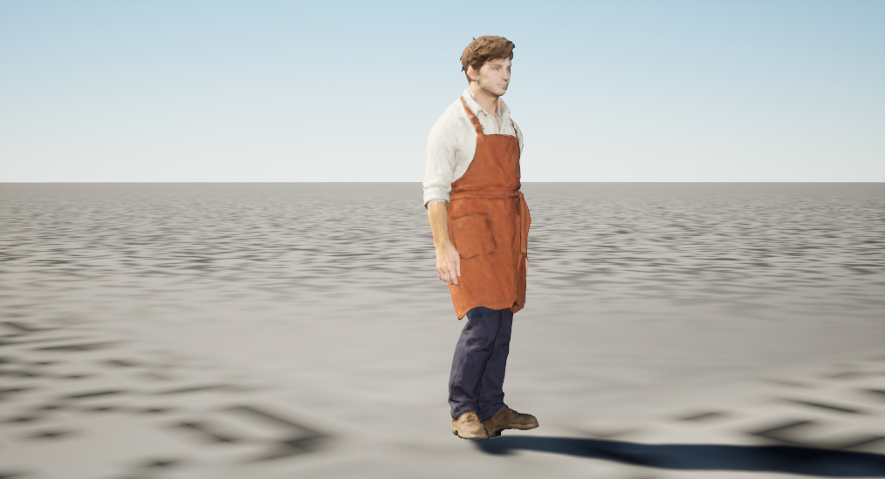 | 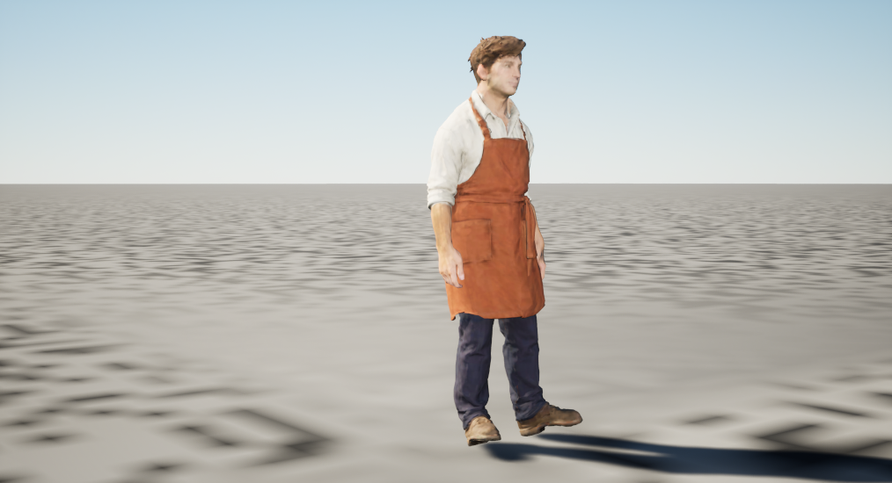 |

Animation-only import now saves exactly one new idle sequence on the qualified walk skeleton, preserving all seven original packages and the reference skeleton. No additional mesh, skeleton, material or texture is created. The native idle is **15.366667 seconds / 461 frames / 462 keys**; that native duration includes the timeline boundary difference from the portable first-to-last-key span. Independent reopening checks the eight-package closure and naturally plays idle and the original walk on one preview component, producing four held captures. Idle's later capture is reached through observed natural playback near **7.662 seconds**, rather than a time or bone update.

`native_character_idle_intake_actual_v1_003` completes the review in **62.468 seconds**, peaking at **5,350,170,624 private bytes**. It reuses v002's successful animation-only Author packages without another import or save. Exact viewport, actor, selection and background state restoration passes; the effective realtime flag settles back to its original false value after five observed engine-frame advances. The earlier v002 review remains failed at its immediate restoration check, and v001's unsupported transform-call failure remains retained. Source-preserved natural motion is selected as an intake stage only. These frames retain the original normal material; diagnostic floor/shadow contact, foot locking, transitions, final art, runtime resident replacement and game performance remain open.

## Saved new-rig avatar and measured fit

| Saved walk pose | Original idle at 8.1 seconds |
| --- | --- |
| 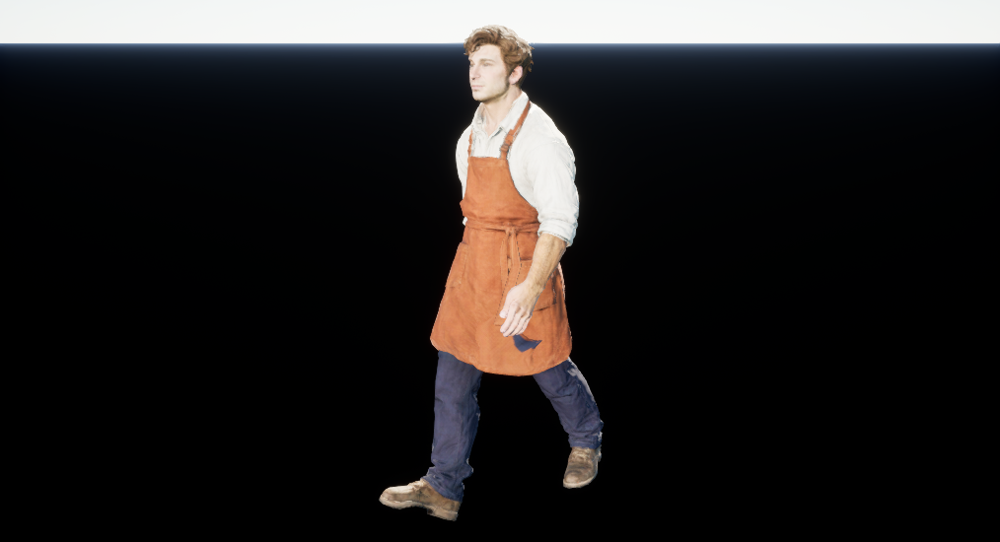 | 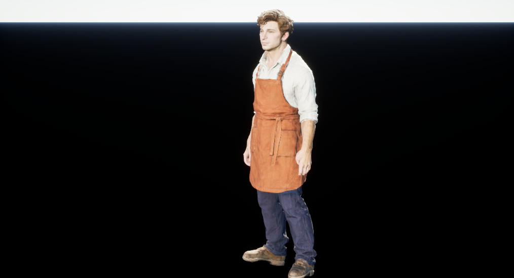 |

The native candidate now saves a mesh derivative with the reviewed face/central-neck material and a mesh-only palm socket, plus a native-built idle/walk BlendSpace. All **15 original packages** remain unchanged. The actual cold material is a `UMaterial` with skeletal-mesh usage already enabled; no usage repair or original material save is needed. Source and derivative reference/render/skin fingerprints agree, and independent reopening preserves the two new assets. The public runtime sampler verifies idle/walk weights at 0, 90 and 180 cm/s.

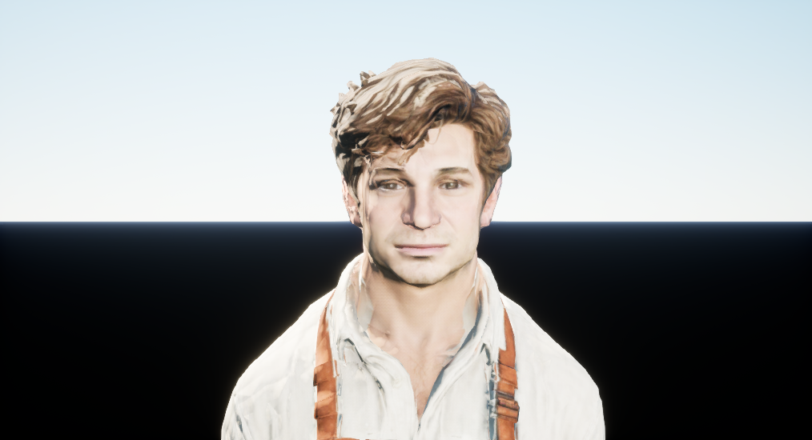

Explicit native evaluation records **561 key/blend poses** with all 10,707 posed vertices, 61 bone transforms and the palm socket. These are diagnostic editor evaluations, separate from natural playback. Root independently replays all compressed observations and matches the recovered metric file exactly. They confirm an idle pelvis lateral position of approximately **−22.47 to −22.30 cm**, versus **−4.11 to −4.09 cm** in walk at the authored 179 cm stature. The unchanged R28/H95 diagnostic capsule does not contain the idle head/torso envelope. A single fixed alignment candidate also fails across both clips. A qualified alignment strategy, new-family route/contact checks and interaction reach must precede live avatar replacement; the old 17-bone character's fit is not reused.

The later [native post-sampling adapter](native_root_correction.md) supplies that alignment without editing the original clips. Its complete 561-point paired proof passes, preserving non-root local transforms and matching the disabled/base geometry exactly. The corrected head/neck envelope fits the diagnostic capsule, while torso overhang and nominal-floor sole penetration remain measured limits. The separate 110 cm/s family, physical calibration and natural Game contacts remain open.

The successful review-only process takes **58.812 seconds / 6,469,951,488 peak private bytes**, reuses the saved packages and pose evidence, and captures the three views above. One restoration application followed by read-only observation at **30 actual engine frames** verifies exact viewport, CDO, AA/streaming settings, selection and actor restoration. Earlier whole-review and private-cache-path failures stay failed. Source/package guards pass and owned processes are reaped. Evidence is `native_character_runtime_replacement_actual_v1_001/Author`, `native_character_runtime_replacement_recovery_actual_v1_001`, and `native_avatar_review_actual_v1_003/Reload` under the existing F-drive root. The root decision is `root_native_review_acceptance_v1_001/avatar_cold_ROOT_VISUAL_REVIEW_v003.json`.

Root selects the saved asset/material/socket/sampler stage only. Hair edges and pale patches, eyes, neck shading, fabric finish, continuous motion, ground contact, final art and Game integration remain held. The black preview background supplies no contact evidence.

## Controlled native surface diagnosis

| Original EV11 lighting | Same material at EV13 |
| --- | --- |
| 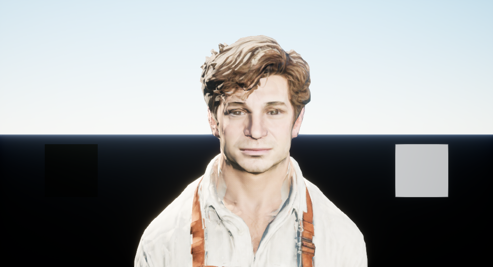 | 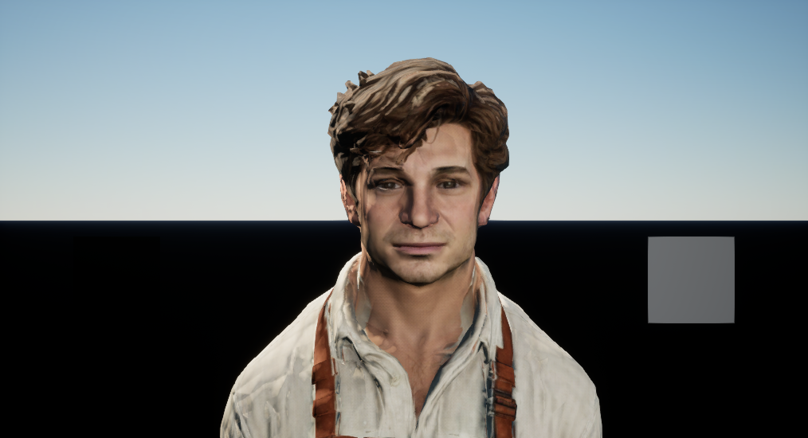 |

Seven matched native views hold the idle pose, camera and source assets while comparing EV11–14, a flat tangent normal, an unlit BaseColor control and the original baseline return. EV12–13 preserve more face and brown-hair color; EV14 is too dark for this presentation. The unchanged-EV11 flat-normal control reduces harsh face, neck and hair breakup, while also removing intended fine relief. It is diagnostic, not a selected replacement material. Hair protrusions, eyes, fabric finish and remaining neck defects still need refinement.

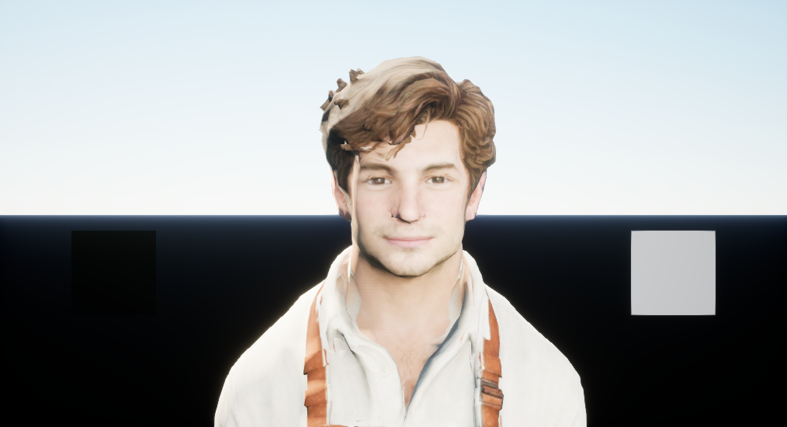

Actual material-function consumer readback confirms blue to Metallic and green to Roughness. The return frame is visually stable, with mean absolute RGB8 difference **0.0746** and p95 **1**. The unlit EV0 image is nearly white and supplies no readable albedo evidence; its underlying control needs correction before attributing surface defects to BaseColor. Original maps are not darkened to compensate exposure. The cards document rendered values without claiming photographic calibration.

`native_surface_diag_actual_v1_002/Reload` takes **109.219 seconds**, peaks at **6,214,639,616 private bytes**, preserves all original packages and restores viewport, CDO, AA/streaming, actors and selection after **51 observed engine frames**. No assets are imported or saved; owned processes are reaped. The root diagnosis is `root_native_review_acceptance_v1_001/character_surface_ROOT_DIAGNOSIS_v001.json`. The earlier metadata-discovery failure remains failed. Final art, continuous contact and Game adoption remain open.

The isolated follow-up makes the BaseColor control readable. It disables the owned lights and atmosphere, bloom and lens flare, and uses zero exposure bias. EV0 shows brown hair and readable skin/clothing without white clipping; EV2 gives the expected darker response. Both control changes are retained, so this does not isolate a single cause of the earlier whiteout. The diffuse card is black, while the 0.18 emissive card measures approximately RGB8 **99.8 / 31.3** at EV0/EV2. These values do not establish photographic calibration.

| Isolated BaseColor, EV0 | Flat-normal diagnostic, EV13 |
| --- | --- |
| 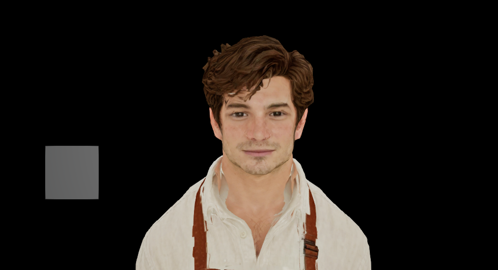 | 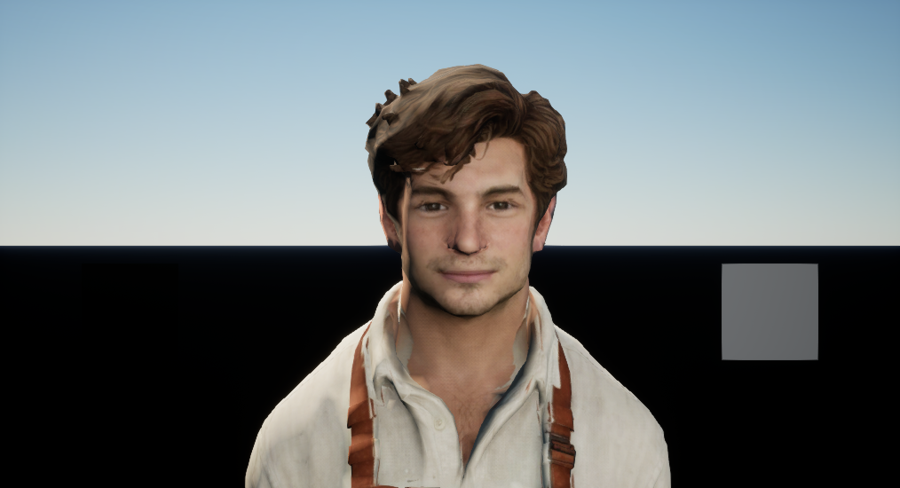 |

At matched EV13 the original encoded normal alone worsens facial breakup relative to the reviewed confidence blend. The flat-normal view reduces pale hair ridges and neck breakup, but also removes intended relief. The next refinement uses explicit moderate normal strength rather than repainting the albedo or replacing all normals with flat values. Hair silhouette spikes, eye anatomy, physical material finish and contacts remain separate work.

`native_surface_follow_actual_v1_001/Reload` passes in **96.297 seconds / 6,134,849,536 peak private bytes**, with no imports or asset saves. The returned EV13 baseline has mean absolute RGB8 difference **0.00001375**, p95 **0**, and exact temporary-state restoration after **46 observed engine frames**. Root reviewed all six views; its decision is `root_native_review_acceptance_v1_001/character_surface_isolated_ROOT_DIAGNOSIS_v001.json`. Original source packages and the earlier invalid control remain unchanged.

### Saved moderate-strength candidates

| Reviewed confidence normal | Strength 0.35 derivative |
| --- | --- |
| 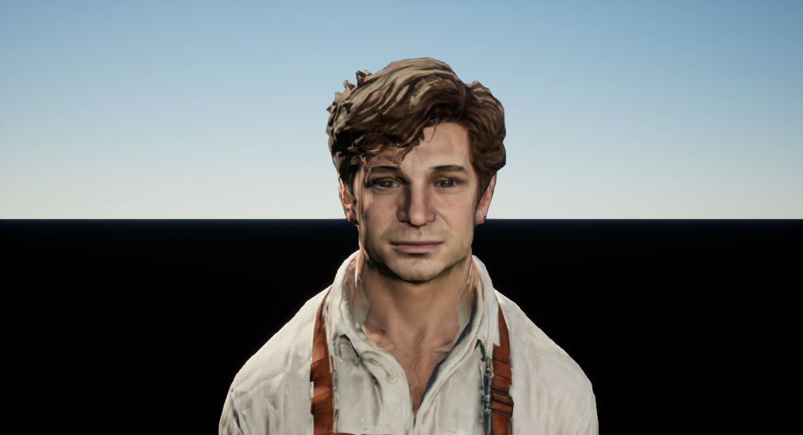 | 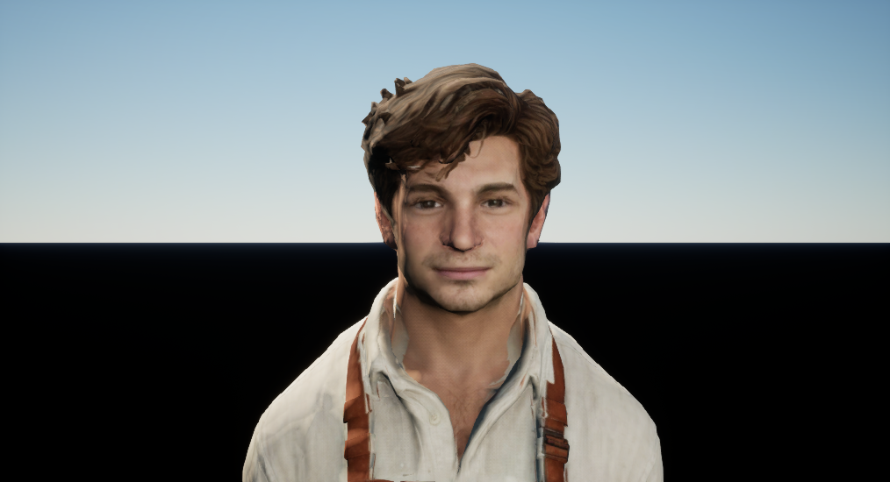 |

Two explicit native material derivatives retain the source PBR graph, maps, UVs, confidence blend and single green conversion, then apply `normalize(lerp(float3(0,0,1), normalize(reviewedNormal), strength))` at strengths **0.35 / 0.6**. Independent reopening checks each saved material's actual class, skeletal usage and whole graph before loading a mesh. Original 17 packages and mesh material slots remain unchanged; preview assignments use temporary component overrides.

Root selects **0.35 as a bounded face/hair/neck improvement**: pale ridges and harsh breakup are reduced while relief and source color remain. The 0.6 candidate retains stronger ridges. Visible shirt/apron detail is softened, but the [body comparison is cropped at the crown and feet](evidence/cafe_worker_v002_strength_body_035_cropped_v001.png). These views cannot approve the entire character. A separate front/three-quarter/back review must fit all native posed vertices within the frame. Hair silhouette, eyes, hands, the dark apron-hem notch and physical contact remain open.

`native_normal_s_actual_v1_001` passes Author in **54.047 seconds / 5,804,150,784 peak private bytes** and cold Reload in **63.000 seconds / 5,864,562,688 bytes**. Root reviews all seven final images. The baseline return is stable, with RGB8 mean absolute difference **0.0656**, p95 **1**, and exact state restoration after **50 observed frames**. Processes are reaped and source assets remain unchanged. Empty compile diagnostics alone do not prove a nonnull native material resource; saved/cold graph checks, the loading barrier, actual rendering and engine-log guards provide the recorded evidence. Root decision is `root_native_review_acceptance_v1_001/normal_strength_ROOT_VISUAL_REVIEW_v001.json`; Game adoption and final art remain held.

### Complete framing review

| Front, strength 0.35 | Three-quarter | Back |
| --- | --- | --- |
| 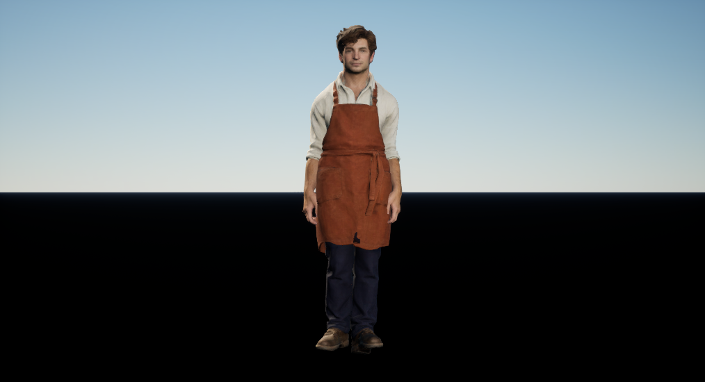 | 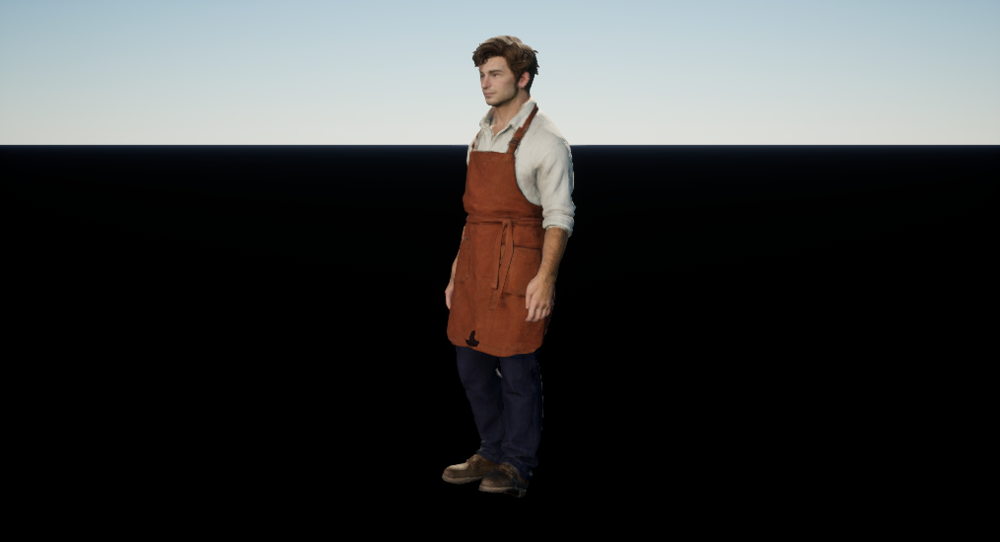 | 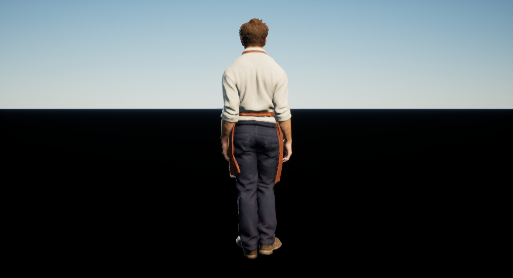 |

A later read-only review fits all **10,707 actual posed vertices** inside the central 88% of the supported perspective projection model before each capture. Actual viewport size, camera, FOV, aspect-axis policy and absent pilot actor are checked. Root sees complete head and feet in all three directions and selects 0.35 as a bounded material candidate. Back-of-shirt and trouser relief is softened, so garment finish remains open. The direct renderer projection matrix and nearplane are not observed; the geometric model and actual rendered coverage are recorded separately.

`native_body_review_actual_v1_002/Reload` passes in **87.453 seconds / 6,201,470,976 peak private bytes**, reusing the exact 19 packages without authoring, importing, recompiling or saving assets. Seven images include source/candidate pairs and a stable baseline return: RGB8 mean absolute difference **0.0544**, p95 **1**. Exact restoration follows **47 observed frames**. The first attempt remains failed before any image because the settings class lacks a Python symbol; the retry reads the exact existing native CDO/property through supported reflection. Root decision is `root_native_review_acceptance_v1_001/complete_body035_ROOT_VISUAL_REVIEW_v001.json`.

The extracted [complete-character framing utility](character_framing.md) now lives in the repository. Thirteen synthetic tests pass on Python 3.11 and 3.12; a separate host replay exactly matches all seven original pose/fit records and 42 before/after capture states. This validates the extraction against retained receipts. The new module itself still needs binding and execution in any native adapter that adopts it.

Hair silhouette, eye/hand anatomy, animation/contact and the dark apron-hem notch remain open. The notch is an observed appearance issue, not established missing topology: the ongoing source audit finds opaque brown triangle hits there. No geometry is filled on that assumption. The black review background supplies no floor-contact evidence.

| Lit hem close-up | Isolated BaseColor control |
| --- | --- |
| 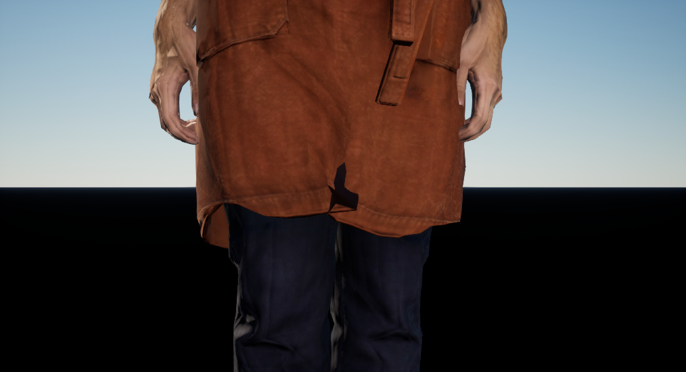 | 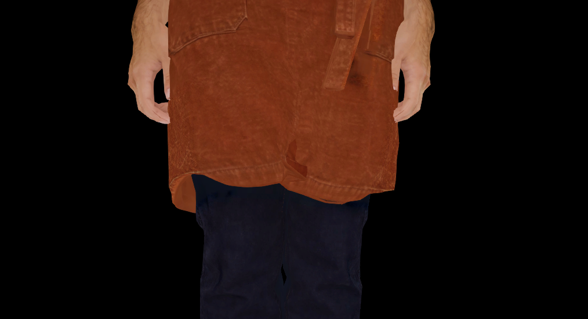 |

The same geometry shows brown folded cloth in the isolated Unlit control. Strength 0.35 does not remove the dark fold under the original lighting. Source analysis finds opaque brown triangle hits at all 77 inspected dark pixels, with no low-poly boundary at that hem. Seam splits limit source/native UV identity claims. These observations do not justify filling a supposed hole; lighting, normal response, occlusion and shape finish need separate assessment. The combined Unlit setup does not isolate one lighting cause.

`native_hem_control_actual_v1_001/Reload` passes four views in **73.407 seconds / 6,137,229,312 peak private bytes**, preserving all 19 packages without original recompilation, import, save or repair. The returned baseline has RGB8 mean absolute difference **0.0636**; state restoration and owned-process cleanup pass. Root decision is `root_native_review_acceptance_v1_001/hem_ROOT_DIAGNOSTIC_REVIEW_v001.json`. Final garment finish remains open.
