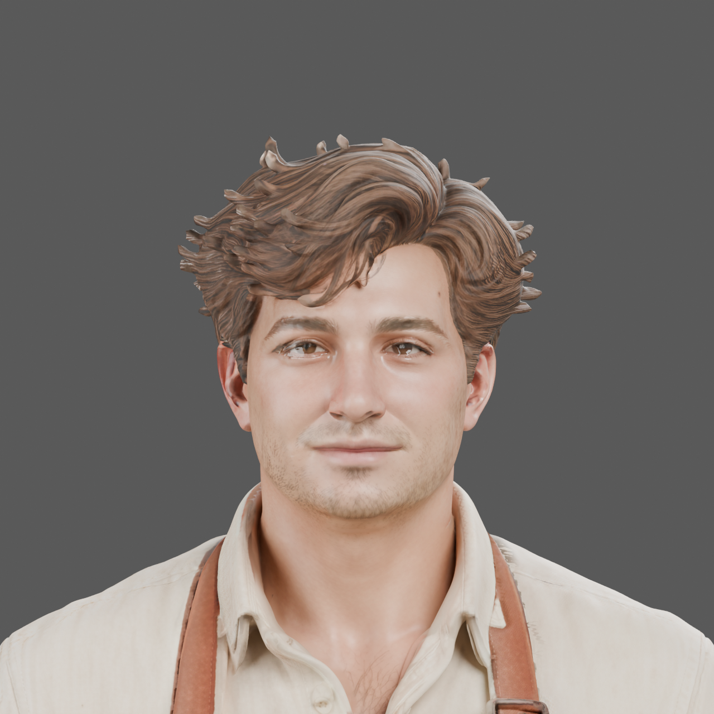

# Breton cafe worker: source model review

The selected [front concept](concepts/cafe_worker_breton_v001/README.md) now has an archived Tripo Studio H3.1 source candidate. Its fabric, stitching, collar, pockets, waist knot and shoes are visible in actual Blender Cycles/HIP renders. The candidate is held for refinement before final rigging or runtime adoption.

## Source and measurements

The original Studio GLB is retained locally as `cafe_worker_breton_v001_studio_original.glb`, 73,311,132 bytes, SHA-256 `b9f1abeb198adf6536439a9383bb03eefc2fbd449db60796cec1dfe93d2cb875`. This commit contains the reference and review images; it does not include the large GLB or claim an engine-ready asset release. Studio asset identity is `801bf01e-5be6-45bf-87a1-1664f51512a1`. Generated-source provenance is recorded; no CC0 claim is made.

Read-only GLB inspection measured one mesh/material, 991,378 vertices and 1,928,055 triangles, with no exact degenerate or near-zero-area triangles under the inspector's stated calculation. The source has no skeleton or animation clips. These are source facts, not topology, deformation or art acceptance.

| Map | Actual encoded image | Size |
| --- | --- | --- |
| Basecolor | JPEG, RGB8 | 8192 × 8192 |
| Metallic/roughness | JPEG, RGB8; glTF G/B links | 4096 × 4096 |
| Tangent normal | PNG, RGB8 | 4096 × 4096 |

The three embedded image payloads were extracted without resizing, re-encoding or channel changes. Blender's packed-image hashes match the original payloads; basecolor reads as sRGB and normal/metallic-roughness as Non-Color. Imported vertex and triangle counts match the source. Original GLB and review Blend hashes remain unchanged through the later view renders.

The source height is approximately 0.97946 glTF units; physical stature is unqualified. An unapplied parent scale of 1.8275345069 gives a nominal 1.79 m review figure. That is an explicit staging choice, not a calibrated source measurement.

## Visual hold and next work

- Correct the conspicuous white crescents beneath the lower lids and irregular eye-opening highlights. Determine the geometry, texture and shading contributions on the mesh before editing.
- Verify independent digits and anatomical joint/tip forms. The hand views show flattened, tightly stacked fingers; they do not prove welded topology.
- Refine the heavy parallel hair grooves and blunt pale spikes while retaining the broad hairstyle.
- Reconstruct the rear garment as a conventional front bib apron with waist ties and visible rear trousers. The generated rear currently reads as a closed skirt.
- Derive and compare runtime topology/LODs, freeze UVs and perform any required texture/normal rebakes before final rigging. Then verify distinct idle, walk, use, eating and sleeping actions with actual deformation and contact.

Six actual GPU images cover front, three-quarter, rear, face and both hands. The initial multi-view process completed the front image and failed with an out-of-memory error on the next render. Five fresh, single-view processes subsequently completed and reaped successfully, with sampled private memory below 5.09 GB each and a 6 GiB hard job limit. Each selected Radeon 8060S HIP with CPU ray-tracing disabled; this is authoring evidence, not game performance or a system-stability guarantee. The failed attempt remains recorded.

No new resident appearance, skeleton, clips, engine binding or qualification flags have been promoted. Continue through the [staged asset pipeline](staged_asset_pipeline.md).

## Local material correction

Source-map sampling found ordinary skin basecolor beneath the bright lower-eye crescents, but very low roughness: the sampled right lower-orbital vertices had median roughness 17/255, compared with 99/255 nearby. A feathered local mesh attribute now raises roughness to at least 0.38 and suppresses metallic response in those skin bands. The same camera, lighting, 1280-square resolution and 64-sample HIP render remove the broad pale crescents. Eye-opening anatomy, iris clarity and the other geometry defects remain under review.

The diagnostic affects 2,658 vertices (1,394 at full weight); it is a local spatial mask, not a complete anatomical segmentation. Position, topology, corner normals, UV and packed-image hashes match before and after. Source Blend size, modification time and hash are unchanged. A new derivative Blend preserves the original separately. The successful worker took 24.641 seconds, exited with code zero, reaped its owned processes and peaked at 5,533,831,168 sampled private bytes under the 6 GiB limit.

This correction currently uses a Blender point attribute and shader nodes. A portable PBR export still needs an explicit bake and UV/texture review; an ordinary GLB export is not proof that the correction transfers.

The repository [Blender diagnostic script](../../tools/asset_refinement/blender_orbital_skin_diagnostic.py) reproduces the correction from the explicitly hashed source review in a fresh output directory. Its separate hardware run completed in 24.141 seconds with unchanged source and mesh/map invariants, exited with code zero and reaped all owned processes. It is specific to this source family and runs under an external resource supervisor; it does not supervise other applications.
