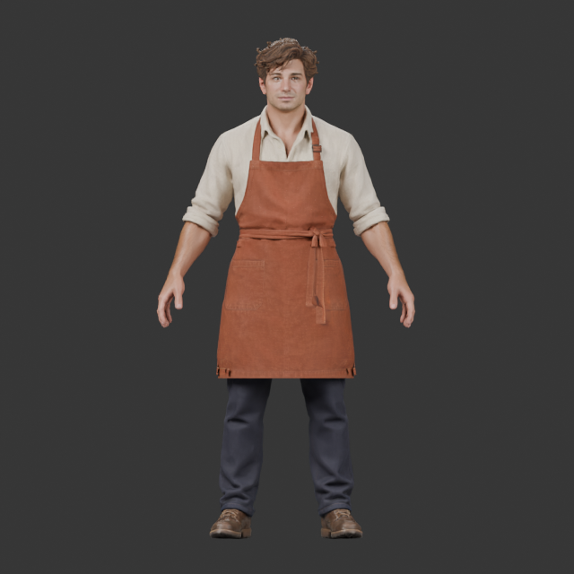
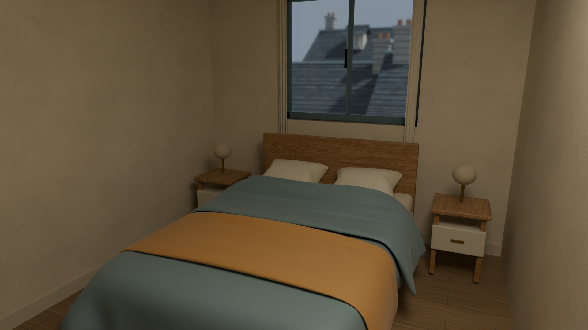

# Character pipeline and local asset checkpoint

Updated 4 November 2026. The full [town roadmap](../active-town-roadmap.md) remains active. The [evidence index](evidence/character_pipeline_convergence_20261103.json) binds the local reviews and two inspection images below. It indexes evidence; it does not bundle the Blender masters, native projects or complete test output.

The main bottleneck is assembly coherence and suitability for animation. Local refinements have often improved one part while weakening the complete person. More texture generation, isolated portraits and exhaustive transport tests cannot resolve that relationship. Progress means a visible defect removed from the consuming character, or a necessary boundary closed so that the next visible test can run.

## Preserve the stronger whole character

The original Tripo worker is the visual baseline: adult facial character, loose asymmetric hair, warm skin and coherent linen/rust workwear. This actual inspection render shows the retained source appearance; the new native resident has not been adopted into the game.

The functional CC0 head demonstrated mouth opening, internal anatomy and central blink closure. Its whole-character trial nevertheless exposed a jagged neck gap, younger narrow face, cap-like hair and pale smooth skin that clashed with the arms and clothing. That replacement route is stopped. Fixing its attachment would not resolve the style mismatch. The anatomy remains a development reference.

The original generated face lacks an established facial rig or morph set. Its 38 near-lip boundary edges form two open chains rather than a verified bounded oral aperture. A jaw displacement cannot be assumed to produce a usable mouth. A fitted functional cage now demonstrates coarse jaw and blink feasibility; projection recovers useful original skin, stubble and iris appearance. These are local improvements, not an accepted replacement head.

Whole-person inspection exposed a more fundamental attachment problem. Trimming the donor's broad shoulder/chest patches restores the shirt silhouette, but old body skin still crosses the new neck and collar, leaving visible slivers and dark breaks. Source UV charts mix skin and clothing, so chart membership cannot define a clean anatomical boundary. Stop the per-piece/chart-cutting family. The next facial assembly needs one continuous neck surface and an explicitly repaired garment boundary, reviewed with the original hair and body before further expression, export or LOD work. Preserve the useful fit and bakes.

## Repeated defects and process changes

| Observed pattern | Evidence and cause | Decision |
| --- | --- | --- |
| Isolated improvements weaken the complete person | The replacement passed functional checks but lost the original identity and material coherence in full-body views. | Approve the neutral whole character before polishing expressions, attachment or transport. |
| More maps produce worse skin and hair | Mixed normal maps added pockmarks/coarse neck creases and a wrinkled hair cap despite adequate visible texel density. | Stop that family. Check map meaning, UVs, tangent basis and actual appearance before adding detail. |
| Surface patches cannot supply missing anatomy | The earlier mouth annulus crossed unrelated atlas charts; the reduced face lacks established lip/lid loops. | Use coherent retopology, projection, baking and rigging; preserve identity. |
| Skeletal weights cannot make a loose apron behave as cloth | Kinematic idle/walk still exposes leg penetration. Offline construction does not prove native simulation. | Use a separate garment with pins, tethers and collision; verify actual chronological playback and particles. |
| Engine errors are mistaken for source defects | The glTF route lost influences; actual FBX retained geometry/UVs and full weights. Later observations isolated sampling and compression loss. | Correct the failing transport boundary before modifying source proportions or weights. |
| Numerical success is mistaken for appealing art | Point-contact checks missed bedding triangle crossings; a contact-safe fallback looked rigid. Exact arrays did not certify the portrait. | Keep visual and data decisions explicit. Stop repeated unsuccessful families and reconsider source or representation. |
| Repeated neck cuts trade one join defect for another | Atlas charts and disconnected source pieces do not correspond to complete skin/garment regions. | Repair the continuous surface and collar boundary once; do not produce a third equivalent mask variant. |
| Diagnostics become a second production line | Observer, selection, pose-frame and attribute-contract errors created false failures and repeated handoffs. | Fix and reuse the observer. Keep detailed receipts in artifacts; use only the evidence needed for the next decision. |
| Successful integration tests conceal a broken rendered scene | The actual pawn walks and saves correctly, but the gameplay captures show the HUD over black 3D. The initial screenshot also came from an Editor viewport. | Check the consuming camera, lighting and screenshot ownership before changing textures or geometry. A green route test does not certify visible presentation. |
| Correctly bound textures appear as checkerboards | The independent world was alive, but authored material resources were not ready for the early capture. One stock loading barrier took 19.32 seconds and restored source appearance with identical bindings. | Use explicit shader/asset/texture readiness before judging material quality; elapsed time and asset paths alone are insufficient. Measure cold preparation separately from steady gameplay. |

Use small material/mesh smoke checks or informative poses to diagnose one uncertainty. Run comprehensive qualification before adopting an acceptable candidate, reusing evidence for unchanged geometry/rest/weights. Visible defects and measured runtime cost take priority over subpixel discrepancies.

For each change, record one baseline, one named visible defect, one hypothesis, the changed representation and the acceptance view or action. Compare the assembled character at the same camera, light and pose. After two attempts retain the same defect, stop that approach and reconsider the source or representation. A new filename is not a new hypothesis. Visual review and data fidelity remain separate decisions; neither replaces the other.

Assign tools to stable responsibilities in this project. Tripo supplies coherent candidate forms and appearance; Blender owns the accepted source topology, semantic surface boundaries, UVs, bakes and rig. Unreal owns the consuming pawn, cloth integration, distance policy and runtime measurement. A new generated part must earn its place in the same assembled character before downstream work. Defer character-variant/customization systems until one resident meets those requirements; multiplying unqualified parts would multiply the current defects.

## Unreal transport and cloth scope

Actual FBX corner/skin inspection accounts for visible triangles and UVs, up to seven body influences, and 61 original bones plus an explicit unweighted wrapper. It does not qualify general rigid-body physics or retargeting.

Across 1,062 idle/walk observations, authored 30 Hz import removes the raw half-key discrepancy: maximum raw body error is about 8.82 micrometres. An owned ACL precision setting reduces the earlier 13.56 mm compressed error to about 0.40 mm, which still fails the unchanged 0.10 mm reference budget. The refusal is retained. Local quaternion observations near 180 degrees are consistent with drop-W reconstruction conditioning; threshold sweeps are parked. Runtime acceptance needs actual camera/pixel and performance evidence separately.

One actual reference-pose test validates the original five capsule inputs through public collision extraction and component transforms. Subsequent native chronological playback exposed the hidden kinematic navy support crossing the visible apron. This was an envelope mismatch, not a blue-texture defect. A four-piece convex support and sixth pelvis capsule remove the troublesome front-walk exposure; all twelve native views were reviewed. Five complete published cloth meshes have no support intersections, with minimum separation about 3.108 mm. Original clips and skeleton remain unchanged.

This permits controlled runtime integration. Back/side waist notches, banded initial reference-pose captures and up to 0.796 mm penetration into the added pelvis capsule remain disclosed. Do not run more capsule, compression or capture grids before exercising the actual pawn, initialization and cost.

The opt-in C++ assembly now builds for both Editor and Game targets. One actual Unreal MCP factory call saves an owned body/socket copy, two clips with constant unweighted-wrapper offsets, and their idle/walk BlendSpace. All eighteen source packages and the original sixty-one animated bone tracks, curves, attributes and timing are preserved. The built sampler returns idle/walk weights of 1/0, 0.5/0.5 and 0/1 at the three checked speeds. The factory's original descriptor bytes identify this four-asset preparation; a reformatted diagnostic mirror is not substituted for that identity.

Compilation and Editor asset preparation do not establish cold loading, movement, cloth appearance, cooking or frame rate. The first two-test host failed its strict clean-run check because a test sentinel mesh lacked a Skeleton. That original failure remains unchanged. The necessary scene-lighting revision also repairs this fixture: both Editor and Game targets now compile, and the same two no-asset tests pass with zero test warnings. The lifecycle test additionally registers for client context, but actual lifecycle execution remains a separate requirement.

The first runtime trial uses an explicitly uncooked Editor/PIE consumer. Stage the complete twenty-two-package character closure, including the string-loaded support, cloth and physics packages. Derived body/animation dependencies alone do not guarantee those packages enter a future cook. The existing lifecycle test is Editor-context only and uses a temporary second pawn; it cannot establish an ordinary `-game` test result or same-pawn movement by implication. Report those boundaries separately.

The first cold consumer now passes: all twenty-two character objects reload in a fresh process, and the existing Ben pawn completes the actual WorldV3 refusal journey. It records 101 natural movement observations and about 507.223 cm travelled, reaches the counter without a meal provider, and produces the paired V4 save. The single automation case succeeds with zero test warnings; the owned Unreal process exits with code zero and no remaining children. This is Editor-hosted PIE integration on the AMD 8060S/D3D12 path. No visual, physical-eating, packaged-game or frame-rate acceptance follows from it. The next observation is the existing gameplay camera during that route.

That visual observation exposed a consuming-scene failure: walking and counter-stop captures contained the actual café HUD over black 3D. An accepted unlit gameplay-view control revealed the textured café and original worker through the same camera, isolating the illumination/render environment. The production venue built mesh parts without the preview's lights. A three-file source revision adds venue-owned lighting only for the validated original-worker opt-in, plus the known fixture/context corrections. Both targets compile; actual normal-lit images now show the café and worker. The same twenty-two character packages and original descriptor are reused. This is a scoped café visibility repair, not the final town environment. The string-loaded engine ambient cube is an explicit additional future cook dependency.

The unlit control also shows garment breakup over the back/thighs at about 0.467 seconds during early walking, and the HUD covers the character's head at this viewport size. Hold visual acceptance. One startup image does not establish persistent cloth failure; retain the existing garment/support and inspect later natural motion after illumination is repaired. The control's original host failure is retained: its reader searched uppercase strings in a casefolded log. A corrected closed CPU reader validates the existing mode acceptance/query, dimensions, source custody and successful route without rerunning Unreal.

The normal-lit route produced three useful images. At two seconds the room materials and worker's back silhouette are readable; the early garment breakup is less apparent. The immediate counter-stop image has severe whole-body noise/ghosting after the test's in-place turn, so it cannot qualify the character. The strict four-phase capture host fails because no ready prewalk IDLE image was available. Preserve that failure and admit the three images only for their actual scope. Do not force an initial pose or change cloth, textures or render settings to manufacture a missing phase.

The attempted post-test settled image exposed a separate lifetime error. The automation controller requests `EndPlayMap` after its final result; removing `TestExit` keeps the Editor process alive but does not retain the gameplay world. The observer then silently waited because it looked for a world before latching completion. Root stopped the owned process and retained the failure; no settled image exists from that attempt. Stop this test-derived presentation approach. Unit tests retain their assertion scope.

An independently started ordinary PIE session now verifies the actual standalone WorldV3 mode, local controller, Ben and new body mesh, retaining the same identities for three natural and wall seconds. Its first image showed gray checkerboards despite correct bound material paths. A single `AutomationLibrary.finish_loading_before_screenshot()` call then completed transient shader/asset/texture work in 19.32 seconds. After a fresh natural settle, the same café and worker display their source textures. Material bindings and the forced `ShowFlag.Materials` override remain identical before/after. No source asset, texture, camera or render-mode edit was needed. This qualifies stationary textured visibility; ordinary movement/turns, stateful lifecycle, FPS, cooking and final art remain open. The helper's explicit level-streaming flush does not apply to Editor PIE, so this is not a level-readiness certificate.

The old supposedly read-only `viewmode` query also reapplies its mode in engine code. The independent viewer removes it and records that correction instead of silently treating it as an observation. Initial settings-class lookup likewise uses its registered class path rather than assuming a Python alias. Fix observer contracts once and reuse them; do not convert their failures into character variants.

The initial normal IDLE image is separately rejected: its 705×464 dimensions differ from the requested 882×462 GameViewport, and it shows the Editor PlayerStart icon. `Shot` is a global request that an Editor viewport can consume first. Require actual render readiness, reject dimension mismatch and review the captured world/HUD; a later frame number alone does not prove ownership.

## Local interior improvement

Procedural bedding attempts were stopped after visible crossing/shape defects. Creator-published CC0 Bed #4 geometry from [NSN3D](https://nsn3d.com/bed4.html) supplies the selected draped forms; its bundled fabric images were excluded. The accepted material uses existing rough-linen maps under [Poly Haven's CC0 asset license](https://polyhaven.com/license).

The actual near model below retains soft folds, pillow forms and linen appearance in matched room/close views while reducing cloth from 111,744 to 48,000 triangles, about 57%. Its 18,000- and 6,000-triangle variants have portable roundtrip evidence. Runtime switching remains unverified. This local Blender result does not establish Unreal material parity or frame rate.

The portable export preserves the accepted dye/UV/PBR appearance through explicit serialization and actual roundtrip inspection. One coupled duvet/throw correction passes all six local views. Freeze that local family. Engine adoption, collision/navigation, room decoration/lighting, wider interior variety and performance remain open.

## Completion sequence

1. Use the cold-loaded existing WorldV3 Ben pawn with the retained original appearance. Review idle, walking, turning and stopping with the actual camera, floor contact, hair, collar and apron together. The initial cold configure/movement/refusal boundary already passes; add a visual observation without rebuilding that machinery.
2. Check possession, teleport/reset, counter refusal and paired saves. Measure loading and ordinary frame cost in a separate interval without diagnostic skinning or screenshot stalls. A compiled Game target or warm Editor capture is not a packaged-game performance result.
3. Continue one functional facial route independently. Approve the continuous neck/collar assembly, then neutral, blink and open/close/chew in whole-person context before final binding or export. The unfinished face must not block locomotion and performance feedback.
4. Finish one visible bite with real prop contact and authoritative consequences in that same consumer. A hand near the mouth does not prove eating.
5. Establish texture residency and distance tiers, then expand the roster and town. Record the requested narrated/subtitled walkthrough and derive its README GIF from that delivery.

The [native WorldV3 café adoption](native_cafe_world_v3_adoption.md) remains the merged gameplay baseline. This checkpoint does not close the broader roadmap or change the default presentation.
