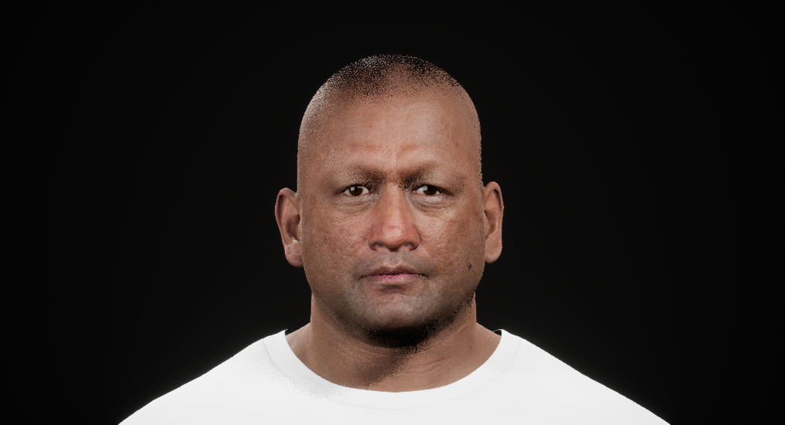
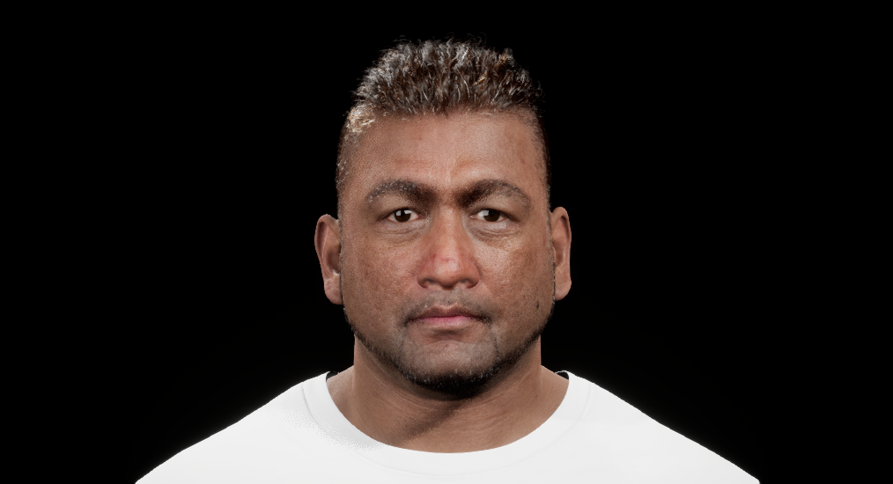
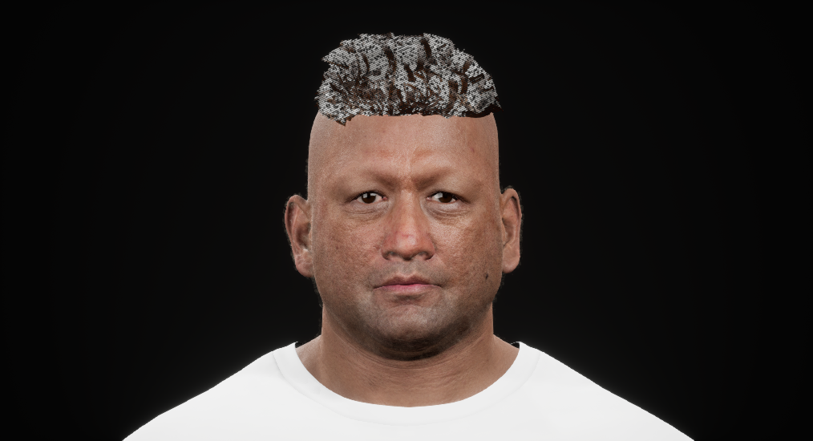
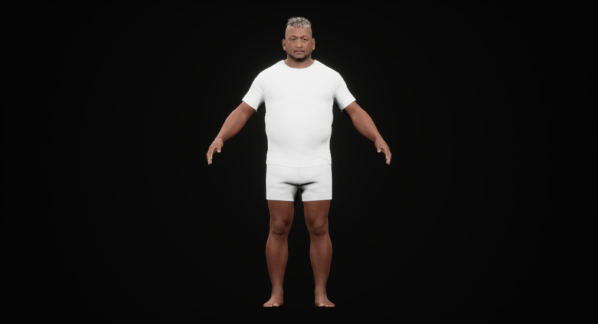

# Character review: fix the responsible stage before adding detail

5 November 2026 UTC. The [previous macro review](coherent_worker_checkpoint_20261104.md) stopped repeated neck, complexion and generic-hair patches. A new native MetaHuman trial now separates another recurring cause: a character can have detailed source assets and still look defective because its review camera or rendering representation is unsuitable. **The trial is not an approved café worker or a runtime replacement.**

## What the controlled views establish

The same complete native Dominic preset, skin, lights, pose and camera location produced the following live Unreal framebuffer images. Orthographic width was 70 cm; perspective FOV matched that width at the head plane. Each view settled for 32 actual Editor frames. Perspective changes apparent depth, so this is a projection comparison, not pixel registration.

| Orthographic strands | Matched perspective strands |
| --- | --- |
|  |  |

The difference is substantial. It establishes a projection-dependent rendering problem in this review setup; it does not establish an engine bug or its exact internal cause. A prior same-camera comparison also retained the artifacts in both high-resolution screenshots and the normal live framebuffer. High-resolution capture alone therefore does not explain them. Changing anatomy or generating another hair mesh would be the wrong next response to this evidence.

Forcing the existing vendor card representations was a separate experiment. Hair, eyebrows, beard and moustache each had five card descriptions with assigned meshes at LODs 0–4. Eyelashes had none; peach fuzz had no active card LOD. Only components with available card meshes changed. Character data, source groom assets, maps, lights and orthographic camera stayed fixed.

| Existing cards in orthographic view | Whole-person check with those cards |
| --- | --- |
|  |  |

**The card result is visually refused.** It restores volume but has an obvious checker pattern. The contribution of material bindings, texture sampling and lighting has not been isolated. A `use_cards=True` readback is not evidence of a finished card material, correct active LOD or better performance.

The whole-person view prevents a face-only decision: stock proportions, pulled-back hair, temporary white shirt/shorts and bare feet miss the café-worker concept. The adult facial structure and skin response are useful source-route evidence, but they do not approve identity, wardrobe or style. Keep the existing coherent Blender construction source and runtime fallback until one complete replacement is visibly stronger.

## Two different readiness failures must remain distinct

The camera observer initially required a unique public/native pose match immediately after piloting. All four public viewport cameras and the native camera still reported the same zero pose. The guard correctly refused this ambiguity. Installed engine source explains the initialization difference: `PilotLevelActor` sets the lock and only moves a perspective camera immediately; `TakeHighResScreenshot` explicitly calls `UpdateViewForLockedActor`. The repaired review uses that already-qualified native update path before live framebuffer capture and verifies the measured camera target. It retains the same unique identity guard and tolerances.

The projection run obtained both images and then failed its final release check because one helper call still assumed orthographic projection. Its failure is retained; the actual failure-cleanup receipt confirms exact original viewport restoration. A CPU regression using the actual perspective receipt reproduces the old refusal and verifies the corrected release. It also confirms that the four ambiguous zero cameras remain refused. The subsequent card/whole-person host completed all phases and normal restoration successfully. No rerender was needed merely to turn the projection run green.

Production assembly is a different missing boundary. The installed Core Data payload now passes all 1,816 Epic-manifest file checks, totaling 6,177,414,710 bytes. A separate complete character data asset was saved; no legacy head was grafted onto another body. Nevertheless, the actual subsystem reports **“Character is not rigged.”** Preview skeletal components are not proof of an assembled, exportable character. Epic requires a rig and downloaded texture sources before assembly, and provides UE Optimized separately from UE Cine. [Epic assembly documentation](https://dev.epicgames.com/documentation/en-us/metahuman/assembly).

Embedded PNGs extracted earlier from preset packages are UV texture images, not rendered preset thumbnails. Their old extraction label is corrected in the evidence interpretation; they cannot support a likeness or appearance decision.

## Apply the macroscopic correction

| Repeated pattern | Responsible stage and next decision |
| --- | --- |
| A local improvement leaves the person generic | Review the clothed whole person beside the concept first: adult facial forms, hair mass, proportions, garment silhouette and palette. Stop unsuitable source families before texture finishing. |
| Hair seems sparse or broken, prompting more strands | Verify the consumer camera, source representation and material together. This trial requires a useful orthographic/card solution; the perspective improvement does not repair the town's other views. |
| A successful import, toggle or screenshot becomes “quality” | Report transport, visible art, action behavior, production assembly and runtime cost separately. None substitutes for another. |
| Review automation causes another asset iteration | Initialize and observe the actual camera before evaluating the asset. Preserve failures; reuse valid observations without rerunning unchanged geometry or completed exports. |
| A preview is treated as a finished resident | Prove assembly viability, then one clothed walk/turn/stop/reach interaction with contacts and apron behavior. Measure loading and CPU/GPU frame cost in the consuming scene before multiplying residents. |

The next character deliverable remains **one recognizable, fully dressed café worker**, with an appropriate hair representation in its real cameras. Necessary source changes are allowed; preserving a generic shape is not the objective. Tripo, Blender and native Unreal tools should each address a named missing part rather than regenerate the whole asset whenever a downstream symptom appears. After two attempts retain the same defect, change the diagnosis or method before another variant.

## Evidence and scope

The [evidence index](evidence/character_representation_review_20261105.json) binds the actual images, source checkpoint, manifest verification, completed hosts, failed controls, cleanup and observer regression. The native card/whole-person host completed in 93.907 seconds on Radeon 8060S, D3D12/SM6, with two shader workers, peak private memory 13,895,323,648 bytes and peak RSS 10,060,623,872 bytes. Its owned process tree was stopped and reaped; source, canonical project and checked global custody pass. These are review-process measurements, **not gameplay FPS, loading time or a crowd budget**.

MetaHuman uses Epic's license and is not CC0; Epic permits use with other engines/software under its terms. This checkpoint publishes rendered review evidence, not the downloaded raw asset payload. [MetaHuman licensing](https://www.metahuman.com/license).

No character/pawn adoption, final hairstyle, cloth simulation, eating/sleep behavior, engine-agnostic export, packaged-game performance or final walkthrough is claimed. The town's interior, terrain, vegetation, reserve, broader gameplay and presentation work remains open. README media is unchanged.
