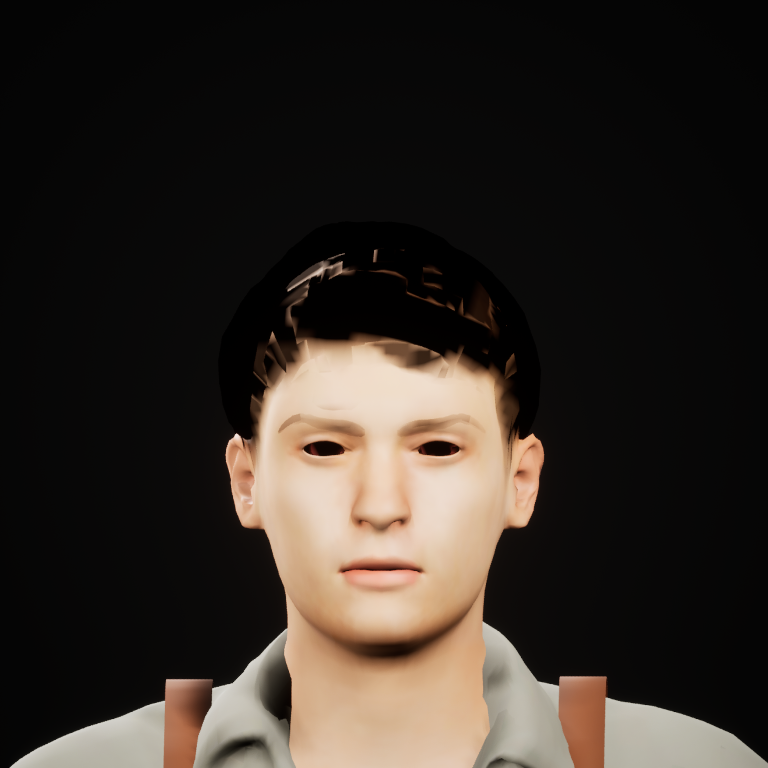
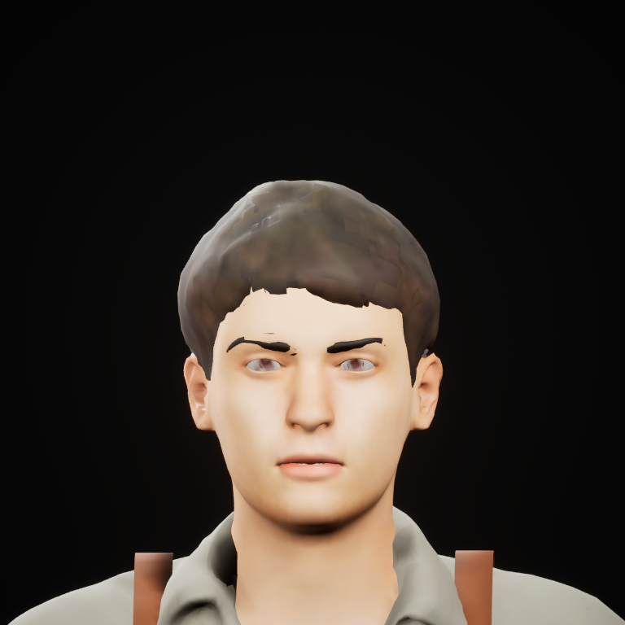
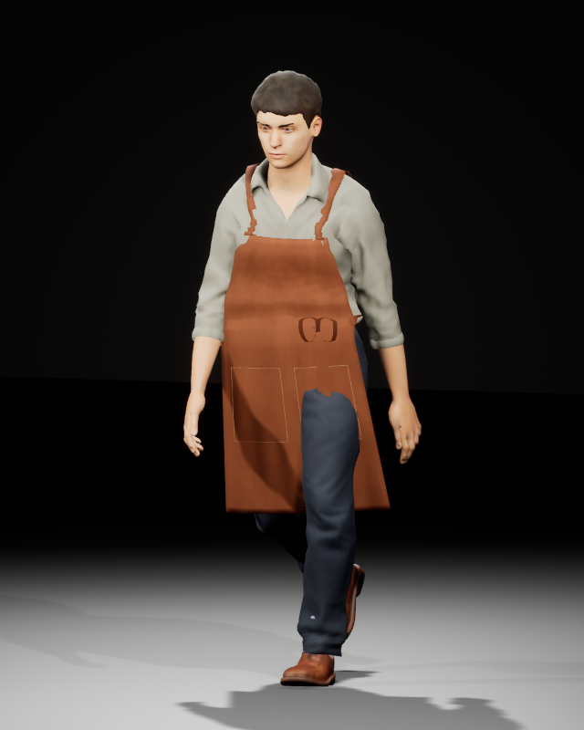
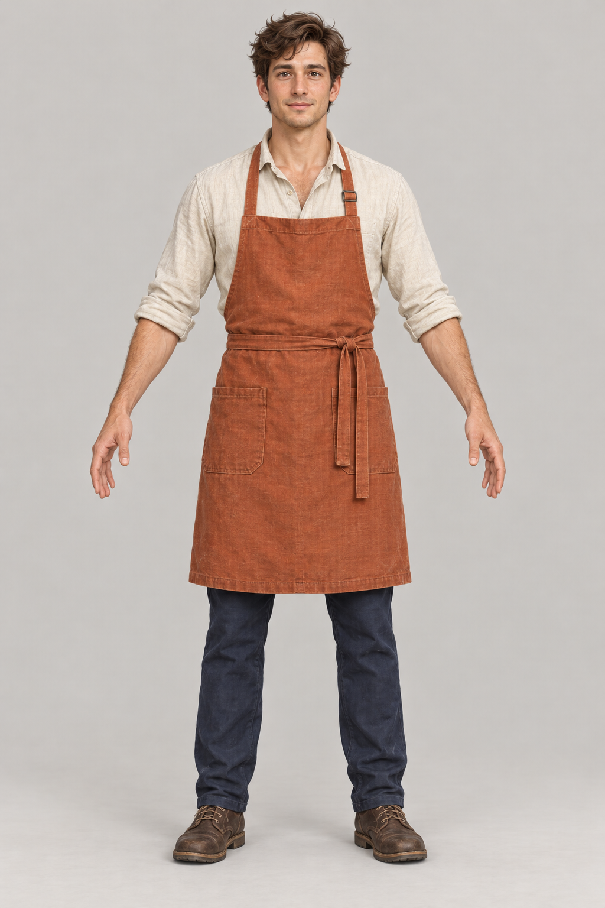
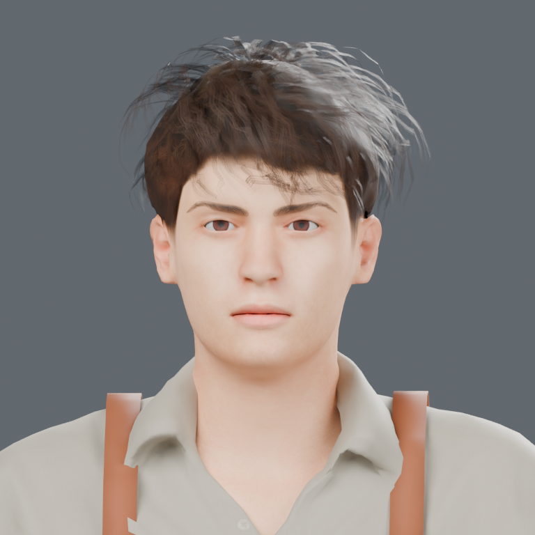

# Character modelling: the next unit of progress is one credible person

4 November 2026. **Technical transport has advanced; character appearance is still unapproved.** The coherent worker now opens in a separate, cold-loaded Unreal review scene. The latest appearance candidate is rejected. Neither result replaces the existing café pawn or completes the town roadmap.

The [5 November representation review](character_representation_review_20261105.md) adds actual native whole-preset, projection and card controls. It distinguishes camera readiness from rendering and assembly readiness; the trial remains unapproved as a replacement. The construction and transport findings below remain retained.

## The recurring failure is choosing the wrong next problem

The repeated defects are related, but they do not all belong to textures. A skin atlas cannot repair competing neck surfaces. A darker complexion cannot supply an adult facial structure. Bone weights cannot make a loose apron simulate. A faithful export cannot make a generic person match the concept.

Three broader causes recur:

1. **The whole person is reviewed too late.** A locally useful face, garment or expression is treated as progress before its effect on identity, silhouette, contacts and motion is visible together.
2. **The responsible representation is unclear.** Source geometry, render layers, collision proxies, baked maps and engine materials are allowed to stand in for one another. A defect is then repaired at the wrong stage.
3. **The easiest measurement becomes the acceptance criterion.** Exact vertices, complete maps and successful processes are valuable transport evidence. Repeating them does not close the visible gap to the concept. Preserving old arrays is a control for a bounded experiment, not a permanent ban on necessary art changes.

| Pattern | What the actual work established | Process correction |
| --- | --- | --- |
| Repeated neck cuts trade one join defect for another | UV charts mix skin and fabric; legacy Head/Body/Facing pieces do not define a continuous anatomical interface. | Stop that family. Keep one continuous body with fitted garments and matching facial correspondence. |
| Bright calf spots invite trouser painting | Shader controls retained the spots; rendered object identity identified the shoe's sock layer. A bounded layer fit removed most of the large spot without changing cloth samples. | Identify the visible surface before changing a map, normal or solver. The remaining point is still held. |
| Source eyes work, but baked/native eyes turn black | One bake lacked face alpha. Correcting that closed the source bake defect. Unreal still needed a separate material-mode correction on the same maps. | Make alpha, color space, normal convention and material mode explicit per consumer. Do not restart anatomy for a material translation failure. |
| New shape details break previously useful cloth | The edited render shirt also defined the collision surface. | Keep an identified simulation proxy separate from render edits. Native cloth must be implemented and assessed independently. |
| Walk clips import, but legs cross the apron | The current native preview carries a rigid, skinned apron; the source's chronological cloth proof is a different representation. | Do not call offline simulation native physics. Inspect the clothed moving pawn before approving the game derivative. |
| More procedural detail retains the same generic identity | The latest strand/card and complexion pass still misses the concept's adult face, brown wavy hairstyle and fabric character. | Stop parameter variants of this candidate. Author the broad forms and visual identity before more baking, export or residents. |

## What is now concrete in Unreal

The separate namespace is `/Game/LivingTown_UEPilot/CoherentWorker53_v001`. It contains 30 assets and one saved `Review_Studio` map. A fresh process and private shader cache reopened all 31 packages, both cameras, three lights, the assigned maps, facial controls and clips. No missing `/Game` package dependency was found. The assets use engine/plugin dependencies, including ACL animation compression; they are not a standalone executable.

The mesh has five render groups and 57,144 triangles. Unreal imports 54 bones: the 53 source joints plus the declared export-rig wrapper. Jaw opening and both blinks survive. Idle and walk retain their original 24 fps source timing and approximately 15.333333/2.333333-second durations. The action images are fixed one-second samples, not a locomotion test.

The following control changes material mode while keeping mesh, maps, camera and lights fixed. Masked Face/HairMask variants restore visible eyes, teeth and brown hair in these views. The original translucent materials and mesh remain available as controls.

| Translucent control | Masked preview |
| --- | --- |
|  |  |

Each of those two materials compiled at 353 pixel instructions rather than 1,884 for its translucent control. This is a shader-resource observation, **not measured FPS**. The intervention establishes the useful material choice for this preview; it does not isolate every internal lighting/sorting mechanism.

The fixed walk sample below deliberately retains the unresolved rigid-apron penetration. The neutral face also remains generic, smooth and youthful; the cap and brows are provisional. These are art/representation holds despite the successful cold load.

## The new appearance attempt was refused

One bounded Blender pass retained all existing anatomy, garments, UVs, skin weights, bind and action keys. It added a zoned guide field with 17,600 strands, a separate 288-card/6,912-triangle candidate and a complexion/stubble adjustment. It completed in 28.5 seconds on Radeon 8060S/HIP, with CPU rendering disabled. All eight actual views were reviewed.

The strand version remains too bright and wispy. The cards reveal patchy layers rather than a convincing wavy mass. Darkening the same stock complexion leaves the same youthful facial form. The candidate is **not exported or adopted**, and its source copy has cloth disabled for rest lookdev; it must not replace the working simulation source.

| Approved visual target | Refused card candidate |
| --- | --- |
|  |  |

This is a process stop, not a request for another density, melanin or alpha-threshold sweep. The generic guide field needs reference-authored sections, parting, fringe and silhouette; the face needs deliberate adult forms. Texture treatment follows those decisions. The precise contribution of lighting versus strand response to the bright highlights has not been isolated and is not asserted here.

## Change the order and size of the work

1. **Approve the broad identity first.** Use the same clothed person at whole-body, interaction and face/profile scales beside the concept. Judge facial form/age, hair mass, expression, garment silhouette and palette. A stock anatomical base is a scaffold. Make necessary coherent source changes rather than accumulating patches around it.
2. **Build hair as an authored style.** Establish a small set of deliberate crown, side and fringe guides before children or card density. Keep source strands and portable cards as separate outputs of the same style. Select native strand/card LODs only after an actual consumer review and measured cost; a triangle count alone is insufficient. Unreal supports these representations through its [groom/card workflow](https://dev.epicgames.com/documentation/unreal-engine/setting-up-cards-and-meshes-for-grooms-in-unreal-engine?lang=en-US).
3. **Prove one clothed interaction early.** The same worker must walk, turn, stop and reach the counter with credible apron behavior and contacts. Eating needs fitted prop handling and an authoritative consequence; jaw opening alone is insufficient. Keep the original runtime fallback until this replacement is visibly stronger.
4. **Refine accepted surfaces at their actual viewing scale.** Cotton/canvas folds, wear, leather, skin variation and eye response should remain readable in the consuming camera. Use Tripo or licensed sources for bounded details where useful; generation does not replace topology, fitting or art review.
5. **Bake once a visual decision is useful.** Reuse the completed transport policy. Retest changed boundaries and required checks, not every historical proof. Measure loading and CPU/GPU frame cost separately from import, shader compilation, screenshots and diagnostic skinning.

Every attempt must name the visible defect, its proposed cause, the representation being changed and the observation that would distinguish success. After two attempts preserve the same defect, change the method or source before another run. Stop earlier when the first attempt clearly exposes the wrong representation. Report technical transport, appearance, action behavior and runtime cost separately.

The next art deliverable is one recognizable worker in the whole/interaction views; the next integration deliverable is that worker's credible clothed action. More residents, map resolution, diagnostic variants or successful receipts are not substitutes. This sequence also applies to town assets: judge a furnished room or inhabited street in context before multiplying isolated props or façade variations.

## Artifacts and limits

The [evidence index](evidence/coherent_worker_checkpoint_20261104.json) binds the local reports, sources and two preview bundles. The actual [native host report](evidence/coherent_worker_native_host_20261104.json), [saved-scene cold read](evidence/coherent_worker_cold_scene_20261104.json) and [lookdev host report](evidence/coherent_worker_lookdev_host_20261104.json) are included for review. A successful host report is not the visual decision. The Unreal assets-only ZIP is 24,203,544 bytes, SHA-256 `df4e433d9e0478314e06b8755c4ecef17a6834fd54ab0cb4803f74ed0fa996d9`; it contains no engine, gameplay binaries, shader cache or user settings. It is a local preview artifact, not a hosted download. MPFB graphical assets and selected official wardrobe inputs retain their separate CC0 provenance; historical animation provenance is retained and is not relabeled CC0.

The first native attempt failed both an API assumption and diagnostic-directory custody: Unreal wrote analytics/trace data outside the private profile and rotated older diagnostic files. That attempt remains failed. Subsequent runs used private analytics settings and disabled automatic trace-server startup; their actual custody checks pass. No restoration of old diagnostics is claimed.

Native groom/LODs, Chaos cloth, face identity, final fabric, eating/sleep and real moving-pawn/loading/FPS qualification remain open. Town layout/contours/reserve/pond/vegetation, interiors and broader gameplay roadmap also remain open. No new final walkthrough or README GIF is implied by this checkpoint.
