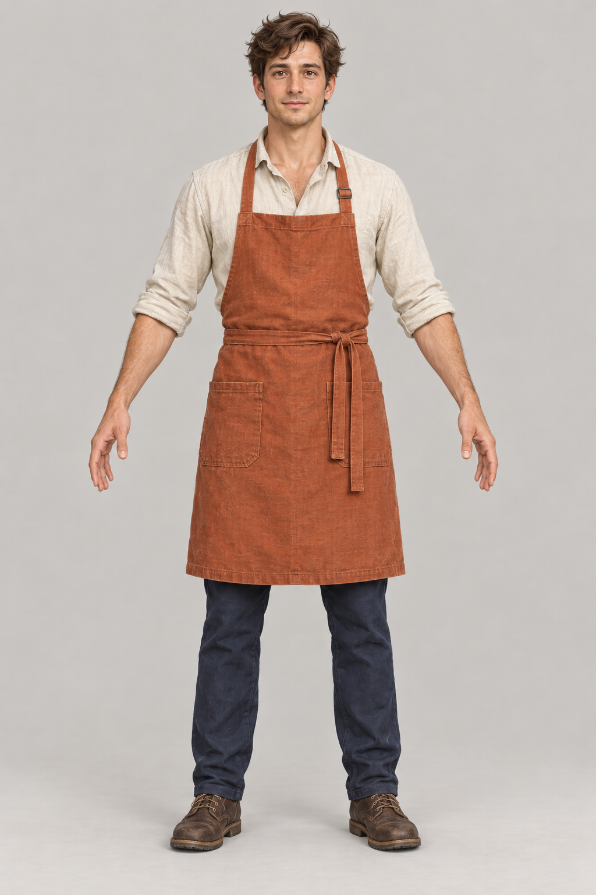

# Breton cafe worker: fresh character family

This is a selected 1024 x 1536 generation reference for a new appearance family. It does not replace an existing model or assign a new appearance to a resident. The source image has not been resized or re-encoded. [Generation provenance and full image prompt](provenance.json) record its actual dimensions and review scope.

Use `reference_front.png` in Tripo Studio's image-to-3D workspace with its Best Quality option and PBR texturing. The [generation prompt](tripo_generation_prompt.txt) describes the intended hidden surfaces and construction. Record the actual model/version, settings and displayed credit cost before submission. Keep the high-detail source and actual texture sizes; a requested resolution is not a measured output.

Export the source GLB and textures, retaining the Studio asset identity and generation lineage. A Blender Bridge import is staging only. Inspect facial anatomy and eyes, all five fingers, garment separation, hair, scale, UVs, tangent basis and PBR channels on the received mesh before deriving runtime LODs.

The new family needs its own skeleton, weights, named clips and measured deformation. The current native cafe consumer can bind a matching idle/walk BlendSpace; use, eating and sleeping presentation remain additional work. Existing avatar material counts, UVs, bones and animation proofs do not transfer to this family. Logical resident identity stays separate from mesh, skeleton and appearance.

No 3D model, PBR set, animation or engine acceptance is claimed by this concept. Follow the [staged asset workflow](../../staged_asset_pipeline.md) through actual mesh and runtime review.
