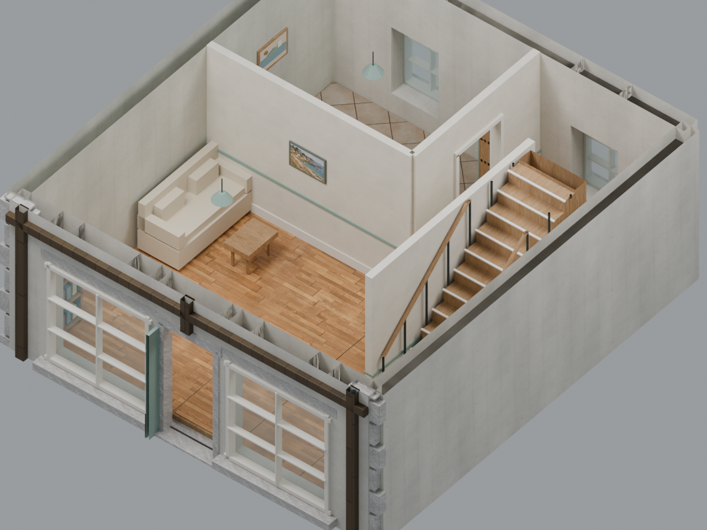
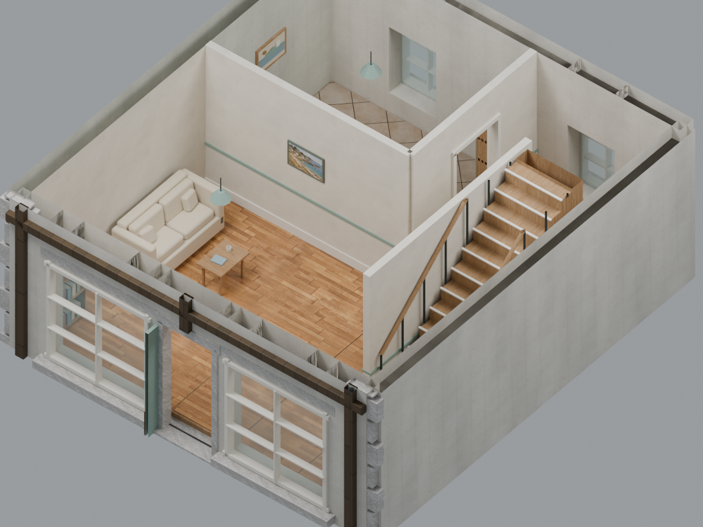
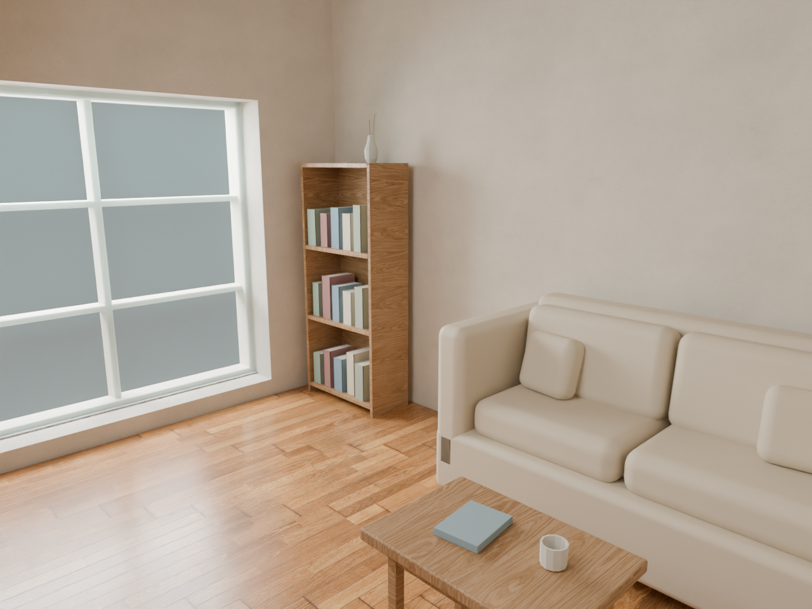
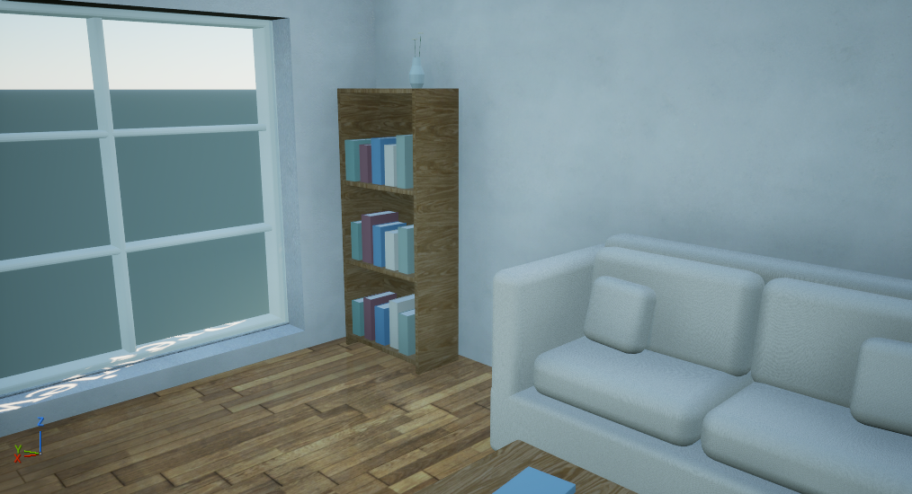
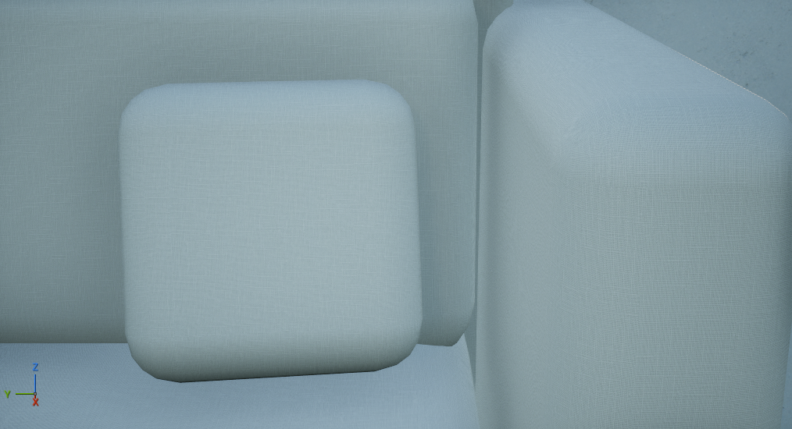
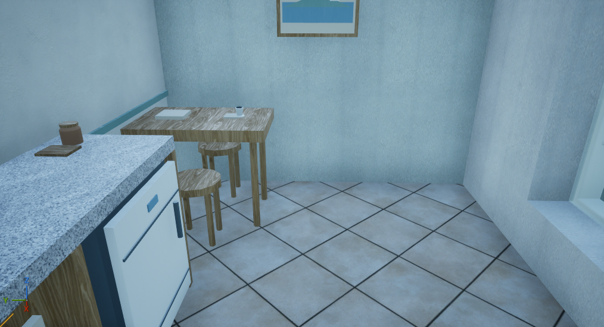
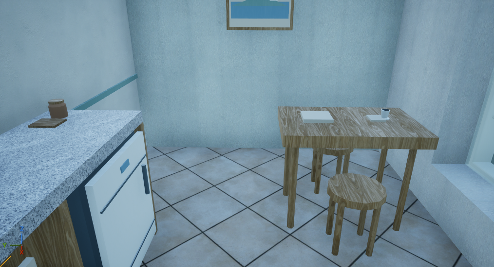

# Half-timber home: living-room refinement

This candidate refines the existing segmented `lot_12_halftimber/L00/Living_Room`. It retains the authored walls, openings, stair, real overhead slab and physical material scale. Rounded cushions, detailed furniture and small props replace the earlier block furniture; the sofa/table group moves along its wall while preserving its facing and 0.40 m seating gap. The 1.10 m circulation strip and source entry/stair keepouts remain clear in the architectural checks.

| Earlier room | Candidate, matched camera and light |
| --- | --- |
|  |  |

The candidate keeps distinct plaster, cabinet-oak and plank-floor maps. It increases the declared normal influence without enlarging the photographic pattern. The original source and maps are preserved. This is a provisional furniture/layout selection; fabric microdetail, decoration and lighting still need work, and this one room does not establish town-wide interior variety.

The portable GLB contains 17,295 triangles, 85 meshes, 30 materials and 24 embedded images. It requires `KHR_texture_transform` and selects its populated default scene explicitly. Some source images are non-power-of-two, so native intake must use the [corrected texture policy](unreal_texture_import_policy.md). Runtime texture derivatives and draw-call grouping remain to be measured.

The original render process completed all three HIP frames and wrote the new Blend/GLB. Its outer observer failed while querying an exiting process's image name; that failed report remains unchanged. Separate fresh processes then reopened the saved Blend and imported the GLB without rendering or rewriting either. Both passed object, bounds, UV and fixture/anchor readback with the no-image-name-query supervisor. Source/artifact hashes stayed unchanged, and all owned processes were reaped. This verifies the existing artifacts without relabeling the failed observer run.

Retained delivery files are `interior_refinement_actual_v1_002/IR001_Halftimber_LivingRoom.blend` (113,905,415 bytes, SHA-256 `cc3a0cc314baa4aee608ce90e7e95d730d8e4a6fcc023f189341ec33df4bde36`) and its GLB (93,165,748 bytes, SHA-256 `2a0d019df0e087f32fb26bf551c1479e5c19f631a44b3ac0790ee7d22d37704a`). Independent reopening evidence is `interior_refinement_reopen_actual_v1_001` under the retained delivery root.

The export carries building/floor/room identities and the required fixture/contact-anchor deltas. External gameplay bindings have not yet adopted those deltas. Native material appearance, door/stair/use routes, collision and frame time remain required before gameplay adoption.

## Isolated Unreal intake

| Room under native review lighting | Upholstery close view |
| --- | --- |
|  |  |

The original byte-exact GLB was imported into an isolated UE 5.8.4 project and its 155 assets reopened in a fresh editor. Native factory identities, 30 materials, 40 texture aliases, 24 embedded-image identities/dimensions and 24 transformed texture roles passed the declared checks. The corrected policy retained all five non-power-of-two images. The 86 source nodes and their poses/bounds are checked against the portable source. All source primitives lack authored tangents; the original intake generated them. The later strict comparison and explicit derivative are recorded below.

The glass material retains native translucent mode and an Opacity connection, but import logged a missing `AlphaMode` input in the legacy material function. That warning and effective glass appearance remain held. The first native attempt also remains failed at its LOD-cache verifier; the corrected intake records both cache lookups and uses source-backed factory lineage where the cached child is absent.

The EV9 views were washed out. Four matched EV11/EV12 frames changed only exposure, retaining the same cameras, materials, 80 klux sun/sky and declared point fill. EV11 is provisionally selected for review: fabric weave, plaster grain and wood detail have clearer tonal separation. Lighting still reads cool and the window/context presentation needs refinement. These Unreal lights differ from the original Blender setup.

Evidence is `native_interior_intake_actual_v1_002` (132.828-second authoring, 43.594-second fresh review) and review-only `native_interior_intake_actual_v1_003` (116.656 seconds, 5,577,236,480 peak aggregate private bytes). Sources and saved packages stayed unchanged; viewport/background state was restored and owned processes were reaped. Native room data, fixture/contact anchors, collision, navigation, normal/alpha behavior, gameplay and performance have not been adopted or qualified by these frames.

## Native geometry derivative

Strict native array comparison of the original intake failed: 55 faces retained positions/materials but changed UV components during native vertex welding, and six print-related meshes had invalid generated tangent bases at singular UV corners. The native builder compares UVs within 1/1024 even when full-precision storage is enabled. Sixteen omitted triangles are exactly the original zero-area faces. These failures remain preserved.

A separate portable derivative appends provided tangent arrays and adds an unused integral `TEXCOORD_1` vertex discriminator on the five meshes affected by welding. All original accessor bytes, topology, `UV0`, colors, node poses, materials and embedded images remain unchanged. Five explicit native lightmap-coordinate settings retain the original effective `UV0`; adding the extra channel would otherwise change automatic selection. The derivative is **94,072,692 bytes**, SHA-256 `c57eb56f0f48d3d1892cf46d04739457b8c94977c18f30e8a945ea809180ab71`, retained under `interior_native_source_derivative_actual_v1_001/Portable`.

The tangent harness processes all 51,885 corners. At 384 exactly singular UV corners in meshes 48–53, it uses a deterministic orthogonal fallback; those corners are explicitly not described as Mikk output. Their source print materials have no normal texture or anisotropy extension. Effective native material-function defaults and routes still require readback before that fallback is accepted for use.

Fresh native authoring in `native_interior_intake_actual_v1_004` saved 155 assets in 123.782 seconds. Its independent comparison passes all 85 meshes and 17,279 positive triangles: exact position, every populated UV channel and material slot; provided tangent/sign/orthogonality within the unchanged SNORM16 representation bound; and effective `COLOR0` within RGBA8 precision. The exact original 16 zero-area omissions remain accounted for. Source `COLOR1` is opaque white and elementwise equal to `COLOR0`; Blender and the native importer consume `COLOR0`. This supports only the declared redundant-white consumer equivalence, not preservation of a second native color channel.

The v004 whole attempt remains failed because its review guard still named the earlier map. A new **review-only** v006 reused the exact saved assets and numeric result, corrected the map/exposure guards, and completed two EV11 hardware frames in 109.922 seconds at 5,548,183,552 peak aggregate private bytes. It performed no import, source export or package save. Root reviewed both frames: wood/grain remain visible, with the same cool lighting and unfinished decoration. Original sources, saved packages and viewport state were preserved, and all owned processes were reaped. Geometry qualification does not establish material-route, gameplay, collision, navigation or frame-time acceptance.

The [typed material-default reader](unreal_material_function_readback.md) supplies 109 actual native input snapshots. Combined with the captured graph, the print-material selector defaults and active switch/reroute branch resolve to `UV0`; a selector-one control resolves to `UV1`. Anisotropy strength defaults to zero and the Anisotropy/Tangent roots are disconnected. The 384 fallback corners belong to materials 23, 24 and 26.

A separate read/export session verifies all four print materials' actual `Normal` output and tangent-space mode. Their actively sampled default texture is normal-compressed, with sRGB and green flip disabled. Its exported Source mip is one constant RGBA8 texel `(127,127,254,255)`. The source-based linear RG unpack example deviates about 0.318 degrees from an ideal flat normal; it is not bit-ideal or a readback of cooked GPU texels. This closes the source-pixel/name ambiguity while retaining the cooked-sampling and complete fallback-consumer boundary. The 44.922-second session preserves packages, dirty flags and world state, reaps its process, and retains evidence under `native_default_normal_export_actual_v1_001`. Final material/art, collision, route and runtime review remain open.

## Kitchen dining arrangement and cold-load check

The adjoining dining set now sits clear of the counter corner. Its five independent source nodes (27-31) move together, including both modeled stools, linen and crockery. The building-local centre changes from `[-2.417866, 1.17]` to `[-1.85, 2.60]` m; its 90-degree facing, geometry, materials, living-room group, partitions, openings and stair stay unchanged. The [portable layout recipe](../../art/interior_revision/halftimber_dining_v002/layout_recipe.json) records the complete group and the coordinate conversion.

| Before: set tucked beside the counter | After: set moved into the rear dining area |
| --- | --- |
|  |  |

These are byte-exact native Author frames with the same camera and EV11 lighting. The source plan leaves about 0.638 m west of the assembly, 0.85 m to the counter front and 0.948 m to the east door-approach keepout. The unseated rear end has 0.25 m and is not a through-route. These are bounded plan clearances, not an ergonomic, collision or seat-use qualification. Oak appearance, cool lighting and decoration still need refinement.

Authoring and a separate cold process preserve the original 155 package files and verify the new map, all 86 node poses/bases, meshes, materials, bounds, room/door metadata and lights. The independent audit also redecodes all six native captures. Owned processes were reaped and original source/profile/config state was preserved. The [compact evidence](evidence/interior_dining_v002_evidence.json) distinguishes explicit CDO/cvar cleanup readback from the final after-set camera/FOV/game-view observation, which was not retained.

The retained portable file is `native_interior_dining_move_prepare_v1_001/Portable/IR002_Halftimber_DiningLayout.glb` (94,072,868 bytes, SHA-256 `3fb5e9dff167c54f0e311c6a1bcea90ddacf2e036732ae55dadc7858e1981afa`). It changes only the five root-node translations; all other JSON semantics and every BIN byte, including vertex/accessor and embedded-image data, match its qualified baseline. The large GLB is retained locally; this repository supplies the small recipe and evidence.

[Source fixture-anchor deltas](../../art/interior_revision/halftimber_dining_v002/source_anchor_deltas.json) remain metadata for a future consumer. Both stool seats, contacts, approaches and action frames must adopt the fixture delta exactly once before actual reach/sit/use testing. External gameplay bindings have not adopted this room. Acceptance covers this dining arrangement only; it adds no gameplay, frame-time, full-material, whole-home or town-wide acceptance.
