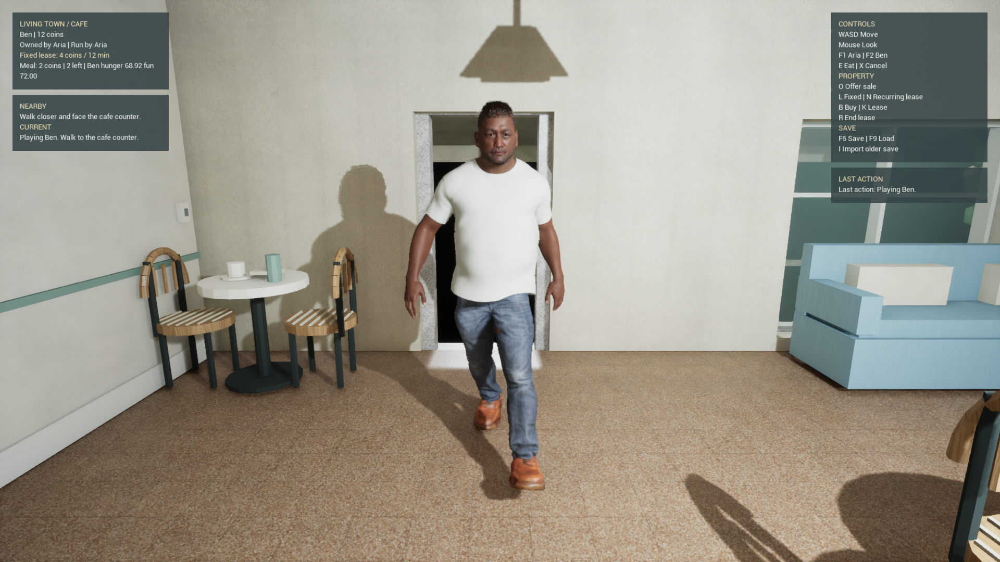

# Casual wardrobe trial

The current candidate combines a fitted MetaHuman SDK T-shirt, CC0 jeans with a belt, and CC0 leather shoes. The T-shirt has separate authored ivory cotton textures. The combined wardrobe is **not CC0**: each part retains its own provenance and source licensing. The earlier collared-shirt candidate was rejected for visible neck and upper-chest defects.

The current Blender trial015 passed a public save/reopen check and six Cycles views on the Radeon 8060S using HIP, with CPU rendering disabled. Root reviewed front, back, side, neckline, waist and shoe views. A smooth lower T-shirt adjustment, at most 14.67 mm, removed the two visible waistband protrusions while retaining the original upper T-shirt, neckline and sleeves. Raw contacts with the SDK garment's internal waist closure remain diagnostic; no hidden-face deletion or material mask was used.

The source master preserves full weights, UVs, packed images, original rig ancestry and pose channels. It has 15,058 vertices and 28,168 export triangles. Both game derivatives use the same observed Blender loop triangles and corner mapping. This avoids the engine-dependent quad diagonals that caused material and fit discrepancies in the earlier candidate.

| Transport001 output | SHA-256 |
| --- | --- |
| Full-weight Blender wardrobe | `d4d06913cc17a2bb7f8faa052eade07efa711523a713a9d1dc084b626a3dc9b6` |
| Stock GLB with available influence sets | `4f7c056e31ca4abc39bffec4b1d77f54d26273d9033abd5c25c979e44b11c4c8` |
| Explicit eight-influence FBX | `fde325a7b2d5b5eabc5e6ae7061bda7518c9b52c2938d92abc9bdf2cfa533c41` |

Actual export and independent factory reload completed successfully. The FBX readback preserved UVs and weights exactly, with maximum world-position error approximately 0.0001 mm and corner-normal error 0.0343 degrees. The original 341 exported joints and root carrier remain. Native Unreal import adds its expected root representation; this is not a claim of bit-exact local reference transforms across formats.

The GLB includes four joint/weight attribute sets. Blender's stock exporter still filters weights at or below 0.0001 before normalization; the full-weight Blender file remains authoritative. Explicit reduction to eight influences measured maximum deviations of 4.15 mm at the hip and 2.59 mm at the shoulder under small offline rotation stresses. Actual idle and walking fit still need validation.

Cotton uses a sixfold UV tile, OpenGL tangent normal strength 0.2 and a linear roughness texture. Actual GLB readback observed the equivalent KHR texture transform and exact roughness pixels in the embedded green channel. Jeans and shoes keep their own source normal strengths and roughness. The native jeans diffuse/AO multiply graph differs from standard glTF occlusion and must be reconstructed from its recipe. Normal green conversion occurs once for the Unreal derivative.

Native intake001 saved the skeletal mesh, three materials and eight textures on the existing MetaHuman skeleton. Semantic material and imported-model eight-influence readback passed; the original character assets remain unchanged. GPU weight-buffer behavior, native appearance and locomotion are separate checks. The native comparison uses full-body front/back/side views including shoes and one torso detail view. Each art still uses 64 render runup frames, with process-local capture settings observed and restored. This improves capture maturity without establishing gameplay frame rate.

The native target is:

```text
/Game/LivingTown_UEPilot/MetaHumanCasualWorkwear_v002/SK_CasualWorkwear
```

Its materials are `Materials/M_CottonTee`, `Materials/M_Jeans_Belt` and `Materials/M_Shoes` in that namespace.

The C++ candidate extends the [prepared whole-actor descriptor](metahuman_whole_actor_runtime_trial.md) with version 2. Version 1 retains its exact 15-field schema. Version 2 has exactly 17 fields, adding `outfit_mesh` and `outfit_manifest_sha256`. Fractional versions and unqualified identities refuse. Native preview002 passed four correctly associated views and was accepted for an opt-in runtime trial. Its manifest pin is `171d59c1e5aba3146f1f73f3e706b25c842414e89369f8d1522cb40b095f286c`. Fine fabric appearance, groom stippling and a narrow underarm side surface/shadow still need neutral gameplay and motion assessment.

After normal MetaHuman BeginPlay, the assembly replaces only the existing Outfit component's mesh, clears base-material overrides and the global overlay, and verifies its original pose owner. Later checks detect mesh, material or component-overlay replacement. Body, face, groom, pawn, controller and gameplay authority retain their existing owners. Independent lifecycle probes cover material/overlay/mesh corruption, restoration and repeated reset.

Game and Editor build027 passed for native source family `f5ebbee1035ca4413ba41fcee11c81b68828bb6dc464992f8ec4fce59e906b18`. All six focused native tests passed: the three prepared-descriptor/identity/refusal tests and the three B749 shape/transform/override tests. The asset-free tests use NullRHI; they establish no rendering or frame-rate result.

The normally ticking WorldV3 PersonaGate also passed with this wardrobe. A separate D3D12/SM6 inspection on the Radeon 8060S observed 506.34 cm of real `AddMovementInput(force=False)` travel, 42 walking samples and 57 idle samples, with the original clips selected from measured velocity. It used no actor translation or manual pose evaluation. Three gameplay camera captures survived independent decoding; EndPIE restored the original actor roster and viewport without saving source assets.



The tested front views show a clean neckline and waistband in idle and walk. The reference-pose underarm flap is not apparent in these views. This accepts the bounded opt-in integration trial. Fine cloth and grooming, all-angle deformation, sole/stride calibration, bright endpoint highlights, eating/sleeping contacts, default promotion, cooking and comparative performance remain open. The original capsule, offset, speed and camera values remain test parameters.
