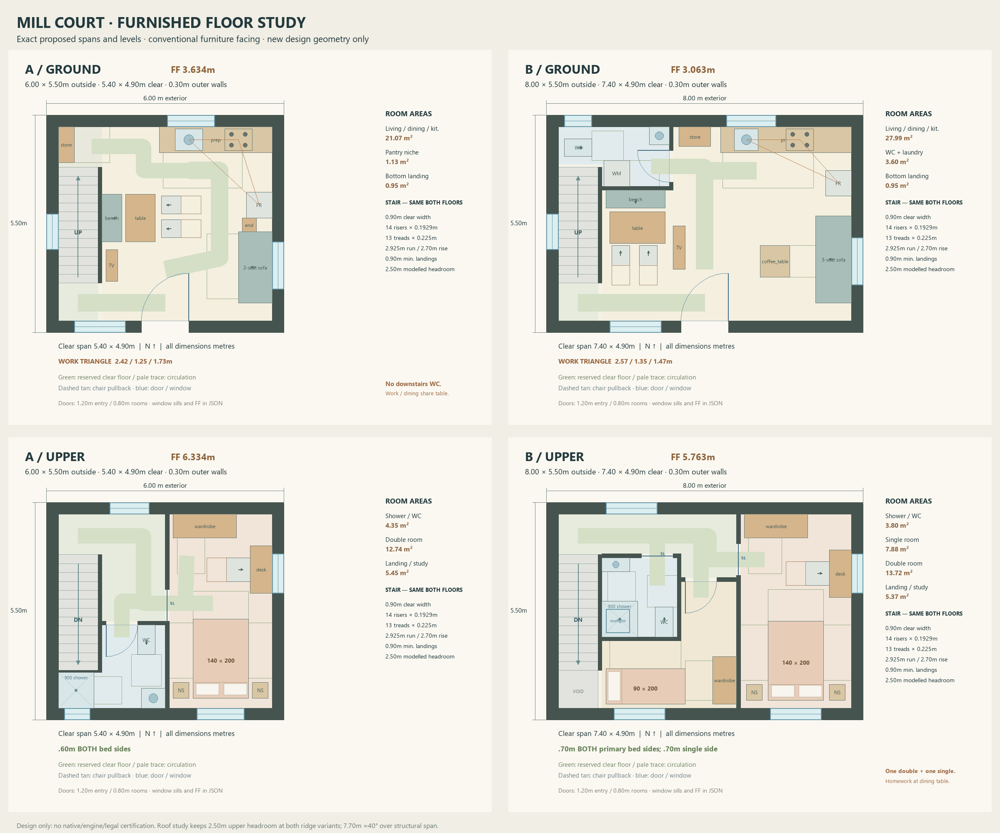

# Mill Court furnished houses

Two compact houses now have explicit room layouts and usable furniture arrangements before their detailed Blender model is built. The plan records doors, windows, stairs, floor openings and furnishings in metres, independently of any game engine.



[Vector drawing](../media/mill-court-floorplans.svg) · [Machine-readable plans](../../art/planning_revision/mill_court/v1/floorplans.json)

## Layout choices

| | House A | House B |
|---|---|---|
| Outside footprint | 6 × 5.5 m | 8 × 5.5 m |
| Ground floor | Living, dining/worktable, kitchen and pantry | Living, dining, kitchen and WC/laundry |
| Upper floor | Double bedroom and shared shower room | Double bedroom, single bedroom and shared shower room |
| Double-bed side access | 0.60 m on both sides | 0.70 m on both sides |

Chairs face the tables, sofas face the media consoles, and kitchen work areas remain outside the main entry route. A small end table replaces a central coffee table in A. A has no downstairs toilet; the available area instead supports a usable staircase and living space. B's single room uses the family dining table for homework rather than forcing in another desk.

Both houses have one shared staircase across their two floor records: 14 risers, 13 treads, 0.90 m clear width and a 2.70 m floor-to-floor rise. The upper slab has an actual stair opening. The compact stair is approximately 40.6°; the analytical model preserves 2.50 m headroom and 0.90 m landings. These dimensions describe the game asset design and are not a building-code certification.

The preferred roof ridge is 7.70 m above the ground finished floor, giving approximately 40° pitch over the structural span. The earlier 6.80 m ridge remains a comparison, not a measured sightline limit. A Blender massing study found that the new house partly screens the windmill façade: the landmark view is partial, not fully preserved.

## Reproduce the layout checks

From the repository root with Python 3.10 or later:

```sh
python tools/mill_court_plan.py
python -m unittest discover -s tools/tests -p 'test_mill_court_plan.py'
```

The checker needs only the Python standard library. `--plan` selects a plan JSON and `--report` writes the measured results; it never rewrites its input. It checks furniture containment and overlaps, hinged-door swings, chair pullback, explicit clearances and full circulation ribbons with chairs both seated and pulled. A 56 cm diameter disc on a 4 cm grid checks the declared interaction targets. The negative tests place furniture inside a door swing, block a chair pullback and enlarge a bed into its side access.

Coordinates start at each floor's inside southwest corner. The JSON provides world origins and finished-floor elevations. Component IDs are local to a plan; use owner, plan and component together. Each staircase is instantiated once per owner, despite appearing in both floor drawings. The validator links the actual slab opening to the stair void and shared stair record.

`wall_segments` describes the finished wall and jamb footprint for clearance checks. Its door gaps are clear passages, not bare masonry openings: the model cuts 50 mm farther into each side, then fits the jambs outside the clear span. Pocket doors require a hollow host partition; their complete sliding sweep is checked against adjoining walls and furniture. B's single-room partition stops at 4.50 m so it does not penetrate the primary bedroom's pocket cavity. Window heights, glazing and door lintels must also be represented in the model.

## Current scope

The four floor plans pass the design checks. The diagrams are plan drawings, not game screenshots. Detailed meshes, surface materials, animated doors, native navigation, furnishing contact and gameplay integration remain separate validation steps. The site massing study also leaves courtyard path/terrain contacts to refine. The existing town and its runtime are unchanged by these planning assets.
