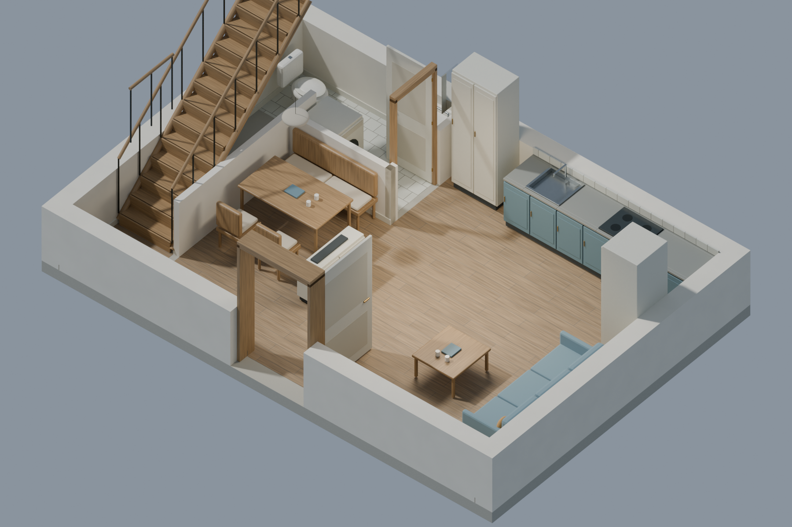
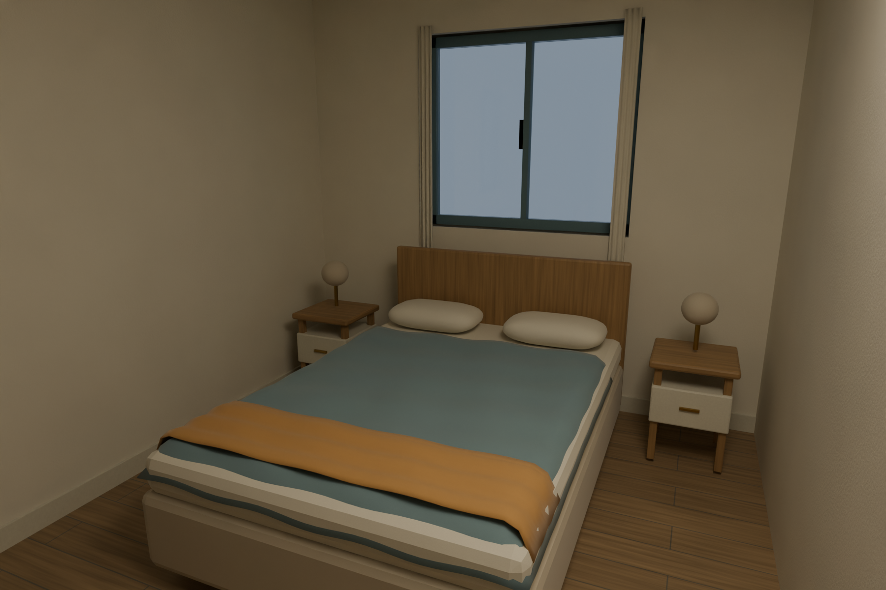

# Mill Court furnished prototype

The two-house generator turns the [reviewed room plans](mill_court_furnished_plan.md) into complete model geometry. It preserves room/furniture positions, world floor elevations and the corrected pocket-door junction. Each house has one physical stair with fourteen risers, thirteen treads, landings and guards. Walls contain real rough openings with jambs outside their nominal clear spans; upper slabs and ground ceilings contain stair voids.

The source uses shared-vertex wall profiles to avoid artificial bevel seams at every aperture-grid cell. Wood has metre-scaled directional UVs; the material graph retains both plank seams and fine grain. Bedding and curtains have explicit folds rather than flat rectangular strips. These images are actual Blender renders of the reviewed source version, not concept images or engine screenshots.

This remains a prototype. The second material review found grain readable on floors, tables, stairs and the headboard; it is still stylized and linear. Pillows/bed shapes and mattress-bevel faceting need refinement. The nominal roof-deck ridge is 7.70m above ground finished floor; its finished cap reaches approximately 7.81m. Open hinged-leaf thickness reduces nominal frame clear passage by approximately 20mm in this version. External threshold/terrain route contacts are unfinished.

The portable package completed four 1800×1200 Cycles HIP renders and an independent reopen in Blender 5.2.2 on 2026-11-02. These previews come from that run. The saved master contains 1,357 geometry specifications and 47 furniture items; the reader verified saved geometry, UVs, transforms, material graphs, lighting and stair openings. Authoring and rendering took 92 seconds on the tested machine, with a measured peak of 3.64 GB private process memory; this is an offline generation measurement, not game frame-rate evidence. The 17 combined plan/generator tests also exercise empty aperture volume, closed wall topology, exact room/site binding, pocket-door travel, relocated outputs and material graph connectivity. They do not certify game collision, native navigation, final textures or runtime performance.

[Generator commands and options](../../tools/mill_court/README.md) · [Floorplan JSON](../../art/planning_revision/mill_court/v1/floorplans.json)

The procedural `.blend` is the appearance master. Optional GLB export contains geometry and placeholder groups only; baked engine-agnostic textures remain a separate step. No final-art, full-town adoption or UE integration result is implied by this prototype.
