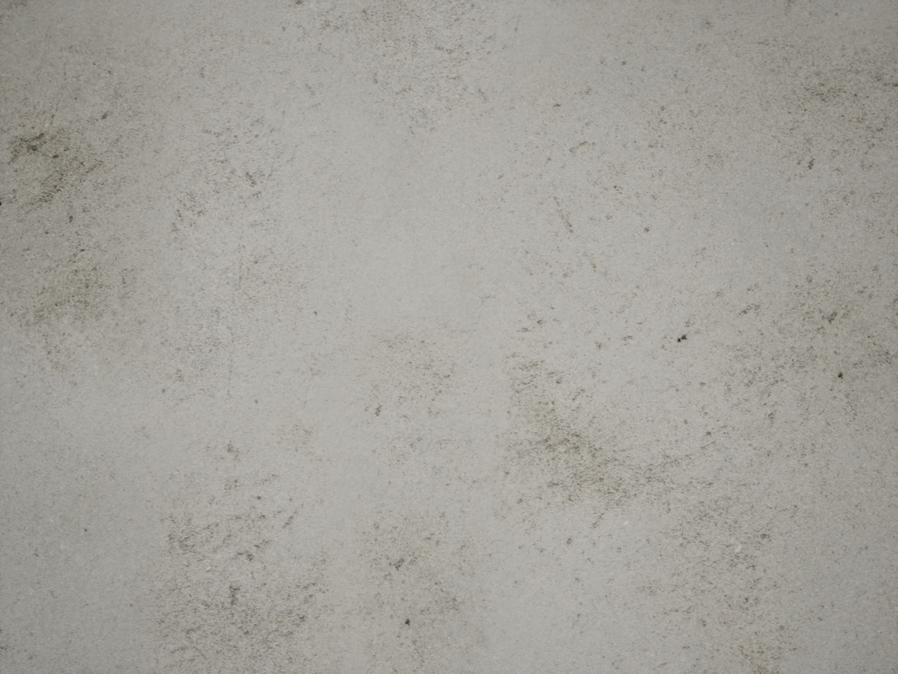
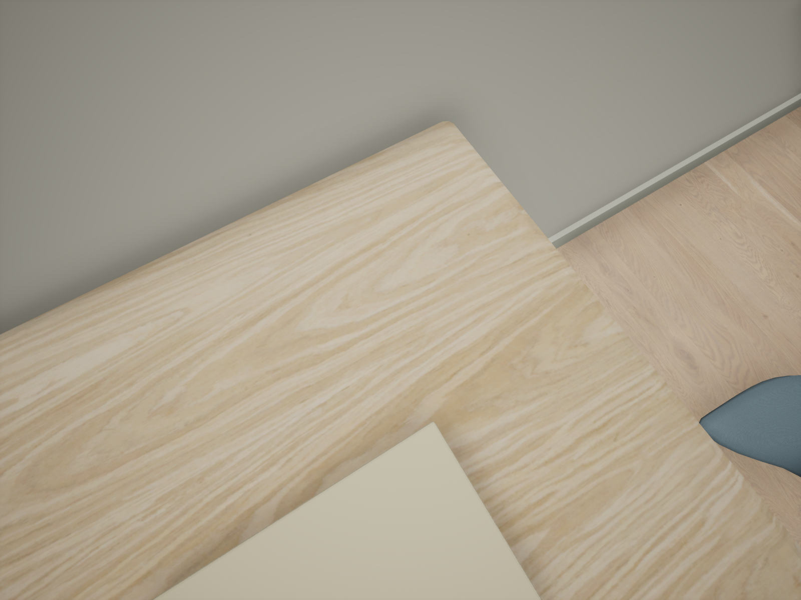
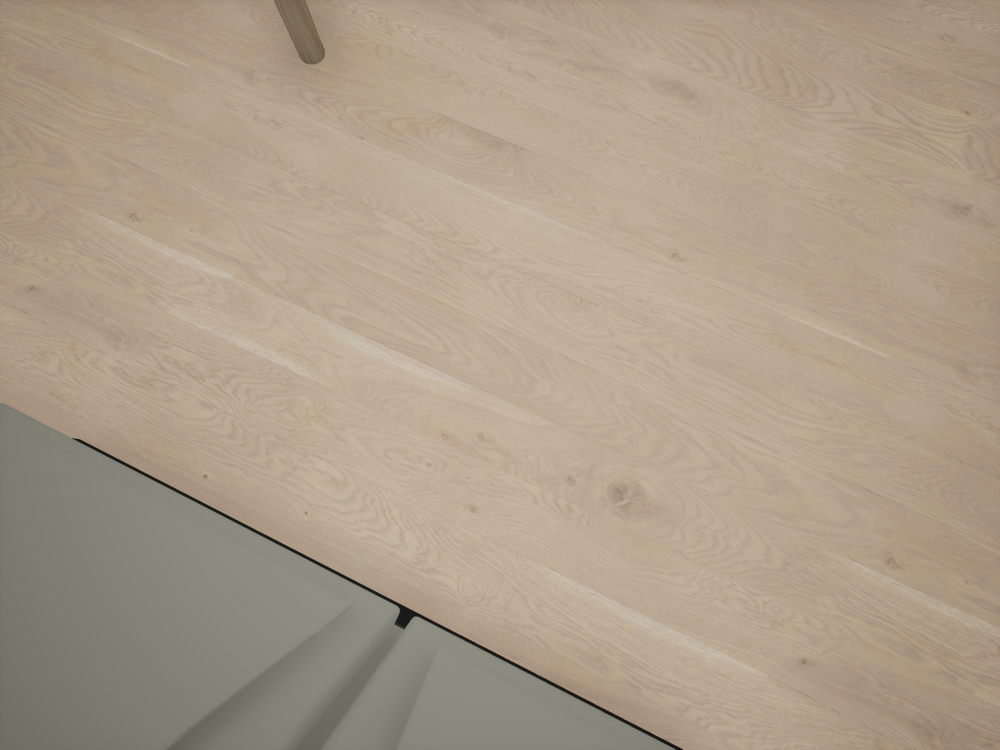
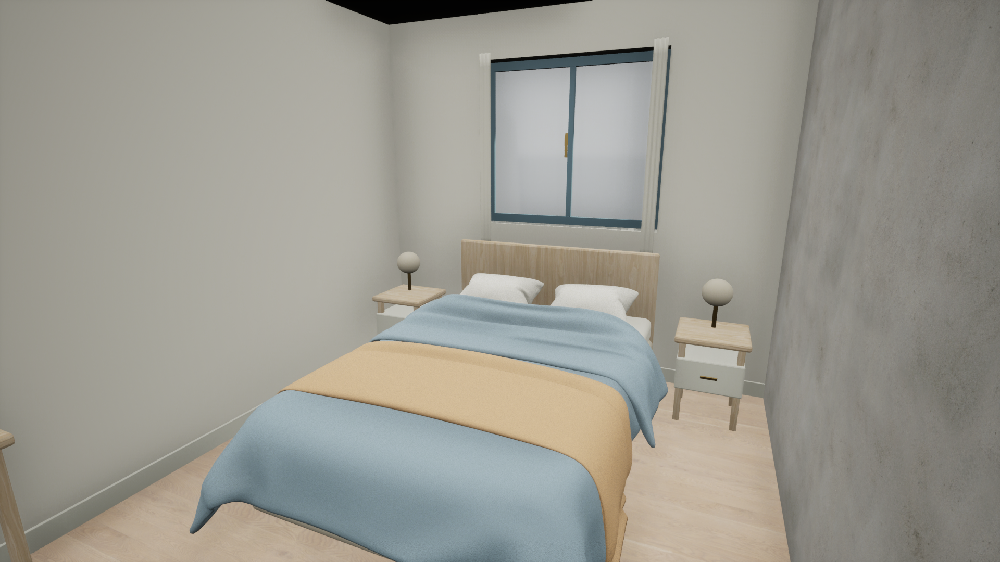

# Native B texture and viewport observation

The B texture reader compiled in the positive Build 017 source family and completed an actual Editor consumer on 2026-11-05. All nine native scalar reads and four PNG captures passed, with the saved map/content clean and the original actor roster and full viewport restored exactly. Root reviewed all four images and **held final room art**: visible plaster/wood detail is established, while daylight and material balance still fall short of the Rohmer/Breton summer concept. This pass added no materials, maps, geometry, streaming settings, or production B registration. The original exact 12-texture terrain reader is unchanged.

[Portable evidence and proof hashes](../evidence/native_b_texture_20261105/evidence.json) retain the measured states and unchanged PNGs without machine-specific file paths. Source family: `548cc64286066dfb349cfcf467771b4b83f37a4feddc1aca076e6b1f45f85094`. Positive Build 017 Editor and Game builds completed in 459.282 s and 254.469 s respectively, each with exit 0 and descendants reaped. The **Editor** observation/capture consumer completed in 88.234 s, with controlled exit 92 and descendants reaped, preserving source/global custody: 850 packages, 750 original placements, 205 accepted finish overrides, four graphs and nine textures. Build times and consumer duration are not FPS or game-loading measurements; the Game build does not establish native player integration.

Native reads occurred at the initial overview, **before closeup camera movement**. Every texture had a 2048² platform size and `MaxTextureSize=2048`:

| Texture group | Native Source: BaseColor / Normal / Roughness | Resident / allowed mips | Cached wanted, debug only | Actual RHI extent | Full within asset limits |
|---|---|---|---|---|---|
| Plaster, three maps | 4096² / 2048² / 2048² | 12 / 12 each | 12 each | 2048² each | Yes, those three at read time |
| Oak joinery, three maps | 4096² / 2048² / 2048² | 12 / 12 each | 12 each | 2048² each | Yes, those three at read time |
| Oak floor, three maps | 2048² / 2048² / 2048² | 10 / 12 each | 10 each | 512² each | No |

All nine returned `READ_ONLY_B_TEXTURE_NATIVE_SCALARS_OBSERVED`; full residency for all nine is **false**. The floor's 512² RHI observation is consistent with its 10 resident mips and cached wanted 10 at that overview. It does not establish a missing source texture or the sampled LOD in the later floor closeup. No shot-specific mip/sample readback, GPU texel equality, final art or whole-town performance is claimed.

The earlier producer's 32² `source_dimension` field was a public `Blueprint_GetSizeX/Y` reading during construction; it did not call native `Source.GetSizeX/Y`. The completed native reader observed the intact 4K/2K Source data above. Early 32² is therefore not evidence of missing source pixels. Source, platform, resident RHI extent and sampled LOD are separate observations.

The unchanged captures show continuous plaster mottling/fine grain, joinery grain/rounded edges, and floor grain/knots. Pale joinery tone/roughness, floor/plank definition, the dark ceiling area and opaque pale-gray window panes keep room-context approval held. Source audit is ongoing; the image alone does not establish the ceiling/window cause. These actual PNGs support that bounded review:

| Plaster wall | Oak joinery desk |
|---|---|
|  |  |

| Oak floor | Full room context, art held |
|---|---|
|  |  |

The new `LivingTownBMaterialInspection` Blueprint function library exposes `begin_b_texture_read(texture)` and `poll_b_texture_read(token)` to Python. Both require the Editor game thread. Begin accepts only an already loaded, clean, exact `Texture2D` from the nine saved `MillCourtB_StaticFinish_v002/Textures` additions: Plaster, OakJoinery and OakFloor, each with BaseColor, Normal and Roughness. It requires the exact saved `MillCourtB_StaticFinishInspection_v002` Editor world, its registered current viewport and matching Editor world context, with no PIE or dirty map. It does not load, import, save, recompile, flush rendering, or force streaming.

Begin returns `PENDING_RENDER_THREAD_SCALARS`, a token, and a game-thread `before` snapshot. Poll on subsequent game-thread ticks with that exact token. Begin refuses a second pending read and an already completed asset. Missing source/platform data, compilation, proxy resources and virtual textures return HOLD without waiting. Source must have one block and one layer. There is no readiness fallback to a default texture.

The snapshot reports native Source width/height/mip count/format/GUID, platform width/height/format and bounded mip rows, resident and allowed mip counts, valid streamable-resource requested/resident/max counts and asset bias, compression/sRGB/green-flip/address/filter/group/max-size/LOD settings, device-profile limits and native RHI name. `cached_wanted_mips_debug_only` is the streaming manager's last computed debug cache (`GetCachedNumWantedLODs`, unavailable in shipping); zero may mean not computed. It is not a current demand or readiness guarantee. Requested state is null if the streamable resource state is invalid. Missing profile fields are null. No data is inferred from the earlier producer's misnamed public size field.

The queued render command copies only scalar fields of the held texture's actual RHI descriptor: extent, mip count, pixel format and flags. It owns a thread-safe result packet; release/acquire completion gates all GT reads. A strong UObject owner stays on GT until that command completes. Later GT resource release/replacement is queued after this read; the RT command holds its own RHI reference while observing. No UObject/platform/source data is touched on RT. Poll verifies the same world, current client, viewport, resource and Source GUID and a clean texture after completion. A five-second deadline closes the session; if the command is still queued, its strong owner is retained until a subsequent completion poll, rather than destroyed while RT could still use it. A timed-out consumer should retain evidence and end its owned Editor process, not retry the session.

Successful terminal status is `READ_ONLY_B_TEXTURE_NATIVE_SCALARS_OBSERVED`. It requires stable source/platform/settings/residency, expected original source dimensions (4K Plaster/OakJoinery BaseColor; 2K the other seven), a timely render read and RHI extent/format/mip count consistent with the reported resident platform mip range. The wanted debug cache is reported before/after but excluded from the stable-state comparison. `fully_resident_within_current_asset_LOD_limits` is a separate observed predicate: no pending initialization/streaming, resident equals allowed, stable snapshot and RHI correspondence. A successful scalar observation alone does not assert that predicate, source-resolution residency, sampled LOD, GPU texels, material appearance, or pixel parity. Existing MaxTextureSize=2048 is observed, not changed.

Minimal ordered consumer usage, inside the serialized deferred MCP/GameThread worker:

```python
# First open the actual saved B map and load its exact saved nine textures.
# Use the existing qualified loading barrier if the owning consumer needs one;
# this library itself never waits or forces streaming.
reply = json.loads(unreal.LivingTownBMaterialInspection.begin_b_texture_read(texture))
token = reply["token"]  # only when status == PENDING_RENDER_THREAD_SCALARS
# Return control to Editor ticks. Do not loop/block the GameThread.
reply = json.loads(unreal.LivingTownBMaterialInspection.poll_b_texture_read(token))
# PENDING: return to ticks; terminal HOLD: retain failure and stop this consumer.
# Require the observed status, and explicitly check the full-residency predicate
# if the consumer intends to make that narrower readiness claim.
```

`LivingTownViewportInspection.configure_b_material_viewport()` is a separate allowlisted entry point for this exact saved B inspection world. `configure_wall_lighting_viewport()` retains its exact Entry-only path/status/guards. Both share the same sole active saved-state owner and token and the same implementation of Lit/GameView, scene exposure, six lighting flags and temporary realtime override. The B method also checks a clean saved map and matching current Editor context. It changes no camera location, rotation or FOV. Its success status is `CONFIGURED_B_MATERIAL_EXACT_CURRENT_VIEWPORT`, scope kind `MaterialLighting.MillCourtB.CurrentClient.v1`.

The completed consumer read textures before changing the viewport, then established its B scope while the saved map was clean. It matched the keyed public viewport inventory to the native current client, moved only that client's view through `LevelEditorSubsystem.set_level_viewport_camera_info`, preserved the original 90° FOV, and used `take_high_res_screenshot(camera=None, force_game_view=False)`. It created no camera actors and requested no pilot/actor locks; map/content stayed strictly clean. Existing keyed public/native correspondence remains required. Any other caller using a camera/pilot lock must release it before `restore_current_level_viewport(scope_token)`. Restore retains its original registration, viewport/world identity, no-lock, exact camera/projection/FOV/exposure/mode/showflag/widget/realtime readback and token checks; B scopes additionally require the same current client and exact B Editor context with no PIE. A refused restore never clears someone else's lock or replaces the original viewport. This consumer's original and final public/native observations matched exactly.

SDK evidence used: UE5.8 `Texture2D.h/.cpp` native source/platform/resident getters and async readiness, `StreamableRenderAsset.h/.cpp` cached wanted/resource state and pending getter, `StreamableRenderResourceState.h` GT coherence, `TextureResource.h`/RHI descriptor access, and the existing strict terrain reader's queued scalar pattern. `HasPendingInitOrStreaming()` may clear an engine-only cached pending-init hint; it does not change texture settings, stream requests, or package data. Existing module dependencies already include Engine, UnrealEd, Json, RHI and RenderCore; no Build.cs or project change is needed.

Source verification covered diff/whitespace checks, exact-nine allowlist/source-dimension matching, SDK declarations, lexical checks, old Entry/FixedMid/read preservation and forbidden asset/streaming mutators. Actual Build 017 compilation/reflection, all nine typed native reads, capture execution and exact reversible restoration now have completed evidence. The four PNG copies total 10,611,612 bytes and match their producer SHA256 hashes; Git filter/text/diff attributes were checked before copying and were unspecified. No images were edited. The concise evidence JSON binds the root review, native results, completion and host receipts. Final room art, shot-specific sampled LOD, player integration, Game/cook closure, town loading/FPS and goal completion remain unqualified.
