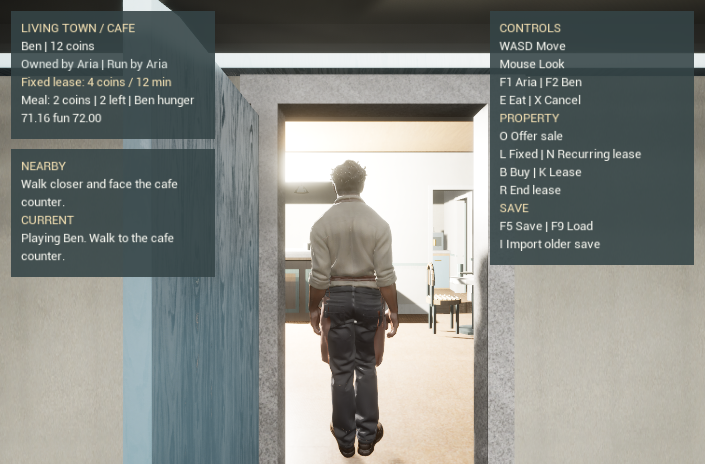
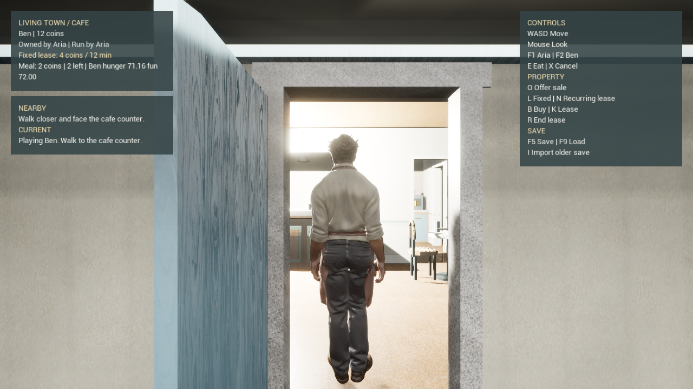

# Native recurring cafe lease

This change extends the existing WorldV3 cafe authority with opt-in recurring rent and explicit V4 save import. Root execution on 4 November 2026 passes portable cases, Editor/UHT and Game compilation, the native journeys and independent fresh-state HUD review. The [evidence index](evidence/cafe_recurring_lease_20261104.json) binds the retained local results and images; it does not bundle engine builds or qualify a cooked game.

The owner can offer a recurring commercial lease with **N** at the real cafe counter. The offer says **4 coins every 12 minutes**, first period paid on agreement. Ben accepts with **K**. His intent binds the recurring kind and the title/offer generation pair from one observed HUD snapshot; an old fixed-lease intent or changed offer cannot silently sign recurring terms. **L** still offers a fixed 4-coin/12-minute lease. Current and imported fixed agreements retain fixed expiry. These 720 authority ticks represent the existing cafe demonstration's elapsed-time period; they are not relabelled as a town calendar week.

A successful recurring payment transfers four actual coins from tenant to owner and extends the same agreement's paid-through boundary by 720 ticks. The HUD displays the rent, period, next countdown and current operator. **R** surrenders before a later bill. If the next period cannot be paid, that paid term ends and operation returns to the owner without a payment for the unfunded period. No debt, new currency, meal benefit or survival penalty is invented. Fixed/private upstairs access does not change.

There is still one world subsystem, Kernel, wallet book, Ben care state and clock. The recurring policy is derived from the immutable accepted grant; the next due is its paid-through `Lease.end`. Due request identities derive from property, grant and scheduled tick. The Kernel's existing private transfer emits each real payment. Bounded catch-up processes scheduled boundaries in order and publishes the candidate only after all ledger/care/clock checks pass. A technical failure rolls back the complete batch. Offer counters retain their released reset semantics after a sale, while the title revision increases with each deed; the combined generation prevents old consent matching a later offer after an ownership round trip. Existing event fields retain that generation through accepted and declined replay. Pause freezes the clock. Existing meal contact and unavailable-provider refusal remain independent.

## Persistence

**F5** writes `Saved/CafeWorldV3/CafeWorldRentCareV5.slot.json`. **F9** loads only that current paired version. No absent, corrupt or partial new save falls back to an older state.

**I** explicitly imports the older `CafeWorldMealCareV4.slot.json`. Its exact legacy source, scene/visual, roster and recipe bindings, SHA256 envelope, canonical payload, full replay, care and fractional clock must match before publication. The legacy decoder excludes recurring actions/kinds; old fixed grants cannot gain a new recurring obligation. Old event/money/title/rights are preserved. Previous care is safely interrupted under the existing AfterLoad rule, earned effects remain, and current pawn/persona/position stay unchanged. The old file is read without being overwritten; a later F5 writes the new slot. A source or content mismatch remains a refusal.

## Validation consumers

`tools/tests/cafe_world_v3/CafeWorldV3RentCases.cpp` covers explicit/changed consent, fixed semantics, recurring payments and nonpayment, surrender, stepped/batched clocks, due retry/spoofing, second-period post-payment rollback, reference/cache corruption, paired due/paid loads, frozen-old active-fixed import, refusal replay, ownership-round-trip stale consent and bounded capacity. The existing property/meal and daily-life cases remain regression consumers. CI's native-property-core workflow explicitly compiles and runs the new cases.

The active-fixed legacy fixture is emitted through the frozen unmodified old core/envelope public APIs and replayed there before writing. It is CPU policy evidence with synthetic scene bindings, separate from the previously accepted actual native V4 producer/cold-restore slot. Neither is silently treated as proving the other's context.

Root native commands are `LivingTown.WorldV3.RecurringLeaseJourney` with `-LivingTownCafeWorldV3 -LivingTownCafeRecurringLeaseJourney -CafeWorldPersona=ben`, and `LivingTown.WorldV3.LegacyV4Import` with the explicit `-LivingTownCafeLegacyV4Import` flag and an untouched accepted V4 native slot staged under matching qualified content. Both pass in fresh private Editor processes. The first case walks the authored route as owner and tenant, sends simulated N/K/R through the actual controller, pauses/resumes, uses legitimate paired near-due saved states produced by public APIs, and observes ordinary elapsed seconds crossing rent/default. It preserves no-provider meal refusal. The second checks strict native legacy import and old-file preservation. Its actual old native slot is unleased and uses the matching default visual; active-fixed import remains separately covered by the frozen old-public-API portable fixture.

| Executed consumer | Result and scope |
| --- | --- |
| Portable property, meal and rent cases | All compile and pass with MSVC C++17 `/W4 /WX`; rent has 4,155 checks across 14 groups, including ownership-round-trip stale consent. |
| Editor/UHT and Development Game builds | Both pass for the current implementation. This establishes compilation and build products, not packaged startup. |
| Recurring journey and actual V4 import | Both native automation cases pass, exit zero and reap their owned children. |
| Backend and visual-identity refusal cases | All four selected native cases pass without serialized character assets. |
| Public V5 refusal and independent cold restore | Both pass; the producer walks about 507 cm in 102 natural observations. A distinct consumer preserves the exact paired save, fractional clock and live pawn. |
| Ordinary HUD at 705×464 and 1280×720 | Both exact-size images show readable new controls and clear head/feet. These fresh fixed-listing views do not demonstrate recurring-countdown pixels. |

The ordinary sessions close with an explicit owned controlled stop after their image/CSV/trace observations; they are separate from the zero-exit automation cases. Their quiet frame medians are 16.667 ms, but 95th percentiles are 29.63–29.67 ms. Pacing remains uneven despite low GPU costs, so these measurements do not certify stable 60 FPS or full-town performance. The first recurring journey protects current implementation bytes before/after; its inherited canonical metadata observer covers the historical worktree. The later legacy, regression and ordinary sessions explicitly guard the current worktree. That scope difference is preserved in the evidence.

Near-due test saves advance the simulation through public Kernel/care operations. They do not claim that twelve minutes of wall time elapsed before loading. The subsequent observed interval changes no clock rate or agreement term. Test receipts establish simulated controller input and data consequences; rendered HUD review, OS keyboard input, cooked content and full-town performance remain separate requirements.

This slice does not complete other property coverage, weekly-calendar integration, visitor lets, business income, payroll, bank/dividends, full-town play or final character art.
