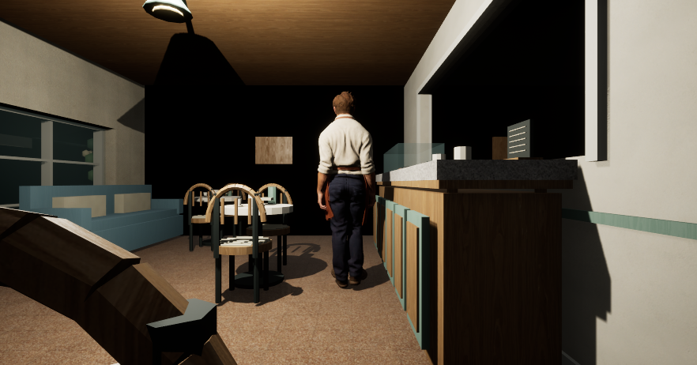

# Native cafe-worker asset and playback adapter

The refined 61-bone cafe worker now has a separate Unreal asset family and runtime strategy. It uses the reviewed strength-0.35 material, the original complete idle/walk clips at rate 1, and a native-built 0–110 cm/s BlendSpace. The measured gait and [post-sampling alignment](native_root_correction.md) replace the previous 180 cm/s assumption for this candidate. Original assets and the existing version-1 consumer remain available.

At the declared 179 cm stature, six near-floor surface-velocity sensitivity cases in the retained native walk audit suggest approximately 109–110 cm/s at the original cadence. The full clip contains two near-repeated gait cycles and remains intact. Lateral/vertical residuals, floor penetration and real support contact remain separate observations; a scalar speed choice does not establish foot locking. Evidence is `native_character_stride_contact_audit_v1_001` under the retained root listed below.

## Runtime and editor behavior

Version-2 bindings explicitly select `cafe_worker61_root_aligned_110_v1`, both source clips and the reviewed idle-root delta. The reader rejects mixed schemas, unknown strategies, incorrect family paths, speed, socket or delta. The consumer checks the saved material's actual skeletal usage before loading the worker mesh; it performs no usage repair. It checks the mesh-owned palm, source clips, two full samples, exact `UBlendSpace1D` class, absent input/sample smoothing, no input-based rate scaling, and public sampler weights at 0/55/110.

The existing root-corrected player is installed with diagnostic pose capture disabled. Its playback API retains the configured subclass; no later `PlayAnimation` resets it. The version-1 branch keeps its existing player behavior. Kernel, scene parts, routes and default runtime-enable flags stay unchanged. No qualified version-2 physical binding is supplied by this change.

The fixed staging [editor helper](../../unreal/Source/LivingTownMaterialInspection/LivingTownCafeWorker110Preparation.h) authors only a fresh mesh derivative and BlendSpace, then independently reopens them. It preserves geometry, reference pose, skin, UVs, decoded basis, slot metadata and the existing mesh-owned palm. It checks the complete selected material before any pilot mesh is loaded. Its two operations are limited to owned F-drive staging projects.

The optional [viewport recorder](../../unreal/Source/LivingTownNative/Public/LivingTownViewportCsvSubsystem.h) exists only for an explicitly selected Game-world map and command-line flag. It records viewport width/height, bounded game-thread frame counter and sample count into the same CSV capture. It changes no viewport setting. Native dense-row, extent-change and lifetime qualification remains pending; dimensions observe the world-tick sample, not every intra-frame or final presentation event.

## Actual evidence

The original asset-adoption **71-input** source digest is `393ffc42efddfd29e480cf10f1f8654de74874fa6834e948eacb00806df46818`. Three existing consumer/binding files change, five files are added, and the other 63 native inputs remain exact.

| Boundary | Actual result |
| --- | --- |
| Editor C++ build | Pass, 176.078 s, 3,972,403,200 peak private bytes. |
| Native regressions | All ten original tests plus the new binding/playback-policy test pass; all eleven SHA known answers pass. Native process exits zero and is reaped after 53.407 s. |
| Asset authoring | Pass, 45.437 s, 5,770,686,464 peak private bytes. Original 19 packages stay exact; exactly two new assets are saved. |
| Independent cold reopen | Pass, 45.500 s, 5,910,614,016 peak private bytes. Complete 21-file closure and Author/cold contracts match. |

The first foundation host verifier rejects the actual Saved directory because it lies under the explicitly configured sibling cache rather than the report folder. A separate read-only CPU recovery replays all eleven test/log results, SHA answers, exact command/UserDir/project mapping, loaded DLL, hardware, DDC, resource, source and cleanup checks. The original host FAIL remains unchanged. Its numeric minimum C-drive free space was not recorded; successful completion of the existing reserve-control branch is recorded separately.

The first asset attempt stops before calling the native builder: asynchronous texture compilation reports temporary 32×32 platform proxies. The continuation retains those observations and uses Unreal's official loading/compilation barrier after loading the complete material texture set. Accepted encoded roles then report the original **2048² / 4096² / 4096²** dimensions with unchanged settings, in both authoring and cold reopening. This is platform-size/readiness evidence, not proof of maximum runtime mip residency.

Independent replay confirms the **556,788-byte** decoded UV/basis export, legacy geometry/bone/skin data, palm/slot metadata, complete material graph, used-texture policies and sampler contracts. The shared full material T3D SHA is `bb35abc9cb6f2368965bfd054cbc07143ef4dbc78a454900d21454b441bf88cb`. All owned processes are reaped; original source/configuration and external state remain exact. These export/test timings do not qualify gameplay performance.

Retained evidence under `F:\Living Town\2026-10-20_Refined_Town` is `native_worker110_build_actual_v1_001`, `native_worker110_tests_actual_v1_001`, `native_worker110_tests_recovery_v1_001` and `native_worker110_assets_actual_v1_002`. The saved 21-file manifest SHA is `ceebfbeb6434081e2c32e40633a5c6812ec80d64a055f28be3de8109e50529f2`; selective code adoption is recorded in `root_native_review_acceptance_v1_001/native71_SOURCE_ADOPTION_v001/ADOPTION.json`.

## Natural movement and camera follow-up

The active player now uses Unreal's `AlwaysTickPoseAndRefreshBones` policy while a player controller possesses the configured new worker. Gameplay palm and body transforms stay current when the camera cannot see the mesh. Unpossession and EndPlay restore the previous policy; legacy visuals, AI and unpossessed workers retain their existing behavior.

The camera now aims at the new worker's capsule centre. The previous 45 cm upward offset cropped the body when spring-arm collision shortened the boom. A controlled native preview records **171 natural idle/walk/stop samples with zero 3% body-framing failures**, compared with 45 failures in the earlier 168-sample run. The actual boom spans 223.072–300 cm. Animation advances naturally, without manual animation ticks, pose/time replacement or actor position changes.

Three distinct GPU viewport captures observe **882×462** pixels; requested Full HD is not assumed. The scene uses three temporary diagnostic lights and explicit exposure compensation. Door occlusion, backlighting, outside context and final lighting remain open. Recorded stance-group floor gaps are 1.00–2.57 cm on the left and 4.41–4.94 cm on the right; foot locking and contact art are not qualified.

The matching C++ integration builds and passes twelve native foundation/selection tests plus eleven SHA known answers. The independent camera audit is `971050102d808ccbd9f46aab0ff0672418362a7c986d0bbc7abbbf43d17d453a`. The original motion/geometry/UV/skin/material sources remain intact. The [property scenario](unreal_native_cafe_property_v2.md) has separate authority/save evidence and uses the older qualified Ben appearance. New-worker physical binding, foot/counter contact, final art, full-town coverage and performance remain in progress.
