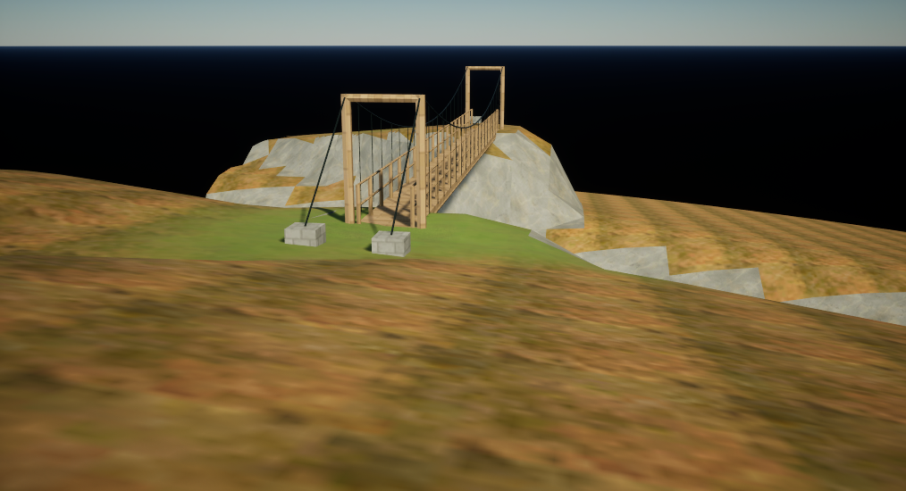
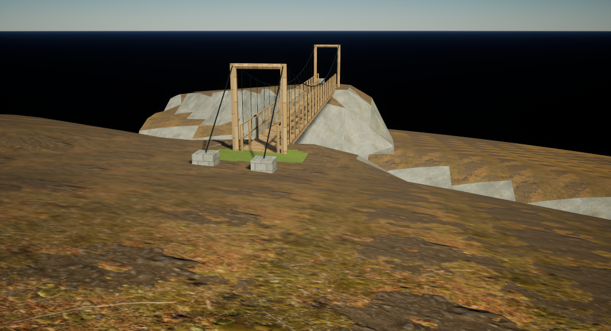
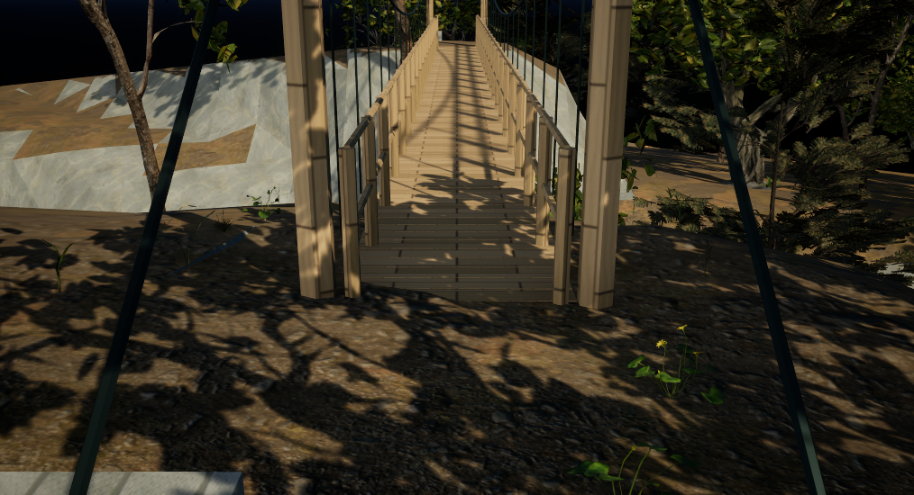

# Reserve cleft photo-ground candidate

The cleft floor now has readable leaf and soil detail at walking distance. A new material uses the existing CC0 photo and G16 height inputs at roughly 3 m repeats across terrain component slot 1. Relative heights choose irregular leaf/soil patches; slope increases exposed soil. Geometry, UVs, rock slot 0, clearing grass slot 2, bridge materials and 229 source plant transforms stay unchanged.

The source 8K atlas supplied about 11 texels per surface metre at this location. The candidate replaces its low-frequency fallback with coherent photo PBR layers. Color, roughness, metallic and normal use the same layer weight. Height selects layers and does not displace the mesh. Raw OpenGL normal RGB stays linear and is decoded in the shader; do not substitute automatic BC5 normal decoding.

These unmodified native images use the same grounded Mid camera, movable lighting and physical EV13 at 1014 × 550. They compare only the floor material:

The clean UE 5.8.4 D3D12/SM6 review verified all 120 serialized package hashes, all 67 texture policies and before/after desired-mip checks across 6 captures, exact saved material graph and Author/cold/final scene equality. Five static components retain persisted `NoCollision` profiles with mesh-default collision disabled. Sun/fill/sky are movable, removing the observed unbuilt-light Preview marks. The caller restored viewport/background state 8 native frames later; the final critical-log guard was empty.

The full native material compiled to 531 pixel shader instructions and 13 samplers; GPU cost still needs its own measurement.

This first review accepts bounded slot 1 readability. The later clearing/context pass below addresses the hard slot 2 material boundary. Pale facets, rigid trenches, the far horizon and outer vegetation remain work. Neither result establishes a finished reserve, gameplay collision/navigation or frame-rate improvement.

`unreal/Shaders/Private/LTCleftFloor_v002.ush` is byte-identical to the tested shader. [The material recipe](../../art/reserve_revision/cleft_floor_v002/material_recipe.json) records all 8 CC0 photo/height downloads, hashes, import/channel rules, physical repeats, 9 required function texture inputs and the project-authored region mask. It includes the exact two Custom node call bodies and UE source-world adapter. Other engines must supply their own proven position/normal conversion. The existing native material retains its previous macro graph and 14 texture-object references; this source extraction does not qualify a fresh standalone graph or redistribute Epic vendor material functions.

`tools/unreal/viewport_background_scope.py` extracts the clean background/realtime lifecycle without file IO, asset mutation or override-stack writes. The caller owns camera/material/selection restoration. Submit the restored background CDO, then poll strict verification after at least 2 native frames on the same editor thread. A source-byte guard is required. The helper is CPU-tested; its inline predecessor has the actual clean review proof. Integration still needs caller-specific native validation. Include the new shader once per material; it shares legacy evaluator type names, so do not combine legacy woodland evaluator headers in the same material compilation.

Photo credit: Poly Haven, CC0-1.0. forest_leaves_02: Rob Tuytel. forest_ground_04: Rob Tuytel, with minor adjustment by Rico Cilliers. The layout mask is project-authored. See [source notices](../../art/reserve_revision/cleft_floor_v002/NOTICES.txt).

## Clearing continuity and bounded source context

A later saved-map derivative applies the same existing photo-floor material to terrain component slot 2 (391 triangles), removing the separate hard green landing patch. A source-accurate surrounding mesh adds 134,698 triangles: the declared 192 m source selection minus the exact original cleft triangle IDs, with original corner order and attributes retained. Together with the unchanged 16,786-triangle cell, the terrain totals 151,484 triangles. This is exact source extraction and unused-attribute compaction, not smoothing or a reconstructed landscape. The [small context recipe](../../art/reserve_revision/cleft_context_v003/layout_recipe.json) records the bounds, roles and exclusions.

Independent cold review verifies all 122 serialized files, the original five static meshes plus the context mesh, 67 fixed texture policies/formats and desired-mip brackets around eight native captures, actual sky/sun fields and all 229 original plant transforms. Near/Mid/Overview enable the plant components; the Ground diagnostic deliberately hides them. No new neighboring plants were added, and retained placement count does not mean every tree is inside a camera frustum. The floor graph remains 531 pixel instructions/13 samplers. [Compact evidence](evidence/reserve_context_v003_evidence.json) records the source and image hashes; these are not frame-time measurements.

Root visual review accepts only the clearing/floor continuity and bounded source extension. Rigid step trenches, pale faceted cliffs, black far horizon, sparse outer context and final art remain held. Native Landscape reconstruction is a separate new source family under study; no Landscape implementation or qualified output is established by this evidence. Collision/navigation, gameplay, FPS improvement and a finished reserve or town remain unqualified.
