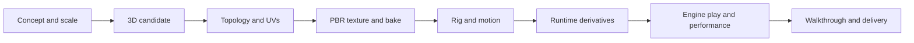

# Staged 3D asset pipeline

The supplied pipeline reference is adopted as a production workflow: choose an appropriate tool for each stage, retain its output, and inspect the handoff before continuing. Living Town keeps its Breton summer palette, readable interiors and varied reserve landscape throughout the chain.



Static buildings, furniture and landscape assets pass directly from texture/bake to runtime derivatives. Characters and moving props also require the rig/motion stage. A candidate can return to an earlier stage when its shape, layout or surface cannot meet the reference.

| Stage | Reviewable output | Acceptance at the handoff |
| --- | --- | --- |
| Concept and scale | Consistent views, dimensions, palette and intended use | Silhouette, proportions, regional character and material choices agree across views. |
| 3D candidate | Versioned Blender source and portable geometry | Plausible construction/anatomy, metric scale, clean separation of functional parts, source and rights recorded. |
| Topology and UVs | Retopology/remesh, UV layout, surface and basis report | Suitable deformation/cutaway boundaries, controlled density, seam placement, texel density, normals, tangent handedness and UV distortion. |
| PBR texture and bake | Albedo, roughness, metalness and explicitly authored/baked normal inputs | Surface detail reads at near/mid/far distances; lighting response, color space, alpha, seams and normal-map convention are checked. |
| Rig and motion | Skeleton, skin weights and named clips | Rest pose, proportions, joints, foot contact, clothing clearance and actual evaluated poses; practical idle/walk/use/eat/sleep actions as required by the asset. |
| Runtime derivatives | LODs, instances, collision, material variants and portable exports | Source identity/ownership survives conversion; visible detail and collision remain appropriate for use; resource costs are recorded. |
| Engine checks | A real scene, playable use cases and hardware measurements | Loading, frame times, memory, transitions, interactions and teardown, alongside actual rendered inspection. |
| Delivery | Tagged assets, source, manifests, narrated MP4 and GIF excerpt | A clean restore/import and the demonstrated journeys are reproducible; captions distinguish gameplay from architectural camera tours. |

## Asset families and replacement

Each candidate belongs to an explicit asset family and revision. A fresh generated character, reconstructed house or new vegetation model can replace an older family after its own review. Earlier sources and receipts remain recoverable. Resident/gameplay identity is separate from the appearance asset.

Preservation contracts follow the operation. Retexturing an adopted model preserves its geometry, UVs, skin and clips. Remeshing deliberately changes topology and needs shape/deformation comparison, fresh UV/basis/bake evidence and any required weight transfer. Rig replacement needs new motion/retargeting checks. A new family is judged against the design and its declared game role. It does not inherit an old family's passed checks by reusing a filename.

Freeze UVs before final texturing. A UV change invalidates dependent textures and tangent-space bakes. A normal/tangent change requires a normal-map convention and lighting check. Separate high-detail authoring sources from explicitly derived runtime assets, with the derivation and loss of detail recorded.

## Texture registration and surface quality

For characters, use a mesh-derived head/feature guide and a head-only unlit UV reference when painting a registered head atlas. Distinguish eye corners, opening centers, rims and approximate anatomical points. Verify actual generated dimensions and feature placement before applying a candidate. A plausible flat texture still requires inspection on the original geometry under several views and lighting conditions.

Keep albedo lighting restrained, record sRGB versus linear channels, and obtain roughness/normal data through an explicit authoring or bake method. Detail should support the surface's physical scale. Padding, filtering, mips and compression are consumer settings with their own checks. A requested image resolution and a generated file's actual dimensions are recorded separately.

For buildings and interiors, inspect wall relief/finish, trim, corners, material transitions, furniture facing and reachable circulation. Preserve building/floor/room ownership through export. For the reserve, review terrain transitions, canopy and understory variety, flowers and horticulture at walking height as well as aerial distance.

## Tool adapters and evidence

The adapters keep inputs, outputs, tool/model versions, relevant settings, provenance/rights, resource use and a recovery path for each stage. Generation, technical validity, visual acceptance and approval for engine use have distinct statuses. A job finishing successfully establishes only its recorded scope.

Blender handles native inspection, cleanup, UVs, baking, rig work and portable export. Image generation supplies concepts and reviewable raster candidates. Tripo or another specialist can provide individual generation/remesh/texture/rig stages after its actual interface, entitlement and output preservation are verified. The pipeline can substitute a tool at a handoff without replacing the town's source model or simulation authority.

Choose the implementation per stage. Unreal is the primary runtime: use its static-mesh LODs, instancing, material evaluation, collision, CharacterMovement and measured loading/rendering where those serve the result. Blender remains available for connected topology, UV and surface authoring, baking and portable asset review. Existing procedural meshes, layouts and adapters may be replaced when a better native result is demonstrated. Engine-specific authored derivatives retain their source identities and a portable asset handoff; engine neutrality does not require identical editor implementations.

The saved reserve cell already uses vanilla Unreal instanced components and native near/far LODs without the custom streamer. The character's [encoded confidence-normal helper](encoded_normal_material.md) uses native material evaluation while retaining original geometry and maps. Neither result enables unqualified full-town runtime flags. Editor captures, game journeys and measured performance remain separate checks, so a native feature is selected for its demonstrated behavior rather than its name.

Existing repository entry points:

- [Asset toolbox](../ASSET_TOOLBOX.md): recipe-driven authoring and evidence inventory.
- [Offline workflow customization](../../tools/asset_refinement/workflows.py): pinned workflow layout preparation; model execution and rights are separate checks.
- [Retexture preservation](../../tools/town_upgrade/tripo_refinement.py): decoded GLB geometry/UV/skin/clip comparisons, with material changes and visual review explicitly separated.
- [Character candidate inspection](../../tools/asset_refinement/inspect_character_candidate.py): read-only geometry, rest bounds, PBR/image, skin and channel-used animation facts for a declared appearance family. Original bytes stay intact; 8K PNG/JPEG diagnostics use bounded strips, and larger images explicitly defer pixel facts. A facts report does not qualify art, actions or engine use.
- [Fresh Breton cafe-worker concept](concepts/cafe_worker_breton_v001/README.md): selected front reference, full prompt and provenance for a new character family.
- [Cafe-worker source review](character_cafe_worker_source_v001.md): measured source geometry/maps, actual GPU views and the visible defects held for refinement before rigging.
- [Native C++ town pilot](unreal_native_town_streaming.md): actual import/readback evidence and pending world/performance checks.
- [Custom Unreal texture policy](unreal_texture_import_policy.md): tested source-sized texture import for fresh definition pipelines, retaining their existing mesh and material settings.
- [Typed Unreal material-default readback](unreal_material_function_readback.md): actual function-input values and literal preview connections, with effective shader behavior reviewed separately.
- [Half-timber living-room candidate](interior_living_room_v001.md): matched furniture/finish views, portable output and independent saved-artifact reopening.
- [Tripo Unreal receiving bridge](tripo_unreal_bridge.md): actual native start/status/stop evidence, the separate Studio handshake and detail-asset intake checks.
- [Two-view cafe-worker source](character_cafe_worker_multiview_v002.md): actual Tripo detailed-geometry/PBR request, preserved original, measured maps and pending close review.
- [Portable material-image derivative](append_metallic_roughness_image.md): tested append-only metallic-roughness image replacement, retaining the original geometry/UV/normal and scene data.
- [Portable normal-image derivative](append_normal_image.md): calibrated native normal output carried through core glTF, with exact old BIN/JSON preservation and matched portable review.
- [Complete-character framing](character_framing.md): host camera math over every native posed render vertex, with explicit projection assumptions and separate native adapter qualification.
- [Native root alignment](native_root_correction.md): an opt-in Unreal player correction using actual blend weights, with tested pose preservation and explicit remaining motion/contact gates.

The current Unreal target consumes engine-agnostic source assets through explicit engine adapters. A model becomes eligible for the final walkthrough after its relevant stage reviews and playable/visual checks, including actual performance observations, are complete.

## Closed toolset source preflight

Copied Python toolset wrappers can register successfully while retaining an old class docstring. Two actual preview attempts stopped before their first method because that native description differed from the registration adapter's declared `DESC`. The underlying saved assets were unchanged.

Run the [source description check](../../tools/unreal/toolset_source.py) before freezing or launching such an adapter, substituting its real source path and class name:

```powershell
python -B tools/unreal/toolset_source.py --source path/to/review_tools.py --class-name CafeEntranceVisualTools
```

This reads the literal module description and cleaned class docstring through Python's AST, without importing Unreal or executing the source. It rejects mismatches, missing/ambiguous declarations and unsupported dynamic descriptions. Its result binds the inspected file's bytes and SHA-256. Native registration, exact tool schemas, source guards and actual rendering remain separate requirements. Eight host tests pass; replay against both failed wrappers rejects them, while the source of the successful native avatar review passes. No earlier failed engine report is relabeled.
