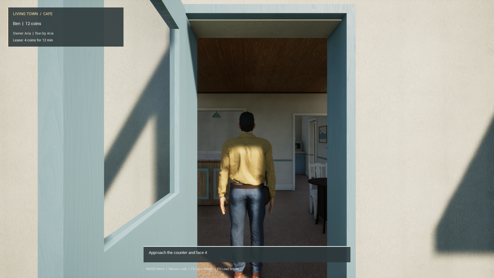

# Cooked B749 startup diagnostic

The explicit Development Game diagnostic verifies a SHA-pinned loose fixture, the mounted Pak providers and five critical cooked packages while retaining their original source provenance. Existing loaded-world checks still run. Native QPC markers record module startup, root-map loading, identity verification, controllability and the first ready player-view sample. The view marker is a game-thread camera/viewport observation.

## Measured startup

One fresh Unreal 5.8.4 Win64 Game process used the current monolithic target, verified Pak002 and Radeon 8060S with D3D12/SM6. It became controllable **5.6393 seconds after the host launch request**; its first ready player-view sample followed at **5.6456 seconds**. The process-creation bracket places those events at 5.4882–5.6393 and 5.4945–5.6456 seconds respectively.

All 600 captured frames contain paired consecutive native/player frame identifiers at 1920×1080. Stock Shot550 follows the ready sample at frame 424. The process exited naturally with Windows exit code 0 and an empty owned job before cleanup. The host took 41.08 seconds, including copying and verification.

Source hashing and runtime copying warm the OS file cache; the GPU driver cache remains intact. These are single-trial startup observations for this slice. The capture does not test movement, frame-rate budgets or GPU presentation latency. Thirteen shader-preload wait warnings remain recorded. Legacy Ben is retained; the new MetaHuman workwear and wider town still need integration and visual refinement.

## Capture lifecycle

Start the threaded GPU capture after engine initialization with the exact deferred command `-ExecCmds="CsvProfile FRAMES=600"`, retaining `-csvExecCmds=550:Shot` and `-ExitAfterCsvProfiling`. Preserve Unreal's key/value quoting when creating the Windows process.

The boot `-csvCaptureFrames` route previously reproduced nonzero shutdown code 777003. The deferred route follows the earlier successfully measured profiler lifetime order and produced natural exit 0 here. The capture start changed, so these CSVs do not support an old/new FPS comparison.

The [evidence index](evidence/b749_packaged_startup_20261107.json) binds the build, cook, Pak, native run, CSV, screenshot and independent closed review. Game and Editor builds plus all 12 native tests passed; the diagnostic remains explicitly gated to Development cooked B749 startup.
