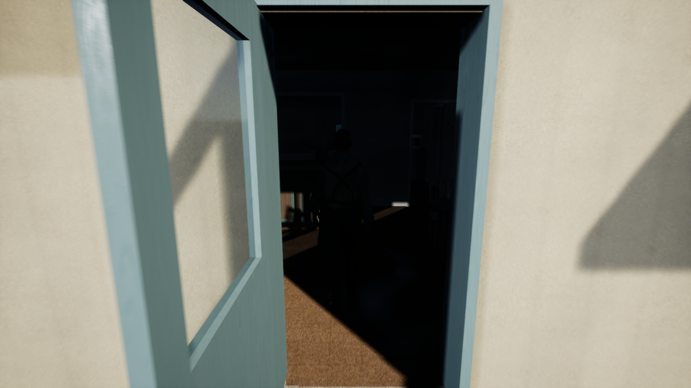
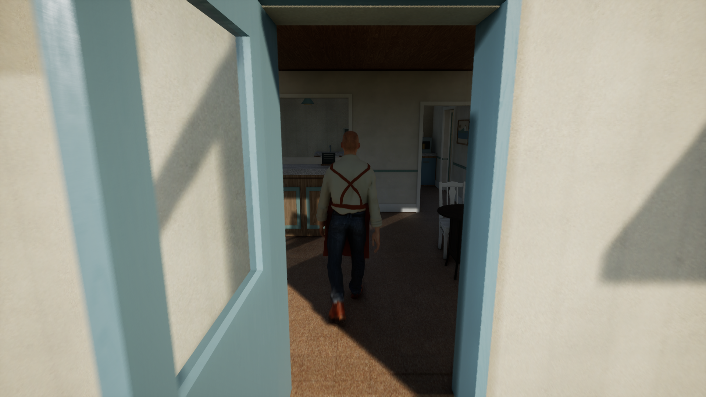

# Current61 avatar preparation and native observations

The current61 worker now has a separate, once-baked Unreal asset path and a native validation path. This change supplies preparation, inspection and an opt-in game test. It does not activate a replacement resident, change the default map, or establish final character art or contact quality.

## Asset and runtime boundaries

The body retains its source 61-joint rig under one Unreal wrapper bone: 62 bones, 43,432 render vertices, 72,848 triangles and eight material sections. The bake applies source scale once; the runtime strategy requires unit mesh scale and a plain `UAnimSingleNodeInstance`. Idle and walk retain their source clip timing and use the saved BlendSpace's real interpolation data.

Binding version 3 explicitly selects `current61_baked_v1`. It requires a complete avatar/contact descriptor, measured motion-axis speed, clip durations, socket transform and qualification hash before the native café character can use it. Versions 1 and 2 keep their existing paths. No production version-3 descriptor has been adopted. The candidate test deliberately creates an ordinary `ACharacter` and cannot grant that qualification.

The active player's bone policy continues to update its interaction socket while occluded; it restores the previous policy when unpossessed or destroyed. This is limited to the qualified possessed player, rather than enabling full bone refresh for every resident.

## Editor preparation and observation

`LivingTownMaterialInspection` remains an Editor module. It supplies explicit current61 source/avatar authoring and separate read-only mesh, skin-weight, current-pose, hair, collision and material-resource observations. These helpers are restricted to their named asset families; they are not general gameplay startup work.

Material resource preparation is an explicit operation, separate from the readiness reader. The preparer accepts only the eight saved body materials and saved hair material, verifies the clean package and expected file hash, and requests stock `UMaterial::CacheShaders(Default)` once per material object. It does not edit or save those assets. The reader checks each material's own usable shader map, feature/quality level, resolved resource and saved-state custody. A global shader queue reaching zero alone is insufficient.

Fixed-camera captures record the actual Lit mode while the orthographic camera is locked, then restore the original viewport. Restoration also clears stale controlling-camera data through the public level-viewport API before restoring the saved projection and view fields. An unrelated existing actor lock is refused.

## Completed local checks

The integrated source was built with installed Unreal 5.8.4 on Windows and run on Radeon 8060S using D3D12/SM6. The Editor build is separate from a Game-target build or package.

| Check | Observed result | Limit |
| --- | --- | --- |
| Native109 Editor build | Successful UBT build and closed owned process; 110 native inputs | No Game-target, cook or package claim |
| Native110 Editor build | Rebuild with focused V3 parser regression cases and unsupported-version fixture corrections; runtime implementation unchanged | Synthetic parser metadata is separate from a qualified production avatar |
| Native110 binding regression | All three Editor suites pass: base binding, authored part contract and worker110 binding; includes one complete synthetic V3 case and 20 malformed V3 refusals | No assets are loaded and no production contact descriptor is created |
| Hair014/015 captures | 25 saved assets unchanged; exact raw hair geometry and RGBA source; all nine own material resources ready; five actual Lit GPU views; exact viewport restoration | Hairline, highlights, neck/jaw bands and fabric detail still need art work |
| Game004 candidate | 325 natural samples, 42 selected vertices and all 62 bones; maximum component skin reconstruction error 0.000308 mm; four phase/speed-gated 1920×1080 GPU images | Candidate motion and numerical reconstruction do not qualify gait, stance slip, palm anatomy or reach |
| Separate Game004 CSV interval | 1,008 frames over about 10 seconds; mean frame time 9.921 ms, p95 10.718 ms; mean GPU time 8.358 ms | Uncooked partial scene, with a read-only observer; not a whole-town FPS benchmark |
| Game005 private Lumen comparison | GI method 1 observed at setup/finish; 315 natural samples and four GPU images; shaded café surfaces and worker become readable without changing exposure, lights or materials | Presentation improvement accepted for further candidates; final room lighting and camera work remain open |
| Separate Game005 CSV interval | 766 frames over about 10 seconds; mean frame time 13.061 ms, p95 14.149 ms; mean GPU time 11.461 ms | Same partial-scene limitation; two observations do not establish a general Lumen cost or complete-town frame rate |
| Portable C++17 regression | Property, care, world-property and world-meal suites passed under MSVC | Engine-independent tests do not replace native integration |

Game003 completed its native observations but failed the overall host because an Engine.ini assignment of the cheat CVar `t.IdleWhenNotForeground` produced a startup ensure. Game004 removes that assignment and observes the stock zero value at setup and finish. The failed run remains failed.

Game004's café is too dark in shaded interior areas. Its configuration permits Lumen scalability but does not select the dynamic GI method. Game005 selects `r.DynamicGlobalIlluminationMethod=1` in the private candidate configuration and verifies that live value without setters. The matched walk view now shows shaded walls, counter, furniture and the worker; exposure, light transforms, materials and saved source assets remain unchanged. Carry this setting into further presentation candidates. This source change does not alter the project's default renderer settings, and final interior presentation remains open. Sole samples also include negative clearances and substantial surface velocity; contact remains open.

These are original native GPU screenshots from the diagnostic scene, not concept art or the final town walkthrough. Walk-phase timing differs between runs.

| Game004 shaded interior | Game005 with Lumen diffuse GI |
| --- | --- |
|  |  |

## Running the candidate test

Build the matching native source with the [isolated native build/bootstrap workflow](../../unreal/README.md). The test requires its exact external saved map, scene descriptor, avatar packages and source/hash bindings; those binary assets are not embedded in this source change.

The opt-in test name is `LivingTown.Development.Current61GroundGameCandidate`. It requires ordinary `UnrealEditor.exe -game` startup and the explicit `-LivingTownCurrent61GroundCandidate` switch, plus its expected viewport CSV map/flag. Running it without its complete bound assets is a refusal, not a pass. It is compiled only with `WITH_DEV_AUTOMATION_TESTS`; Editor inspection functions are not used in the game observation path.

Before first sampling, the native test requires three distinct eligible frames with no registered asset compilation and no parallel animation evaluation, within a finite 180-second admission window. It never manually advances animation to satisfy readiness. The later CSV interval excludes the native CPU skin, surface rays and screenshot work. Exported evidence remains candidate-scoped.

## Evidence identities

Local receipts are retained outside the repository under the 2026-11-01 native run archive. These hashes bind this report to actual outputs; the archive is not a downloadable release.

| Receipt | SHA256 |
| --- | --- |
| Native109 `BUILD_RECEIPT.json` | `66f5a78c556a3a5d8a770bb8cfbe8fe005aab3165d1ca788b3b12a1b105cf1cd` |
| Native110 `BUILD_RECEIPT.json` | `518daea3581f3edbbb34088f72fbbe14f5694f0bbeceff23db7d58343773391b` |
| Native110 three-suite root review | `250f47b5ca4465a9ba6666ef8e6335fed6374e72c5b897b9d909af8f2ac5e0dd` |
| Hair015 root technical/visual review | `c71fea6d1cfc4bcccd0295be4f98bd9561e6486cf67f7975020e9b9539019472` |
| Game004 root observation review | `a8a4f4ed8fdda0e1a11975759d71659ae6a4e21088ea9b3308eeb7edd0197b75` |
| Game005 root Lumen comparison review | `2e161290d8eb2c84149080ce099ef0d2bb620c56747833c3fbb66d243424c1c4` |
| Four portable regression results | `1a27308a517acad52baccb0850df0605de8e91ef037ed6bfcd166f6ff9dd3a25` |

Remaining delivery includes character surface repair and physical gait/contact, native daily-life action integration, the complete town population and vegetation, representative interiors, cooked startup and whole-town profiling, followed by the new narrated/subtitled walkthrough. The existing README showcase remains the previous Godot reference until that new recording is verified.
