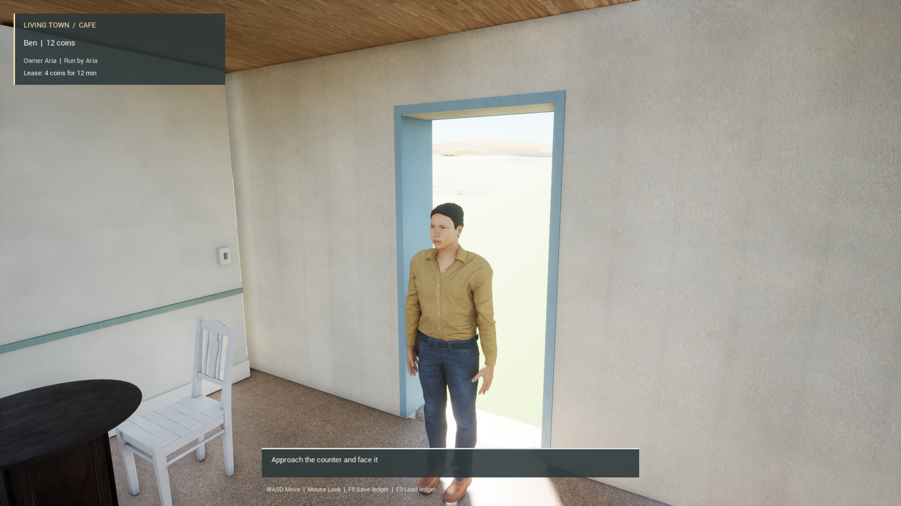
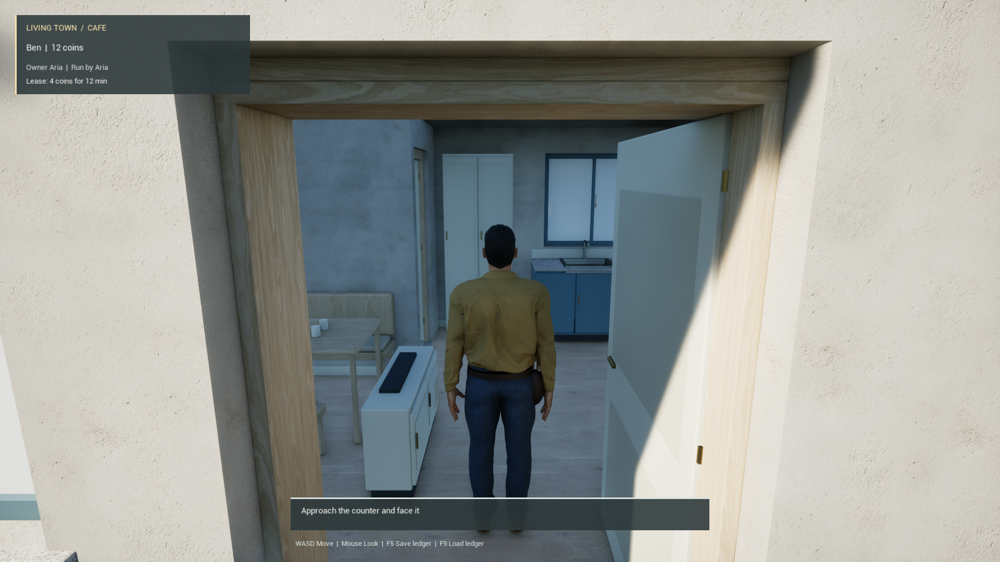

# Daylight and interiors with software Lumen

Physical daylight previously left the café interior very dark and washed out the character when viewed towards the doorway. A controlled comparison kept the same materials, geometry, 35,000 lux sun, sky, camera and quality settings. Software Lumen made the ceiling, walls, furniture and clothing colours readable.

`DefaultEngine.ini` now explicitly selects software Lumen, screen-space reflections, mesh distance fields and deferred rendering. Hardware ray tracing stays disabled. The existing extended EV100 exposure range remains enabled. These are startup settings; use a fresh process. No C++ or asset geometry changes are needed for this configuration.

## Actual playable route

A fresh Unreal 5.8.4 normal Game process consumed the candidate project configuration with the existing B749 town profile. It completed all 27 waypoints from the café to the house interior and back through ordinary CharacterMovement input. The sampled path measured 202.38 m against the planned 202.57 m, with 1,039 route observations and 9,752 input frames. The house photo retains actual capsule support on floor M0231.

The four captured views cover the café doorway, character quarter view, house room and return. They establish lighting readability in this slice. Character identity, furniture arrangement, the bright view through the exterior doorway and the wider town still need refinement.

## Measured cost

The earlier matched stationary comparison added approximately 4–4.5 ms to median frame time: café 7.78 → 12.30 ms, character quarter 8.29 → 12.36 ms. Those two stationary windows are distinct from the later walking measurement.

The integrated run captured one new 30-second walking window at 1920 × 1080 on Radeon 8060S, D3D12/SM6. Shader/loading preparation and all photograph holds occurred outside this window. Among 2,508 retained frames, FrameTime was **11.90 ms median, 12.89 ms at the 95th percentile and 45.50 ms maximum**. Positive native GPU counters had a 10.26 ms median; their exact phase and freshness remain unqualified.

An adjacent CSV row records 18.43 ms in GarbageCollection, GC/Count 1 and 44.40 ms GameThreadTime. The retained sidecar around the long frame records ordinary grounded walking and about 0.31 ms observer time. Further profiling is needed to attribute the whole hitch. Per-frame actor, camera and control transforms are retained with the timing data.

This is an observed normal Game slice, with fresh private caches and a naturally exited process. It does not establish a whole-town or packaged-game frame budget. The 382.52-second host duration includes source staging, preparation, the complete journey and photographs; it is not an initial loading-time measurement. Cooked startup and loading work remains open.

The [evidence index](evidence/b749_lumen_integration_20261106.json) binds the configuration, captures, native run, CSV and independent review. Original source assets and the separate native023 worktree remain retained. The roof inspection map is a separate authoring candidate and cannot replace the profile's tagged streamed unit directly.
