# Native town streaming pilot

The native port moves outdoor asset loading and component construction out of the legacy eager town startup. It uses cooked, typed root/render-unit data assets, soft mesh references and world-owned asynchronous requests. The portable source assets and simulation kernel remain separate from this presentation layer.

This is an opt-in pilot. The driver defaults to disabled, all new qualification fields default to false, and the default map/GameMode is unchanged. It requires the existing qualified native café before starting. It creates no population, duplicate café or fixture behavior. Authoring the data assets, qualifying collision/materials and testing a real streamed world remain required before activation.

## Runtime behavior

- Root, unit and mesh loads retain their streamable handles. Dependency closure and support reference counts keep shared units alive until their last consumer leaves.
- World ownership, weak callbacks, request tokens and an epoch reject stale completions after cancellation, restart or teardown.
- The pilot permits at most two concurrent incoming units. Registration, collision changes, visibility changes and destruction share a budget of four component operations per tick, serviced across units. Static meshes and ISM groups have no per-object tick. Loading radii use hysteresis.
- Arrival and retirement advance incrementally. Departing geometry stays while the demanded cohort is incomplete or the active driver has no focus. Reacquisition restores surviving component slots without duplicates. Explicit stop cancels requests and drains even without a focus; driver loss also drains. Geometry belongs to a separate world actor so destroying the driver cannot bypass this budget.
- Full native mesh identity is checked when an immutable loaded asset is first installed. The cache also checks lighting/collision GUIDs and material paths, slots and blend modes. It is invalidated on release. It does not promise to detect arbitrary in-place editor mutations without identity changes.
- Original float64 placement matrices are retained alongside qualified native transforms. Shear, reflection, invalid matrices, unsupported ownership and reserved café source IDs refuse.
- An incoming failure stops new work and retains already resident units until explicit stop/teardown. It does not silently substitute missing geometry.

The operation budget counts lifecycle policies rather than every internal engine call. It does not bound milliseconds, shader compilation, mesh hashing, a large registration or teleport landing safety. World/subsystem teardown remains a synchronous cleanup exception. Actual town frame timings and loading observations are still needed.

## Editor readback

The editor-only `LivingTownTownSliceReadbackLibrary` exports closed LOD0 buffers for the fixed exterior pilot namespace into a fresh owned output directory. It records position, normal, tangent, UV, color, index and section data; material slots/modes; precision/build settings; collision identity; and source-package hashes. It neither modifies assets nor places actors. The editor module depends on the runtime module; the game target does not depend on this editor helper.

Unreal's installed Python wrapper returns `None` for a C++ false result when output parameters exist. A successful `ExportTownSliceMeshes` returns `(receipt_json, error)` with its Boolean stripped. A failed Python call cannot expose the native Error output through this signature. Consumers must save raw return diagnostics before parsing and must not assume a three-item tuple.

The new tile-authoring and Westwood-material helpers instead return JSON strings with explicit status/error/readback fields. Tile authoring is restricted to the frozen pilot plan and fresh staging paths. Its preview entries are editor-only, non-ticking and non-colliding; the driver and qualification flags remain disabled. They require an editor view with Game View off and do not establish a playable world. The material helper inspects constant-input semantics and can clear only four named overrides on the marked new Westwood derivative. Compilation establishes neither its shader output nor visual quality.

## Evidence and remaining work

The outdoor/material/lifecycle implementation was verified in the 56-input source cut SHA-256 `f5b0b23d11c630b328631196e5e424d72f0a2bd9ad775c13b639370618f810ba`. It compiled successfully with UE 5.8.4/58902052, MSVC 14.44.35229 and SDK 22621 in 114.875 seconds. All 60 bootstrap/source/receipt checks passed against that build.

Nine native automation tests passed in a separate hardware run: the four existing café authority tests, tile matrix/demand/metadata/unit boundaries and `LivingTown.Native.TileLifecycleBudgetWorld`. The new test observes real transient world/components with a one-operation budget through arrival, cohort hold, partial retirement, reacquisition, cancellation, driver loss and cleanup. It uses synthetic primitives, so it does not qualify imported production assets or frame times. Eleven native SHA known-answer cases also passed; the run had zero errors, warnings or skipped tests.

An actual assets-only hardware D3D12/SM6 run imported and saved all 1,488 outdoor definitions and exported their native buffers in 240.704 seconds. It used the Radeon 8060S, peaked at 11,196,723,200 bytes aggregate RSS, preserved bound source/config/private data and reaped its owned process tree. This measures editor authoring, not game startup or sustained FPS.

The initial saved-buffer comparison failed because its validator incorrectly applied the importer's mirrored-transform winding branch to identity definitions. That failure is retained. The corrected offline comparison matches positive-area geometry, float32 UVs and material assignment on all 1,488 definitions, with zero missing positive faces and zero extra faces. All definitions meet the declared normal/color storage-format checks. The engine omits 5,726 exact source zero-area faces across 116 definitions; full-source geometry equality remains false for those definitions.

Of the 1,488 definitions, 1,486 pass the complete narrow array-format checks. The two original named Mikk derivatives have real zero tangents affecting four positive-area triangles each, despite their recompute flags and preserved finite normals. Those old assets remain refused. This comparison did not reimport or change any source/native assets.

A separate numerical investigation traced the zero weights to rounded dot products on very thin triangles. Two fresh `TangentBasis_MikkStableAngle_f64_v001` derivatives use an explicitly altered Mikk angle calculation and provide their reviewed tangent basis to the importer. This is a new basis lineage: original tangent/sign preservation is not claimed. Their actual assets-only Unreal import took 43.265 seconds on Radeon hardware, created exactly two mesh packages and preserved all 1,736 prior packages. After the editor was reaped, an independent saved-buffer comparison passed all 24 sliver and 2,200 grass triangles, including source geometry/UV/material assignment, normal format and provided derivative tangent/sign fidelity. Both have zero tangent failures; actual full-UV/high-basis precision and CPU access were read back.

The two-buffer comparison SHA-256 is `8070434d9d512b75368a4086d37f8eb9486a7b46e62b423e641fe9398d0fbe3d`. It does not establish the grass source alpha cutoff, normal-map graph/green-channel behavior or rendered shading on 55 flagged grass corners. The typed root has not been remapped to these candidates. Material sampling, collision, rendered views, actual streaming cancellation/teardown and gameplay/performance qualification are pending. No whole-town or final-art acceptance follows from the build, tests or imports.

The seven-cell source slice retains whole-owner closure, exact shared-instance provenance and the external café exclusion. Its current authoring derivation has 116 render units, 1,638 component entries and 587 unique repeated placements using 52 prototype meshes. This offline derivation is not a created or qualified runtime world.

## Current viewport and saved-material review

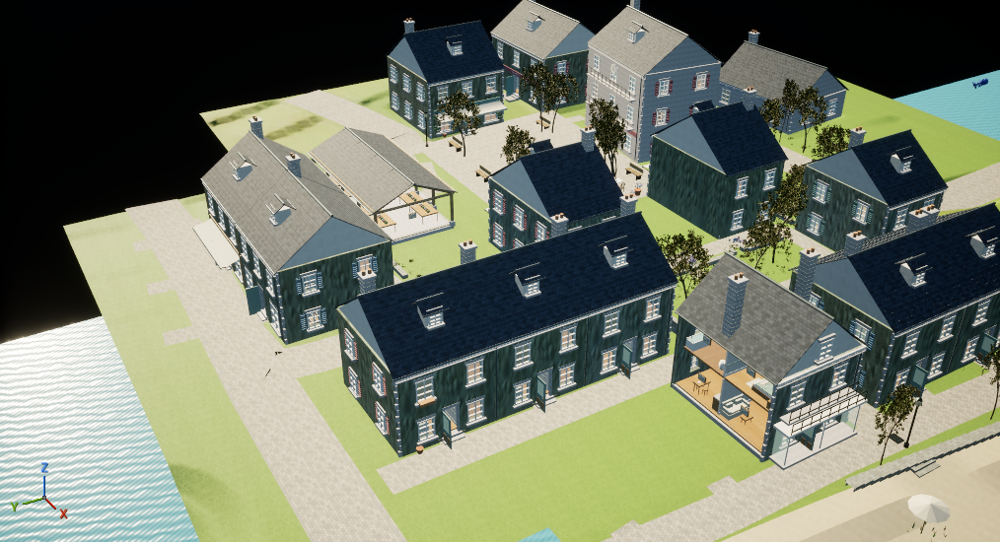

The current 58-input source cut, SHA-256 `716d7364e8fdcb3ee7872d93ae49003a1185a2c7db3fab8382aebacfc4767e2e`, adds an editor-only exact-current-viewport helper and its `UnrealEd` dependency. The other 55 inputs remain byte-identical to the earlier cut. Its actual build completed in 120.906 seconds, exited with code zero and reaped its owned processes.

The [editor helper](../../unreal/Source/LivingTownMaterialInspection/LivingTownViewportInspection.h) reads the same `GCurrentLevelEditingViewportClient` used by installed MCP `CaptureViewport`. A scoped fixed Mid review sets perspective, Lit mode, scene-driven exposure, lighting flags and a temporary realtime override, then restores both camera transforms, view modes, flags, exposure, widget and realtime state. It refuses an unrelated world, PIE, actor lock or an existing incompatible override. Direct client facts do not observe later render-family adjustments. Background editors can append a later throttle override; the local offscreen review launcher temporarily disabled that setting in its owned editor's CDO memory and restored it without saving configuration.

A fresh hardware run reopened all 1,854 saved package files and captured Unlit plus manual EV12/13/14 frames. Native client facts matched before and after each Lit capture; viewport restoration and the temporary owned-editor background-throttle restoration passed. The run took 186.312 seconds, peaked at 13,125,591,040 aggregate private bytes under a 16 GiB authoring limit, preserved sources and reaped all owned processes. This measures editor review, not game loading or FPS.

The image remains held for presentation work. The camera looks below the horizon across the edge of the seven-cell terrain slice, so surrounding landscape coverage needs review. The original foreground plaster appeared teal; those exact wall meshes have no source or native vertex-color buffer. The image does not establish complete-town or final-art acceptance.

| Original native material bindings | Source atlas bound to two derived materials |
| --- | --- |
|  | 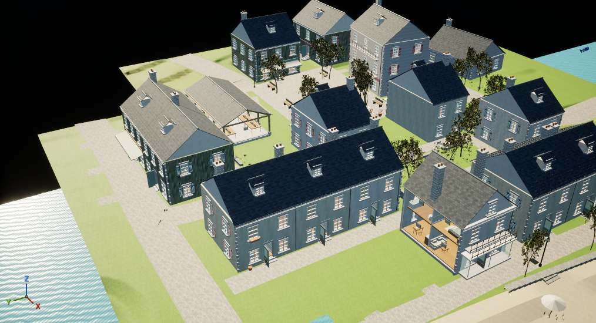 |

The later matched EV12 comparison isolates a real import defect. Both plaster materials referenced the engine default texture for BaseColor. Their shared source albedo is a valid 1536 x 1536 PNG; the original glTF Interchange import rejected its non-power-of-two dimensions and omitted all four texture aliases. A fresh, explicitly configured legacy TextureFactory import retained the exact source image bytes and dimensions. Two cloned materials change only that texture binding. Both frames were captured after the full scene, original materials and clones were warmed; camera, exposure and source-sized texture readiness were checked for both. The corrected bindings remove the teal streaking. Plaster still reads cool gray at this distance, so color, normal strength and close-range surface quality remain art work.

The review completed both captures and restored all 61 component override arrays, the native viewport scope and the owned background-throttle setting. Original packages were preserved and owned processes were reaped. It took 224.719 seconds and peaked at 13,404,962,816 aggregate private bytes. The log contains one handled engine ensure: a redundant public realtime-enable call attempted to remove a subsystem override that was absent. The editor continued through capture and restoration; this is completed evidence with a warning, not a clean stability qualification. The legacy TextureFactory setting does not fix the separate Interchange pipeline policy. A durable one-shot importer must explicitly allow valid non-power-of-two source images and refuse missing referenced texture bindings.

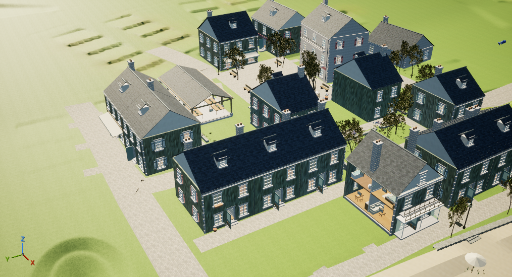

The subsequent [custom import-policy test](unreal_texture_import_policy.md) located the actual defect in the town's freshly constructed generic pipeline. The configured glTF pipeline already allows these images. The tested helper now enables the custom pipeline explicitly while preserving its single-stack geometry settings and `IMPORT_AS_MATERIALS` mode; all five fixture materials passed actual graph checks and fresh reopening. Its full definition rebuild is recorded below; saved-world authoring and visual review remain separate steps.

A later full definition rebuild completed in 467.625 seconds, peaking at 9,529,548,800 aggregate private bytes and reaping its owned processes. All 93 source materials, 153 texture-role aliases, 71 images and 38 connected texture transforms passed the declared native binding/dimension checks. The accepted geometry comparison retains 1,486 narrow passes and the two original source-basis holds. Render hashes and material slots match the prior definition cut, but collision GUIDs and metadata hashes changed on all 1,488 meshes. Fresh authoring therefore recreated the 117 typed assets and review map against the new native manifest in 127.360 seconds. Original packages remain untouched; source-role checks do not establish shader pixels, sampler evaluation, collision, art quality or FPS.

A render-only context review reused 16 saved packages and the independently verified 261,103 positive terrain faces. One singular source tangent has an explicitly named orthogonal-basis derivative; all other geometry, UVs and PBR inputs are unchanged. The three transient context actors are checked with an inclusive world census because the editor's listing API excludes transient actors. Both original actor lists and the exact viewport/background settings were restored, sources stayed unchanged, and all owned processes were reaped. The run completed in 190.594 seconds with 15,502,528,512 peak aggregate private bytes and no handled-ensure log patterns.

The surrounding land fills the former black gap. Surface repetition, sparse vegetation and the original wall bindings remain visible in this separate context-only frame. This establishes landscape coverage for this camera, not finished reserve art, full-town planning, collision, streaming or FPS.

Separately, the unassigned Westwood material and seven new textures were saved, reopened in a fresh editor and checked independently. The split color/roughness/metallic and normal Custom nodes compile without the earlier `PixelNormalWS` dependency error. Six original expressions, 13 new role nodes, all 12 used textures, full image dimensions and sampler/color-space settings match the declared graph. The six photo maps are 2048 square; the region mask is 512 × 1024. Original packages remain unchanged.

| Macro material, near view | Westwood detail layer, same near view |
| --- | --- |
| 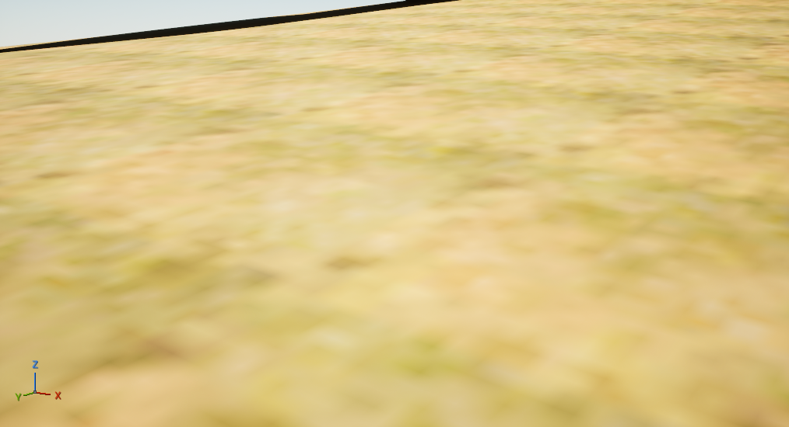 | 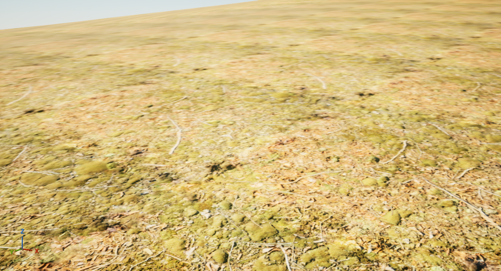 |

Six actual static frames compare Macro/Westwood at 4/15/40 m and 1.7 m eye height, with matched manual EV12. The detail layer resolves nearby leaf litter more clearly; repeated patterns remain visible at middle/far distances. This is a provisional detail selection. Soil close-ups, transitions, additional lighting directions, vegetated reserve context and projected-texture streaming still need review.

The exact terrain test mesh has 82,423 positive source faces. Independent native-buffer comparison matches every face, UV and material assignment, with zero normal/tangent failures. Unreal intentionally omits its redundant all-white color buffer; the declared equivalence uses the installed vertex factory's opaque-white default and does not claim physical color-buffer preservation. Nonwhite or translucent color loss still refuses. A redundant per-triangle full-color conversion was moved outside the loop; the bounded comparison now completes in 9.875 seconds instead of exceeding 60 seconds. No comparison tolerance was changed.

## Rebuilt textures in the reopened world

| Aerial diagnostic; art held | Creperie at walking height; composition held |
| --- | --- |
| 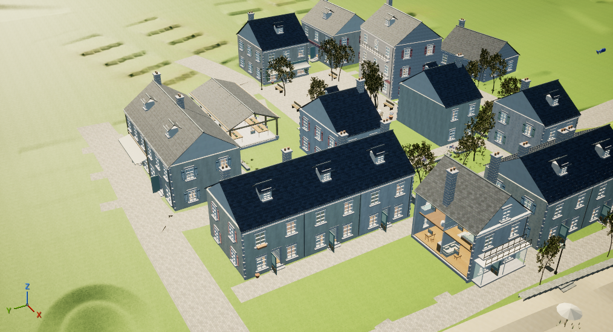 | 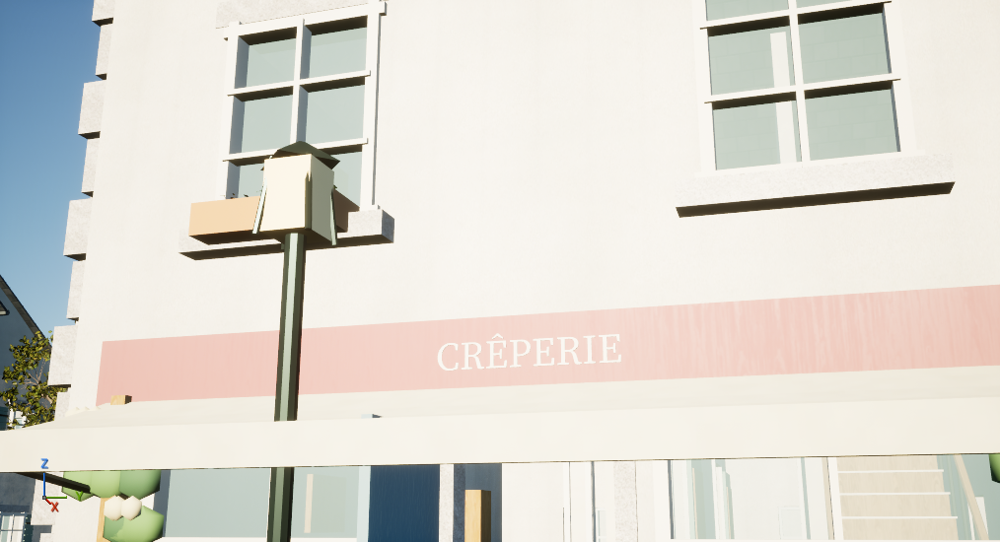 |

A separate editor reopened the new 1,858 preview packages plus 16 saved terrain-context packages. Independent typed readback checks the regenerated native identities, then the disabled world retains its 1,638 components, 587 repeated instances and deferred doors. Three transient terrain actors fill the same view's surrounding land. Exact viewport, temporary exposure, background-throttle and context changes are restored; all 1,874 saved package files remain byte-identical and owned processes are reaped.

The sunlit creperie wall now reads warm cream with visible fine plaster grain, a pink sign and white lettering. Shadowed aerial walls still appear cool. That contrast does not prove all scalar/function defaults or identify a shading defect. The additional Unlit frame was nearly solid white and cannot diagnose BaseColor. A lamp and awning crossbar obstruct the close view; it remains a material checkpoint rather than a finished camera composition. Sparse planting, repeated ground patterns and overall palette/context refinement remain visible work.

The 210.203-second Radeon D3D12/SM6 review peaked at 15,413,551,104 aggregate private bytes, with no monitor errors or handled-ensure/error log patterns. Evidence is `native_town_rebuilt_view_actual_v1_002`, using the exact saved Author packages from v001. The earlier whole v001 attempt remains failed because its capture-label helper omitted the new walking label; its successful authoring, partial image and cleanup evidence are preserved. The resumed review prevalidates labels and saves raw responses before parsing. Runtime streaming, collision, navigation, sustained frame time, final art and walkthrough acceptance remain pending.

## Migration coverage and first exterior collision result

The [coverage report tool](../../tools/unreal/native_town_coverage.py) compares unique source identities, retaining repeated references caused by split native chunks without inflating the count. Against the complete 58,233-placement assembly, the current typed plan references **4,366 placements**. Explicit vegetation tags give:

| Tagged source category | Complete source | Referenced by native plan |
| --- | ---: | ---: |
| Trees | 6,701 | 16 |
| Understory | 23,475 | 476 |

This is a migration-scope gap, separate from foliage density and material quality. Untagged street trees are outside these category counts. A source reference alone does not prove that every triangle of a split placement is saved or rendered. The report also groups vegetation by 64 m cells using transformed glTF X/Z bounds centres, providing a practical starting point for expanding reserve coverage. It does not measure canopy area, appearance or frame rate. Evidence is `native_town_coverage_actual_v1_001/COVERAGE.json`; three CPU regression tests cover split references, null source metadata and invalid source identities.

A separate saved exterior subset now contains 26 exact placements and 16 owned collision-mesh derivatives. Unreal cooks their source triangles with explicit double-sided collision; original render buffers and source packages remain preserved. Both authoring and independent fresh reopening pass the **10.733 m exterior subcorridor** floor, overlap and capsule-sweep checks at radius 28 cm / half-height 95 cm. The unchanged café exit fails in both runs: actual hits identify the lintel, threshold/plinth and low awning. These observations do not execute CharacterMovement's full step solver. The next trial must fit the character profile to measured posed bounds and follow actual floors around the awning, or explicitly rebuild the portal if necessary.

Evidence is `native_static_exterior_route_actual_v1_002`: both owned editors exit cleanly, sources and original collision identities remain preserved, and the full-town driver stays disabled. The first attempt failed before launching an editor because two proven identical source records target the same staging JSON. v002 permits only that exact dual-provenance copy and retains all other overwrite refusals. No game journey, full-town collision or FPS qualification follows from the successful exterior query.

## Saved native forest cell

A 64 m reserve cell now saves as a native map with **31 vanilla instanced mesh components and 363 placements**: 120 tagged tree placements and 243 understory placements. It uses the existing graded Westwood terrain and source-derived walking camera heights. Independent cold reopening preserves the component census, material bindings and all world transforms; maximum source/native affine-probe error is **0.00005323 cm**. No new C++ or custom streaming system is needed for this saved cell.

All 31 prototypes preserve source positions, UVs, material assignment, normals and colors. Thirty pass the full declared array checks. One 2,200-triangle grass prototype retains two tangent failures; the failed comparison stays failed. The diagnostic review explicitly permits only that named hold without changing tolerances. The earlier import attempt also remains failed after an unavailable `MathLibrary.make_transform` call; the continuation uses the installed supported `unreal.Transform` constructor and checks all 363 transforms before map creation. Imported prototypes are reused rather than imported again.

Root reviewed both walking views. Canopy coverage is fuller, but final art is rejected: coarse far-tree triangles appear at walking distance, understory remains sparse, and the soil repeats. Source/camera projection traces the large gray sheets to the far pine variant's bark triangles, including a roughly 1.88 m edge only 16.47 m from the camera. This is a source geometry problem. Its detailed counterpart has 15,787 triangles versus 7,656, with no bark faces exceeding 1.5 m edges. A native near/far LOD trial is being prepared rather than attributing the sheets to a texture defect.

Evidence is `native_forest_instancing_actual_v1_002` for saved authoring and `native_forest_instancing_actual_v1_003` for diagnostic cold reopen/views. Author takes **74.250 seconds**, peaking at **10,756,816,896 private bytes**; Review takes **90.609 seconds**, peaking at **13,925,343,232 bytes**. Sources and saved packages remain unchanged and owned processes are reaped. These are editor preparation costs, with final art, wind, navigation, gameplay and frame-time qualification still open.

## Native tree LOD and clustered groundcover

| Forced far pine geometry | Automatic native near LOD |
| --- | --- |
| 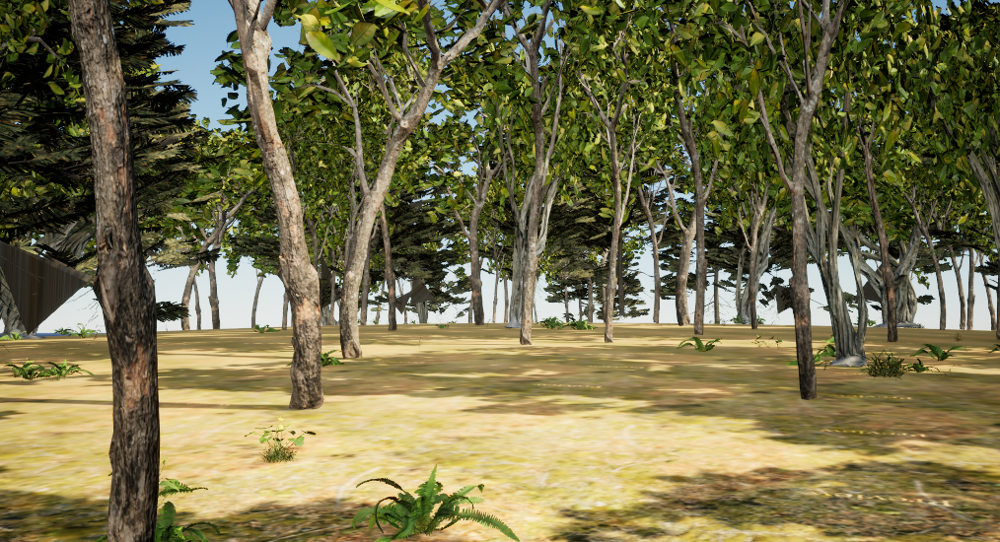 |  |

`native_forest_pine_lod_actual_v1_001` replaces one owned pine prototype with a two-level native static mesh: the detailed 15,787-triangle source at LOD0 and its original 7,656-triangle counterpart at LOD1. Nine placements use the derivative. All 363 transforms and 31 component material lists remain unchanged. The near source passes the full native LOD0 array comparison, while LOD1 has copy/settings/count readback rather than an independent raw GPU-array export. Cold reopening produces Auto, ForcedNear and ForcedFar comparisons; Auto and ForcedNear remove the large gray planes, while ForcedFar reproduces them. Root selects this bounded geometry repair. Author takes **49.313 seconds / 4,605,308,928 peak private bytes**; Review takes **66.437 seconds / 12,417,515,520 bytes**. It does not establish final forest quality or a whole-town LOD policy.

| Original understory | Source-masked clusters |
| --- | --- |
| 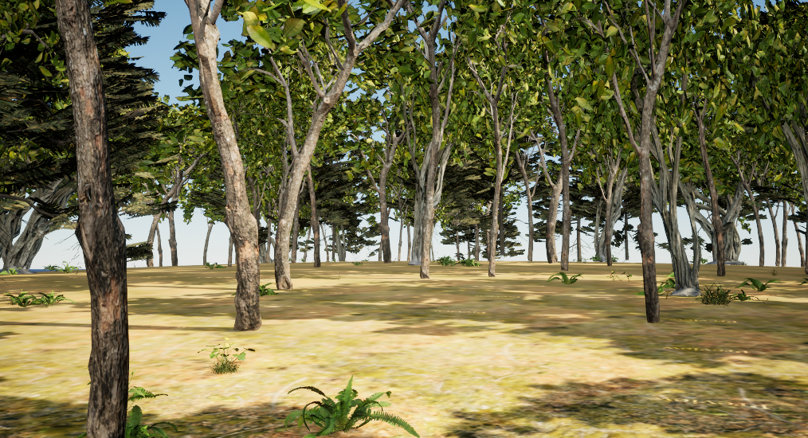 | 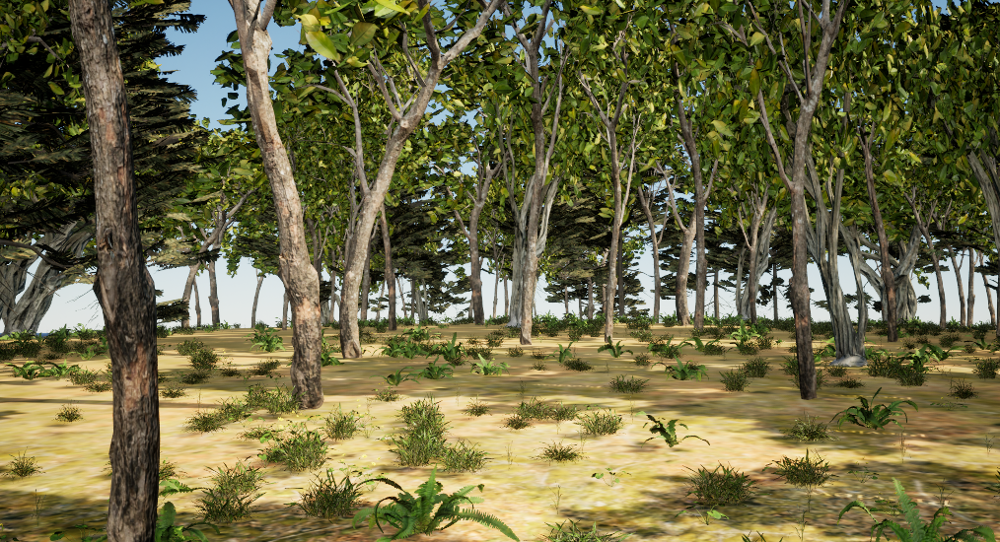 |

`native_woodland_groundcover_actual_v1_002` adds **2,000 grounded placements in 48 irregular drifts**, grouped into seven vanilla instanced mesh components. The saved cell has **2,363 instances / 38 components**, with its original 363 transforms preserved. Three grass forms, two fern forms and two low herb forms reuse source assets. Point selection protects authored paths, clearings, coast, fixtures, building/entrance envelopes and reserve pads. Source mask sampling and barycentric terrain queries determine placement, with no flat-height fallback.

This map explicitly registers the reviewed stable-tangent grass derivative for the 11 existing grass placements and new grass groups. Original positions, normals, UVs, indices and material semantics remain exact; the tangent lineage changes deliberately. The original two-failure comparison remains failed. Cold reopen checks the declared derivative, all points and original transforms, then captures matched Near/Mid views and editor frame/memory samples. Species cull ends are 48–76 m; no smooth material fade or additional LOD chain is claimed. No new C++, custom streamer or PCG graph is needed for this bounded placement pass.

Root selects the added clustered coverage, with final reserve art held: yellow lawn-like soil, ground variation, plant composition and the distant environment need further work. The **96.563-second** review peaks at **12,660,002,816 private bytes**. Its warmed Slate callbacks and engine frame counter describe this editor trial; they do not establish game FPS, presented frames or GPU timing. No full-reserve migration, navigation or runtime performance acceptance follows. The v001 runner-state mismatch remains a separate failed attempt before map authoring.

## Actual entrance journey and game-only material defect

A separate retained native experiment rebuilds the café portal rather than reducing the character capsule. Three ambiguous source parts use an analytic local aperture/reveal replacement: **56 source triangles replaced, 1,828 reused unchanged and 152 clipped/reveal triangles authored**. The remaining proposed parts keep their declared geometry lineage. Twelve saved mesh/map packages pass independent native array, UV, opening and source-preservation checks. Two fresh editor processes also pass the complete floor/capsule route and 297 sampled poses for the existing Ben character at **radius 28 cm / half-height 95 cm**. These posed bounds do not qualify the new 61-joint café-worker as a runtime replacement.

The ordinary game then completes all **281 guide points** using normal CharacterMovement, with **1,373 consecutive engine-frame observations / 1,370 moving samples** and the new physical-binding journal provenance controls. The actual automation test succeeds with no warnings or errors. No teleport, manual animation/bone update or movement-mode change is used. The host's first report remains failed because it looked under `Project/Saved`; `-UserDir` correctly redirects the native files to the owned `cache/private/User/Saved` directory. A separate CPU recovery validates those original files in place, loaded runtime bytes, source/binding identities and frame/JSON agreement. Root independently reruns that validation and matches the receipt exactly.

Evidence is `native_cafe_exit_repair_actual_v1_004` for the two fresh physical checks, `native_cafe_exit_repair_actual_v1_005/Game` for the actual game, and `native_cafe_exit_game_recovery_actual_v1_001/RECOVERY_RECEIPT.json` for recovery. The external 63-input native source experiment remains separate from canonical source adoption while architectural appearance is revised. Actual game resolution is **888 × 500**, despite a requested 1600 × 900, with a three-core limit retained. Its launch-to-test-observed readiness of **64.643 seconds** includes the automation observation boundary; it is an upper bound rather than earliest playability or first presentation. This is neither Full-HD/full-CPU performance evidence nor a cooked product loading time. Close views hold final art: the raised portal intersects the old fascia/sign composition, and the door glazing has solid backing. The next local assembly revision must coordinate door, glazing, fascia, lettering, awning and closing clearances.

The first separate Full-HD woodland game smoke exposes another real consumer defect. All eleven foliage materials lack saved `InstancedStaticMeshes` usage. The editor auto-enables that permutation in memory, while the game renders default gray materials and logs the missing flags. The 900-frame CSV, 1920 × 1080 image and saved bindings therefore **do not qualify performance**. No balanced comparison runs are allowed on this fallback scene. Evidence is `native_game_benchmark_smoke_resume_actual_v1_001/Smoke_Groundcover_Near`; original failed reports and raw files remain intact. A native repair is preparing owned usage-enabled material derivatives, complete per-slot overrides, cold graph/flag checks and a fresh textured game view. Editor-only visual acceptance remains explicitly separate from game material acceptance.

## Persisted instancing material repair in the actual game

| Original game fallback: held | Saved native usage and complete overrides |
| --- | --- |
| 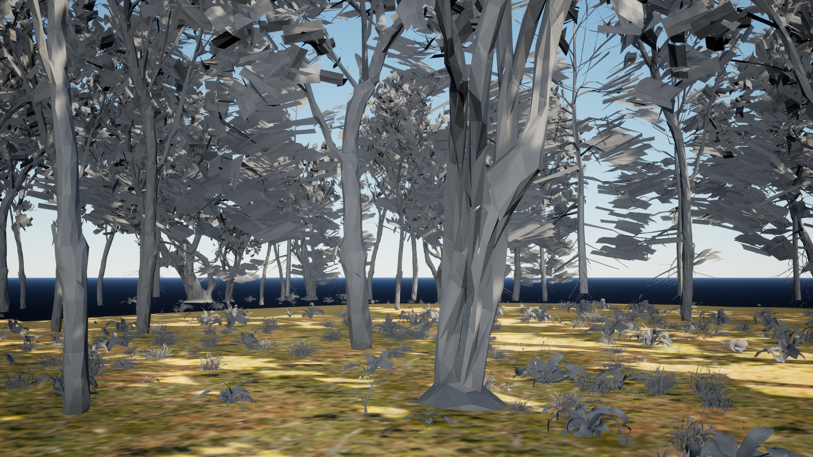 | 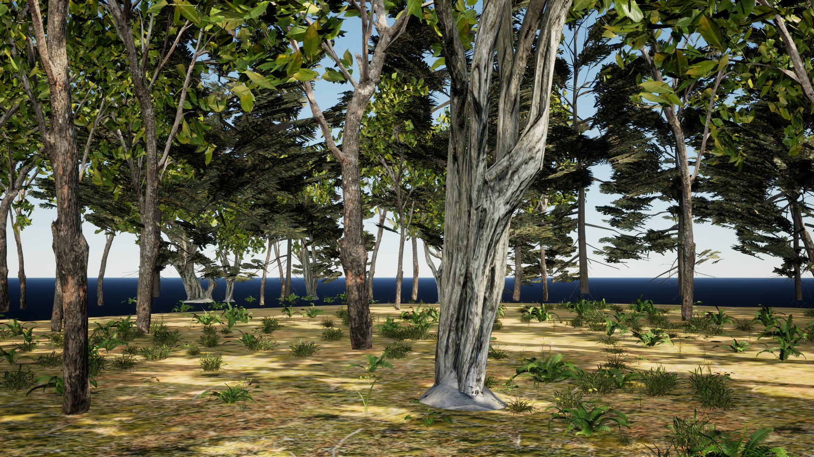 |

The repair now saves eleven owned material derivatives with native `InstancedStaticMeshes` usage and assigns them to every instanced slot in four new camera maps. It preserves all original material, mesh, texture and map bytes. Independent cold reopening loads the materials before any map and checks the saved flags, shader graphs, texture policies, alpha/surface settings and every override. The shader graph remains exact after accounting only for named duplicate identities, usage and separately validated generated texture-streaming metadata. Ready-state comparisons and raw operands are retained; the earlier failed attempts remain failed.

The fresh **1920 × 1080** ordinary game reports all eleven usage flags, no material fallback and the expected camera, culls and **38 components / 2,363 instances**. Root reviews the actual image and selects the restored bark, leaf, grass and fern material behavior. `native_ism_material_usage_actual_v1_003` Author takes **57.844 seconds / 9,981,337,600 peak private bytes**, cold Review **18.844 seconds / 4,518,481,920 bytes**, and game smoke **22.610 seconds / 6,912,442,368 bytes**. All owned processes are reaped. Original editor auto-usage changes in memory are recorded separately from unchanged package bytes.

The 900-frame smoke validates the real consumer; it is not a balanced frame-cost comparison. Its native CSV remains at Unreal's actual owned user-directory location, with GPU timing and warmup/lag boundaries recorded. Final reserve art remains held for the yellow lawn-like ground, plant composition and distant context. This repair does not enable the full-town driver or qualify whole-town performance. Root's bounded visual receipt is `root_native_review_acceptance_v1_001/ism_material_game_ROOT_VISUAL_REVIEW.json`.

## Coordinated entrance revision

The next native entrance assembly replaces the door's solid upper backing with a true glazed aperture, relocates the fascia and lettering, and raises the canopy with its connected support. It retains the radius-28 cm / half-height-95 cm movement profile. Actual saved and reopened geometry passes the portal, glazing-ray, closing-envelope, sign-height and floor/capsule checks. A separate root CPU replay reproduces both native comparisons and rejects five deliberate changes to position, UV, normal, tangent handedness and the handle transform. The earlier host comparison remains failed: its decimal rounding key crossed a boundary after valid native float32 narrowing. The replacement guard compares the declared float32 transform exactly, together with the other vertex attributes.

The revised assembly also completes the ordinary-game exit journey with **281 guide points and 959 moving observations**, zero observer frame gaps, natural CharacterMovement and animation, and the new binding's journal provenance. The native automation test succeeds without warnings or errors. This run takes **75.480 seconds** including startup and exit; first test-observed readiness is **64.707 seconds** after launch. Actual resolution remains **888 × 500** with the three-core limit, so this is a physical gameplay check rather than a Full-HD or full-town performance result.

Three further native close views preserve all source packages and restore the exact temporary viewport/door state. The interior reveal no longer has reversed floating lettering, and the canopy support connects coherently. Root rejects that revision's façade art: the canopy/front valance obscures the upper café lettering, and its milky pane still needs an appearance review. The later local revision below addresses those two holds. Fitting lettering within the fascia's vertical bounds alone does not prove visibility from the street.

Evidence under the existing F-drive root is `native_cafe_exit_repair_actual_v1_006` for saved/reopened geometry, `native_cafe_exit_qualification_recovery_actual_v1_001` and `root_cafe_architecture_recovery_verification_v1_001` for strict CPU replay, `native_cafe_exit_repair_actual_v1_007/Game` for actual gameplay, and `native_cafe_entrance_visual_review_actual_v1_002/Review` for the three close views. The root decision is `root_native_review_acceptance_v1_001/cafe_architecture_ROOT_VISUAL_REVIEW_v002.json`. This external source experiment is still separate from canonical authoring-source adoption and the new 61-joint avatar's fit qualification.

## Native canopy and glazing refinement

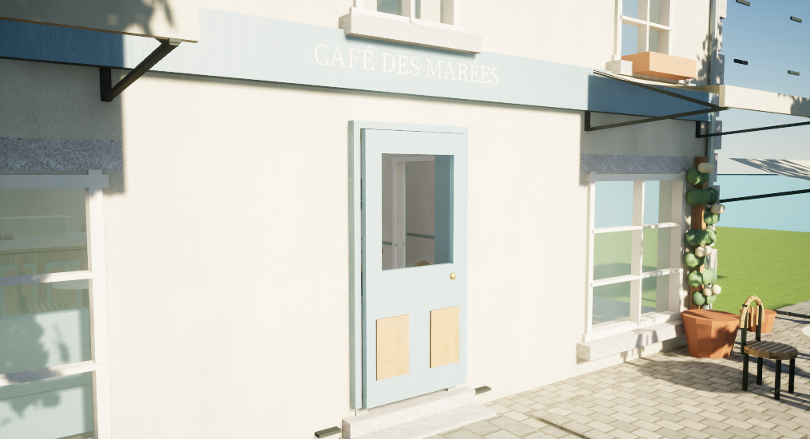

Two 2.4 m side-window awnings now leave a 4.5 m central entrance/sign gap. Connected support ties and tabs retain upper-window and closing clearances. The four CPU camera checks find all 2,336 front-letter triangles unobscured. The new native Thin Translucent door material replaces the milky appearance with a clear view into the interior. Root selects this local assembly improvement after reviewing all three actual native views. Strong exposure still pales the fascia; side-window glazing, overall lighting, façade finish and complete town context remain open.

| Interior reveal | Connected awning support |
| --- | --- |
| 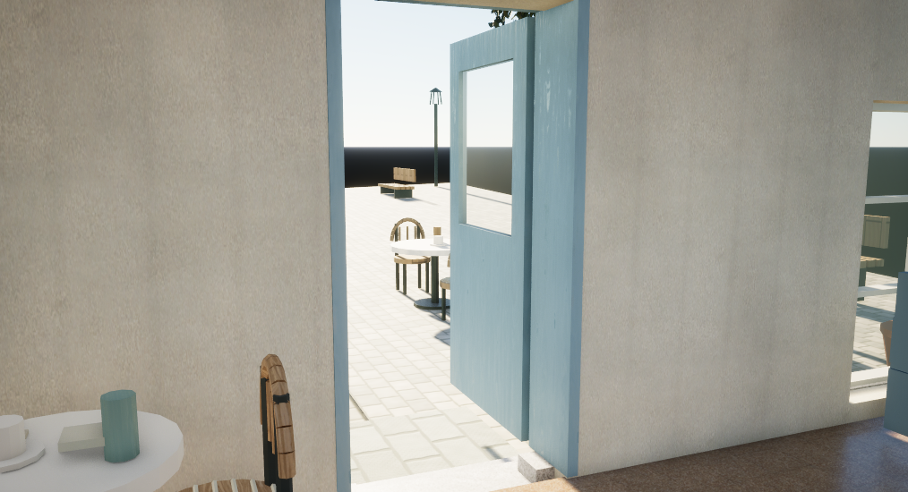 | 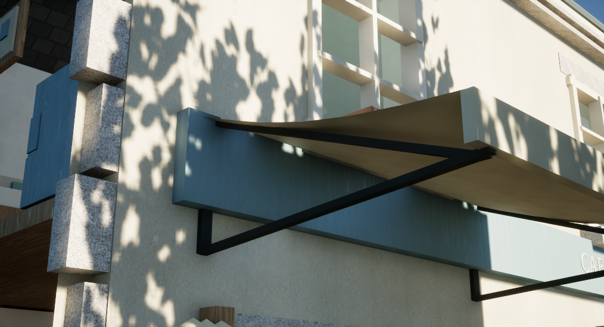 |

Material assignment preserves the pane's rendered positions, indices, normals, tangents, UVs and section ranges exactly. Its collision cooking GUID changes after native `SetMaterial` rebuilds physics, so the qualification binds the actual new GUID and separately checks the unchanged collision policy and physical queries. The earlier compound-assert failure retains its failed status; its lost operands cannot prove the same cause retroactively. Original geometry/material/map packages remain unchanged. Author and independent reopen pass in **121.657 / 88.031 seconds**, followed by a fresh normal-game journey using the unchanged R28/H95 movement profile.

That game run records **1,208 moving frames**, p95/p99 intervals **10.495 / 12.318 ms**, and first observer readiness at **62.966 seconds**. Its actual **888 × 500**, three-core, offscreen uncooked subset does not establish Full-HD, presented FPS, full-town performance or packaged startup. The three later native close views take **161.297 seconds**, with exact temporary state restoration and no asset saves. A preceding close-view attempt fails before any method because of mismatched toolset descriptions; the [source preflight](staged_asset_pipeline.md#closed-toolset-source-preflight) prevents that metadata error before future launches.

Evidence is `native_cafe_canopy_material_resume_actual_v1_001` and `native_cafe_canopy_material_visual_actual_v1_002`; root selection is `root_native_review_acceptance_v1_001/cafe_canopy_glass_ROOT_VISUAL_REVIEW_v003.json`. These remain external authoring experiments, separate from canonical recipe adoption, full-town rollout and new-avatar integration.

## Longer foliage measurement: capture valid, comparison held

The first 36,000-frame ordinary-game pilot preserves all 116 saved inputs and records 32,000 frames after its native warmup boundary. Their summed frame intervals are **404.092 seconds**, matching the native event-wall duration within **0.000466 seconds**. The actual image is 1920 × 1080, quality settings are 3, screen percentage is 100, the GPU is Radeon 8060S D3D12/SM6, and all eleven instanced material flags remain true without fallback messages. The session takes **471.968 seconds** and peaks at **8,015,851,520 private bytes**. This is an uncooked development run of the fixed cell, with full CPU affinity and two shader workers.

| Retained native timing | Median | p95 | p99 |
| --- | ---: | ---: | ---: |
| GPU | 10.333 ms | 15.740 ms | 17.417 ms |
| Game thread | 1.601 ms | 2.679 ms | 4.144 ms |
| Engine end-frame interval | 2.089 ms | 3.743 ms | 506.168 ms |
| Render thread | 2.079 ms | 3.361 ms | 579.666 ms |
| RHI thread | 0.852 ms | 1.409 ms | 510.264 ms |

The long tails need investigation before any eight-run comparison. There are **847 intervals above 33.33 ms**. Overlapping thread/GPU timings are not added, and the inverse of the median interval is not presented as display FPS. The run uses offscreen rendering, so these CPU waits alone do not establish visible presentation stutter or its cause.

Root also finds lower bark detail in the pilot's early image. The raw row corresponding to screenshot frame 500 contains **312.0664 MB pending texture data**, versus zero in the accepted smoke's screenshot row. The later retained window has no pending texture data, but that cannot qualify the earlier image. A further diagnostic must capture after streaming readiness and compare normal windowed presentation with the same offscreen scene. Evidence is `native_forest_game_balanced_actual_v1_001/Pilot_Groundcover_Near`; its capture PASS is preserved while visual/performance acceptance and the full batch remain held.

## Texture-ready visible and offscreen diagnostic

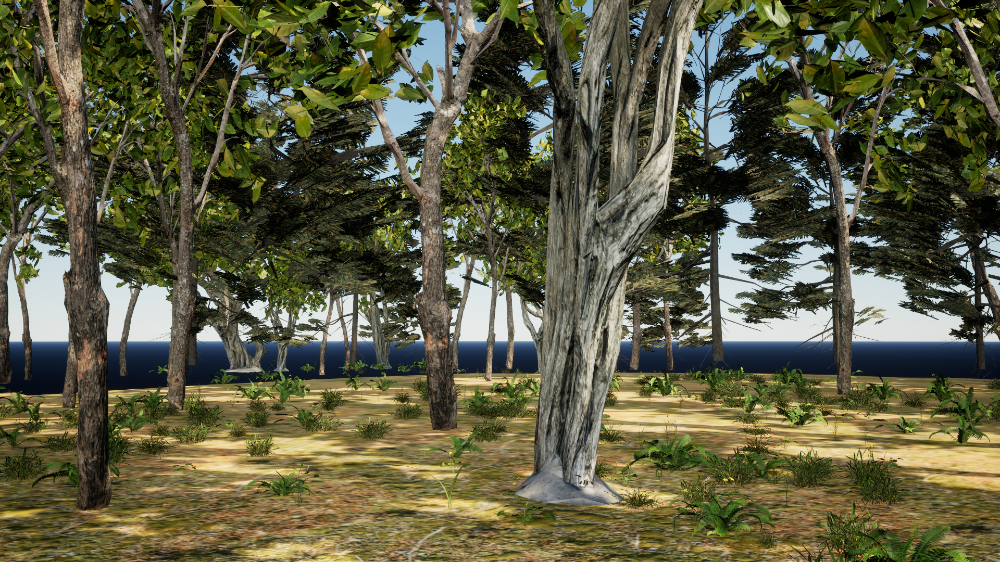

Two fresh game runs now capture at frame 4500, bracketed by native texture inventories. All **35 source-bound textures** have their allowed source dimensions, current mip dimensions at least their wanted dimensions, and zero budget bias. Throughout the image window, pending texture data is zero and desired-loaded percentage is 100. Root reviews both late images and confirms the foreground bark detail is restored. This qualifies the ready capture; it does not force every distant texture to its full source resolution.

The normal visible arm and matched offscreen arm preserve the same 116 package files, camera, instances, quality-3 settings, Full-HD resolution, uncapped controls and GPU instrumentation. Their command difference is the offscreen flag. The visible arm also verifies an owned, visible, nonminimized 1920 × 1080 client window. Each retains 5,000 engine-frame intervals after the probes:

| Actual observation | Visible window | Offscreen |
| --- | ---: | ---: |
| Retained duration | 69.322 s | 62.238 s |
| End-frame interval p99 | 21.765 ms | 544.090 ms |
| RHI thread p99 | 2.108 ms | 551.737 ms |
| GPU median / p95 | 10.857 / 14.842 ms | 10.255 / 15.482 ms |
| Intervals above 33.33 ms | 1 | 119 |

This ordered diagnostic pair associates the large CPU/RHI tails with the offscreen presentation path. It does not isolate the engine's internal cause, count physically displayed frames, or establish a balanced optimization gain. Installed D3D12 source disables the swapchain for offscreen mode but retains common frame-event paths, so a blanket claim that offscreen skips all pacing is unsupported. Player-oriented profiling will use a normal visible window; full-town movement, startup and Blender navigation remain separate work.

Both owned processes exit normally and preserve source/configuration bytes. The visible session takes **155.344 seconds / 9,021,759,488 peak private bytes**; offscreen takes **135.703 seconds / 7,556,030,464 bytes**. These peaks include loading and shutdown, so they are not a steady-state feature-memory comparison. Evidence is `native_forest_game_pilot_diagnosis_actual_v1_001`; root's decision is `root_native_review_acceptance_v1_001/forest_present_ROOT_VISUAL_REVIEW_v001.json`. The eight-case batch and final reserve art remain held.

## Runtime safeguard against unprepared instanced materials

Canonical source now checks each effective material's native `InstancedStaticMeshes` usage before installing an instanced entry. The check precedes mesh-cache reuse, so a mesh accepted earlier for an ordinary static component cannot bypass the instanced requirement. Refusal names the entry, mesh, slot, interface and base material, and requests an authored/saved/cold-reopened content correction. Static and deferred-door entries keep their existing policy. The gate reads the interface's effective flags, including Unreal 5.8 material-instance overrides, and retains the engine's special-material exception. It does not enable flags, compile shaders, dirty assets or substitute a default material.

The exact adopted **60-input source digest** is `21652d00827261744d9356e82a70dffbd028579163c876a85f4c46072884e062`. Its actual native build passes in **132.953 seconds / 3,860,844,544 peak private bytes**. A hardware automation run passes **all ten native tests**, including the nine existing lifecycle/authority tests and `LivingTown.Native.TileMaterialUsage`, plus eleven native SHA known-answer cases. It takes **48.797 seconds / 4,046,127,104 private bytes**, with zero test/engine warnings or errors and all owned processes reaped. An independent four-file review finds no actionable issue in this scope.

The new synthetic test checks static-to-instanced cache reuse, missing/present/revoked usage, material-instance overrides in both directions, unchanged flags after refusal, missing material and the special-engine-material exception. Synthetic cached receipts do not qualify production geometry, saved content, shader completeness or a rendered image. The earlier actual eleven-material cold/game proof remains separate. Current callers use mesh slots without component overrides; a future override path must validate its effective material too.

Root adopts only the four reviewed and tested source files; their canonical native input digest matches the build exactly. All runtime-enable flags remain false. Evidence is `native_ism_runtime_guard_execution_build_actual_v1_001`, `native_ism_guard_tests_actual_v1_001`, and `native_ism_runtime_guard_adoption_actual_v1_001/ADOPTION_RECEIPT.json` under the existing F-drive root. This change does not adopt the separate café-authoring/avatar source experiments or qualify a Shipping build.
