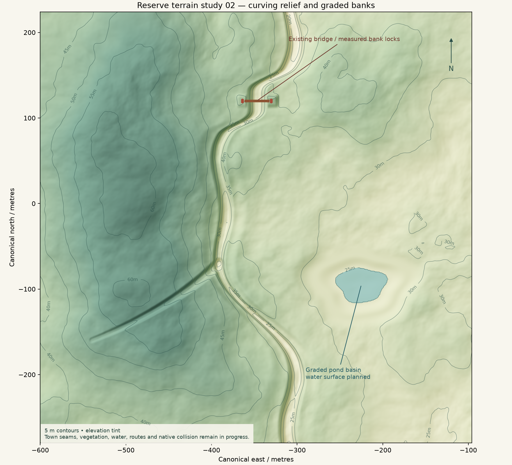

# Native reserve Landscape preview

The Editor helper imports a portable 505 × 505 heightfield as a stock UE 5.8 Landscape and checks its merged heights, component grid, collision and renderer texture references. It gives the reserve its own editable terrain family, with native component LOD and collision. Runtime simulation and enable flags remain unchanged.

This bundle contains source code and a terrain fixture. The fixed map and its opaque Surface `UMaterial` are separate prerequisites. The surrounding town, bridge meshes, foliage and finished surface material are supplied by the scene pipeline. Terrain art and game performance remain unqualified by this adoption.

## Fixed fixture

The native loader reads these paths relative to the Unreal project directory:

- `Config/ReserveLandscape_v001.json`
- `Content/ReserveLandscapeSource_v001/Height505.r16`

The JSON has exactly 15 keys; unknown or missing keys are refused. The selected fixture is 510,050 bytes, with 255,025 unsigned 16-bit little-endian samples and no header. Its SHA256 is `2b5839619c03277cc4e73bb97e0d250661e9aec1efe5efe61850e5c16170b5cb`; the byte-exact configuration SHA256 is `7dfec8155ef185f04acda5bc5e0f433bb163bcac5bcdfc0f3b477381c463e312`.

| Key | Fixture value |
| --- | --- |
| `schema` | `LivingTown.ReserveLandscapeSource.v1` |
| `map_path` | `/Game/LivingTown_UEPilot/TownSlice_v003/ReserveLandscape_v001/L_ReserveLandscape_v001` |
| `material_path` | `/Game/LivingTown_UEPilot/TownSlice_v003/ReserveLandscape_v001/M_ReserveLandscape_v001.M_ReserveLandscape_v001` |
| `height_relative_path` | `Content/ReserveLandscapeSource_v001/Height505.r16` |
| `height_sha256` | The full R16 SHA256 above, lowercase |
| `height_bytes` | `510050` |
| `width` | `505` |
| `height` | `505` |
| `height_encoding` | `uint16_le` |
| `row0` | `minimum_UE_Y` |
| `origin_cm` | `[-60000, -22400, 4000]` |
| `scale_xyz` | `[100, 100, 25]` |
| `subsection_size_quads` | `63` |
| `num_subsections` | `2` |
| `component_count_xy` | `[4, 4]` |

The loader hashes the actual configuration and validates the R16 against its declared hash. The configuration and raw hashes in the returned receipt let the caller bind the exact intended fixture. Each component has 126 quads per side (two 63-quad subsections), giving a 504 m square with 1 m horizontal spacing. Nanite remains off; the import creates the stock edit layer rather than using a legacy non-layer toggle.

For zero-based column `c`, row `r` and decoded integer height `h`:

```text
UE centimetres:
X = -60000 + 100*c
Y = -22400 + 100*r
Z = 4000 + (h - 32768)*25/128

Portable town coordinates, metres: (X/100, -Y/100, Z/100)
```

Row 0 is canonical north at Y = 224 m; the last row is Y = −280 m. East spans −600 to −96 m. The selected elevation range is 17.96484375–64.361328125 m, with an encoded height step of 0.001953125 m. These are local town coordinates, with no geodetic CRS implied. Blender or another engine can reconstruct the same grid from the raw samples and formula.

The original contour study below visualizes this exact heightfield. Its planning caption predates the native collision validation described below. The PNG is a labelled visualization; the R16 carries the height samples.



`bridge_bank_anchors.json` preserves six source-derived bank constraints and their coordinate convention. CPU bilinear interpolation of the selected R16 differs from those support heights by at most 0.000832 m. This is a source-fit check; bank walkability, town-road/building seams and gameplay traversal require separate validation.

## Explicit Editor calls

Build the existing `LivingTownMaterialInspection` Editor module with its direct `Landscape` and `Foliage` dependencies. Open a render-capable Editor world at the exact configured map path, outside PIE. The caller creates that fresh map and provides the existing opaque Surface `UMaterial` at the configured path. Material instances or a missing material are refused by this fixed importer.

Call on the Editor game thread, then read again on later Editor ticks:

```python
import json
import unreal

created = json.loads(unreal.LivingTownReserveLandscape.create_reserve_landscape_preview())
observed = json.loads(unreal.LivingTownReserveLandscape.read_reserve_landscape_preview())
```

`CreateReserveLandscapePreview` refuses an existing Landscape. A successful import returns `IMPORTED_PENDING_NATIVE_MERGED_HEIGHT_READBACK`; it does not save assets or the map. The caller controls any later save. Repeated creation is unnecessary while the reader reports `PENDING_NATIVE_EDIT_LAYER_MERGE` or `PENDING_COMPONENT_OR_COLLISION_READINESS`.

`ReadReserveLandscapePreview` verifies all 16 unique component bases, registered collision with query-and-physics state, the fixed transform/material/Nanite policy, the sample extent and every merged uint16 height. It preserves the package's dirty state and exports the merged R16 only beneath `Saved/ReserveLandscape_v001/`. Existing readback files must contain identical bytes. Height/grid/physics readiness returns `READY_NATIVE_LANDSCAPE_SOURCE_HEIGHT_COMPONENTS_AND_COLLISION`; `ERROR` retains a specific refusal reason.

The separate `renderer_texture_provenance` record uses public native `GetHeightmap(false)`, desktop `GetMaterialInstanceCount/GetMaterialInstance(true)` and the current-quality `GetUsedTextures` overload. It records final heightmap references, actual component material interfaces, their base materials, texture paths and editor-source metadata. Its own `complete` field must be checked separately. Platform formats, loaded/resident mips and actual per-pixel sampling are separate evidence, obtained by the scene harness after its full loading barrier and native texture inventory. The helper makes no residency or GPU timing claim.

## Recorded validation and remaining art work

The byte-exact 83-input source family (`ad3d3c091a86a521e36f9acd2019bce1ca36b79dd21be7964d010253d3875ea8`) compiled and linked against installed UE 5.8.4 / CL 58902052. Build receipt SHA256: `9f286274445153e9662c9f33a14beef82fa2ebcc1a35dadadc710c76770da0ba`.

The separate actual Author and new-process cold reopen both verified all 255,025 heights with zero mismatches, one edit layer, 16 registered components and 16 physics-ready collision components. Native renderer readback completed for all components, with the shared final heightmap and selected material references retained. Source/config hashes matched the fixture and the read did not change package dirty state. The qualified private scene closure contained 124 serialized files; cold-proof SHA256: `5091e014cb3e8e15b1ae547bab99e1f73b14622ee698cf2e223eb29f5b8d32b5`.

Those checks qualify the importer/readback and data round trip. Root's actual image review still held the far checker/tan surface pattern, sparse/bare edges, composition and full terrain presentation. No filtered shader or material package is adopted here. Pond water, surrounding vegetation density, town interfaces, navigation, final surface quality and measured game performance remain separate work.
